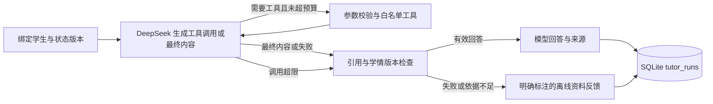

# DeepSeek、LangGraph 与课程检索说明

Phase4A补充：[受控学习指南](PHASE4A_GUIDE.md)复用WorkbenchAgent执行器，程序确定重点后显式注入经允许字段筛选的摘要，模型仅辅助解释；沿用只读工具/预算/引用校验，指南同意独立且逐轮重置。本阶段9次模拟模型、0次真实模型，下文旧实调记录独立保留。

Phase3B另有[受控资料问答](WORKBENCH_GUIDE.md)：使用固定来源/学情上下文、只读工具、逐轮个人片段外发同意和独立workbench_runs；原课程Tutor工具及契约不变。本阶段只完成模拟模型测试与真实本地HTTP，新增真实模型调用0；下文真实DeepSeek记录属于此前课程Agent阶段。

截至 2026-10-19，第三阶段的基础 Agent、课程检索和引用流程已实现，**138 项离线自动测试通过**，另完成两组真实 DeepSeek 场景验证。题库扩充、人工审阅、真实学习效果与 Vue 界面仍未完成。

2026-10-20 补充：Vue 页面已实现，后端 186 项、前端 17 项测试通过，详见 [Web 说明](WEB_GUIDE.md)。40 道候选题与 30 条检索开发集均待审，当前服务仍用原 10 题库。课程外误检见 [检索评估](RETRIEVAL_EVALUATION.md)，题库见 [内容审阅](CONTENT_REVIEW_GUIDE.md)。下方 138 项记录为 10-19 的 Agent 阶段验证。

同日 0.4.1 更新：后端 202 项、前端 18 项测试通过。先本地检索原问题，证据不足时返回 `insufficient_evidence`，不调用模型；有依据时限制模型检索返回到原问题候选章节内。2000 字问题分段处理，新回答记录 `retrieval_policy`。两套开发集仍有意图误检，见检索评估；本轮没有新增真实模型请求，下方真实模型次数仍为此前记录。

后续新增 [有限教学决策对比](POLICY_EVALUATION.md)，完整后端 225 项测试通过。比较的是同一合成状态下的确定性推进规则与固定两题基线，未修改 LangGraph 图或再次调用模型，不能当作模型规划质量或学习效果评测。

v0.5.0 Phase 1 展示层已增加 [Markdown/LaTeX 渲染](MARKDOWN_GUIDE.md)，后端回归 225 项、前端 47 项测试与构建通过。LangGraph、提示词和现用模型配置没有变化；个人笔记工具尚未实现，本轮模型请求为 0。

## 当前架构与能力

一个 LangGraph 图编排一个 DeepSeek 模型和三个工具：

| 工具 | 实际行为 | 不发送给模型的内容 |
| --- | --- | --- |
| `get_learning_state` | 读取绑定学生的目标、BKT 概率、答题次数和最近正误 | 学生标识、真实姓名、其他学生记录 |
| `retrieve_course_material` | 从 FAISS 索引中检索自建课程章节 | 任意文件、模型密钥、完整题库 |
| `get_next_exercise` | 创建或复用受先修规则约束的合法练习分配，给模型行动元信息 | 题干、选项、标准答案和解析；题目由客户端单独展示 |

模型选择工具、组织讲解和个性化建议；学习推进由既有规则约束。评分与 BKT 更新仍通过答案提交服务执行，模型没有改分或写入掌握度的工具。



每次请求建立独立的图状态，没有启用对话记忆或中断恢复 checkpoint。工具消息留在当前请求内存中；本地数据库保存最终回答、来源、工具名称/状态、token 用量和学情版本，不保存密钥或模型内部推理。

## 模型与本地配置

默认模型为 `deepseek-flash`，使用非思考模式、非流式请求。模型名称可在本机配置；使用前应核对 [DeepSeek 当前接口文档](https://api-docs.deepseek.com/api/create-chat-completion)。HTTP 目标固定为 DeepSeek 官方 HTTPS 地址，不提供可重定向凭据的任意 base URL 配置。

当前已配置本机 `.env`，该文件被 `.gitignore` 排除。不要在文档、命令参数、截图或聊天中再次发送密钥。由于此前密钥已出现在聊天中，建议负责人在服务商控制台轮换，并在本地更新配置。

新环境首次设置时，从 [.env.example](../.env.example) 复制配置后在本机编辑；不要覆盖已有 `.env`：

```powershell
Set-Location D:\ZZUAgent
if (-not (Test-Path .env)) { Copy-Item .env.example .env }
```

| 字段 | 默认或示例 | 说明 |
| --- | --- | --- |
| `DEEPSEEK_API_KEY` | 空占位符 | 仅在本机填写；环境变量优先于 `.env` |
| `DEEPSEEK_MODEL` | `deepseek-flash` | 模型名称，已实际验证 |
| `EDUAGENT_AGENT_ENABLED` | 示例为 `false` | 填好有效密钥并安装依赖后改为 `true` |
| `EDUAGENT_MODEL_TIMEOUT` | 25 | HTTP I/O 超时秒数，可设置 1～60 |
| `EDUAGENT_MODEL_MAX_CALLS` | 3 | 每次助教请求最多调用模型的次数，可设置 1～4 |
| `EDUAGENT_MODEL_MAX_TOKENS` | 700 | 每次模型请求的输出上限，可设置 100～1500 |

`.env` 只支持明确字段的 `KEY=VALUE`，可用配对引号，不执行命令、不展开变量。空白和注释行会忽略，错误消息不包含配置值。启用 Agent 却没有密钥时启动失败；密钥失效、余额不足、网络错误或超时发生在模型调用时，会返回明确降级状态。

修改 `.env` 后需要重启后端。自行在前台启动时按 Ctrl+C 再执行启动命令；本次会话启动的后台服务可由后续协作重启，配置文件变化不会自动热加载。

## 安装与启动

```powershell
Set-Location D:\ZZUAgent
.\.venv\Scripts\python.exe -m pip install -e './backend[api,dev,agent]'
.\.venv\Scripts\python.exe -m uvicorn eduagent.api.app:create_app --factory --host 127.0.0.1 --port 8000
```

若服务已在后台占用 8000 端口，直接使用现有服务，不要重复启动。完整安装新增 LangGraph 1.2.16、FAISS CPU 1.15.1、NumPy 2.5.4，复用 httpx2 2.14.0；显式固定 LangSmith 库为 0.14.11，仅使用其本地 tracing 上下文关闭远程跟踪。离线命令行核心仍只依赖标准库；未配置 Agent 的普通 API 可继续使用已有规则闭环。

`GET /health` 的 `mode=offline_rules` 表示学习推进仍采用规则约束；`agent_enabled` 表示 Agent 配置已启用，`retrieval_available` 表示本地索引已加载。它们不代表每次外部模型请求都能成功，实际结果看助教响应的 `mode` 与 `fallback_reason`。

## 新增 HTTP 接口

| 方法与路径 | 输入 | 行为 |
| --- | --- | --- |
| `POST /api/v1/materials/search` | `query`，可选 `knowledge_id` | 直接检查课程检索与引用，不调用模型 |
| `POST /api/v1/students/{student_id}/tutor` | `question` | 执行 LangGraph、工具调用、讲解与来源检查，保存本地记录 |
| `GET /api/v1/students/{student_id}/tutor-runs/{run_id}` | 路径标识 | 查询属于当前学生的助教记录 |

调用助教前先使用原有 `POST /api/v1/students` 创建或恢复记录。例如：

```powershell
$base = 'http://127.0.0.1:8000/api/v1'
$student = 'tutor-' + [guid]::NewGuid().ToString('N').Substring(0, 8)
$body = @{ student_id = $student; goals = @('gradient_descent') } | ConvertTo-Json
Invoke-RestMethod -Method Post -Uri "$base/students" -ContentType 'application/json' -Body $body

$question = @{ question = '请读取我的学情，检索资料解释梯度下降，并安排下一道合适的练习。' } | ConvertTo-Json
$reply = Invoke-RestMethod -Method Post -Uri "$base/students/$student/tutor" -ContentType 'application/json; charset=utf-8' -Body ([Text.Encoding]::UTF8.GetBytes($question))
$reply.mode
$reply.answer
$reply.citations | Select-Object citation_id,title,section,source
$reply.tools_used
$reply.next_exercise
```

正常模型结果为 `mode=deepseek`；失败时为 `offline_fallback` 并给出机器可读原因，如 `model_timeout`、`authentication_failed`、`insufficient_balance`、`model_call_limit`、`unverified_model_answer` 或 `learning_state_changed`。降级不冒充模型成功。

每次 POST `/tutor` 都是独立生成，可能产生 API 费用，客户端目前不应自动重试。只查已返回结果时使用记录查询接口。`next_exercise` 是单独供客户端展示的题目分配；答题仍调用原有 `/answers`，保留原 `event_id` 幂等规则。

## 检索与引用的实际边界

资料为 [manifest.json](../data/materials/manifest.json) 登记的 5 份自建 Markdown 草稿，共 15 个二级标题章节，每份对应一个知识点。均标记 `pending`，不是正式教材或已人工审阅资料；没有复制学校内部文件或第三方课程原文。

检索使用中文单字/双字及英文词的本地 TF-IDF 向量，L2 归一化后交给 FAISS 内积索引，作为余弦相似度基线。索引在启动时从小型资料重建，不调用嵌入服务，也不训练大模型。它依赖词项重叠，同义表达与更复杂语义的覆盖有限，0.12 检索阈值也是工程设置，尚未用真实问题校准。

来源 ID 如 `gradient:1` 对应资料及章节，响应还提供相对路径、标题、章节和原文片段。模型最终输出的引用 ID 必须属于本次实际检索结果，并出现在正文中；否则改为离线反馈。这只能检查来源存在与引用一致，不能证明模型每一句话都正确或完全受到引用支持，仍需内容审阅。

## 验证与遗留项

- 自动测试：`.\.venv\Scripts\python.exe -m pytest backend/tests -c backend/pyproject.toml -q`，最终 **138 passed in 5.16s**，测试不调用真实 API。
- 真实验证：[模型验证记录](LIVE_MODEL_REPORT.md)，两组场景各三次模型请求；只验证接口、工具执行与引用，不作为学习效果证明。
- 本地数据库从 schema 1 增加 `tutor_runs` 后升级至 schema 2。已有答题事实、掌握度和配置保留，真实历史迁移由临时数据库测试覆盖；部署前另备份了当前数据库。
- 尚未完成：30～50 题扩充与人工审阅、课程说明人工审阅、检索评估集、Vue 页面、真人试用和真实学习效果验证。
