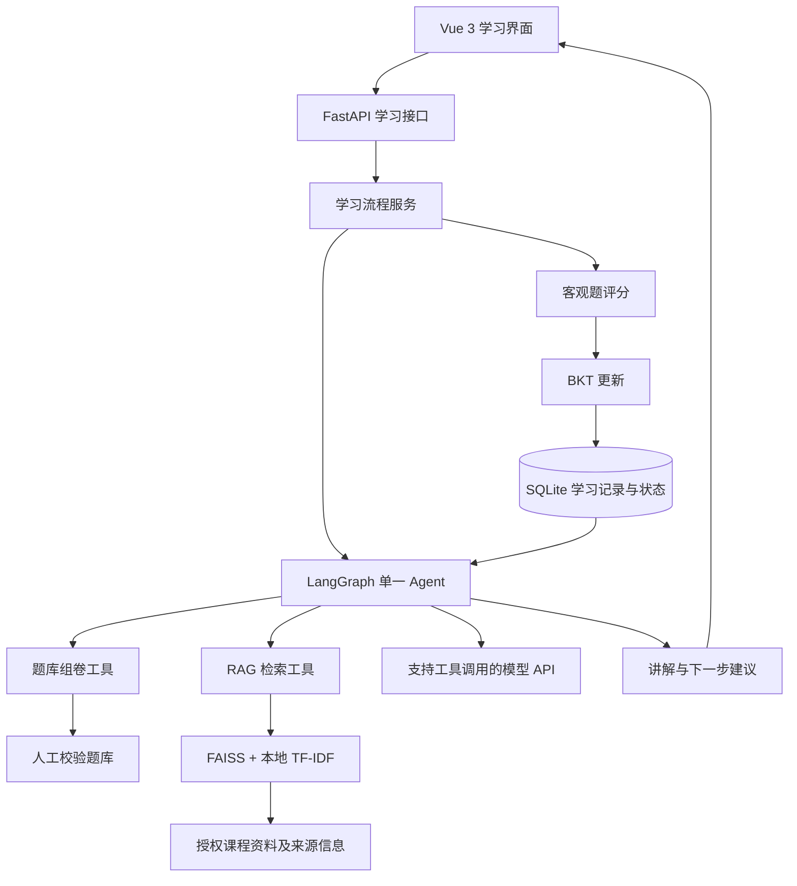

# 开发计划与进度

最新配置记录（2026-10-22）：用户明确授权启用PDF手动选页识别，已打开现用视觉开关并重启，真实HTTP capabilities=true；仍须每轮选页并明确同意外发（≤3页，每页≤3000输出token），不自动发课件。本次未调用模型，重启前后原27表摘要一致。真实视觉接口兼容/质量未实测；[启用报告](../data/evaluation/vision-manual-enable-v1.json)。下方阶段报告中的“视觉关闭”保留为交付时历史。

当前新增阶段（2026-10-22）：[Phase4B-2课程知识体系](PHASE4B2_GUIDE.md)已按用户正式授权完成。**501项后端、131项前端与构建、64组隔离HTTP通过；schema7→8备份迁移，原21表及资料文件保持。** 章节/概念/关系、独立草稿/发布历史、规则课件候选/预览/证据、正式学情只读关联和树形界面已部署。现存3页PDF最终仍为3个未分类页面，不强行生成知识结构；真实浏览器与内容准确性待验收，真实模型0，视觉关闭。4B-3及后续未实施。下方保留各阶段历史。

最后更新：2026-10-21（Asia/Shanghai）。**用户已批准并完成Phase4A工程：[PHASE4A_GUIDE.md](PHASE4A_GUIDE.md)。355项后端、101项前端及构建通过；18组隔离真实HTTP、9次模拟模型、0次真实模型。schema5→6已备份迁移、原12表摘要不变、旧版副本回滚验证通过；Studio自评/对照/规则建议/受控指南已部署。浏览器人工验收、真实模型预算和真实教学效果仍待完成，交付后停止。下方318/87等保留为阶段历史。**

后续用户单独授权的[工作台问答修复](WORKBENCH_ANSWER_FIX.md)：382项后端、103项前端及构建通过；7组修复HTTP加18组4A回归通过，共15次模拟调用、0次真实调用。检索无匹配片段时继续发送问题、标注模型自身知识；兼容JSON围栏和有效引用尾注，记录具体错误。schema6不变，主库15表摘要不变；未扩展新阶段或问答模式。

用户澄清[资料与模型结合的问答](WORKBENCH_HYBRID_GUIDE.md)：目标是RAG辅助上下文、大模型综合生成，未命中或部分命中也继续解释。北京时间只是例子，误加的时钟功能已移除。当前391项后端、104项前端与构建通过；10组问答+18组4A HTTP回归通过，最终HTTP报告18次模拟/0次真实模型。保持schema6、原学习数据、指南/评分规则，不新增模式。真实模型和浏览器人工验收待执行。

最新[模型响应修复](MODEL_RESPONSE_GUIDE.md)：403项后端、106项前端与构建通过；12组问答+18组4A模拟HTTP通过。工作台独立1500 token上限与JSON模式、明确终止原因、失败用量及不重发保护完成。用户另授权最多2次真实请求，仅用1次即完整成功（3课程引用+模型补充，输出652 token），剩余额度未使用；主库数据保持，浏览器人工及教学效果未验证。

最新[字段兼容修复](ANSWER_SCHEMA_GUIDE.md)：428项后端、107项前端及构建通过，14+18组模拟HTTP通过。聊天兼容字段别名/附加显示元数据/一层包装，保留服务端引用和控制字段边界；新增无内容泄露的结构摘要。用户允许少量真实调试，本次上限2次、实际1次，用5课程+2合成笔记和同一问题完整成功，真实个人笔记发送0。已部署8000服务，15表摘要不变、完整性/外键通过，无数据库迁移。旧失败JSON不可倒推；指南严格契约不变。

长期范围见 [项目上下文](PROJECT_CONTEXT.md)，开发规则见 [AGENTS.md](../AGENTS.md)。阶段范围与第一阶段技术选择已确认；时间窗口仍需随实际进度调整。

**新版进度**：[Phase4A](PHASE4A_GUIDE.md)记录当前自评/规则/指南接口、schema6、迁移/回退与验证；[Phase3B工作台](WORKBENCH_GUIDE.md)和此前记录作为历史保留。下方原P0～P5与新版Phase编号分别管理。

## 1. 当前状态

| 项目 | 状态 | 证据或说明 |
| --- | --- | --- |
| 目录检查、官方通知及附件 1～3 阅读 | 已完成 | 原始附件位于 `docs/references/` |
| 开发规则、项目上下文、阶段计划、README | 已完成 | 本轮建立的 4 份 Markdown 文档 |
| MVP 技术方案、第一阶段范围 | 用户已确认 | 2026-10-19 用户回复“可以” |
| BKT、题库、评分、存储、决策器 | 工程部分已实现 | `backend/src/eduagent/`；5 个知识点、10 题草稿、65 项测试通过 |
| FastAPI HTTP 接口 | 已实现并验证 | 共50个OpenAPI路径；4B-2新增知识体系10路径/12操作；旧契约兼容 |
| 申报内容草稿 | 已完成，待负责人核对 | `docs/APPLICATION_DRAFT.md`；个人信息及签署未填写，未提交 |
| LangGraph、DeepSeek、课程/个人RAG | 课程/工作台Agent保留；受控指南完成 | 后端355项；4A模拟验证、真实请求0；程序确定重点，模型只辅助解释，个人外发逐轮同意 |
| 候选题库与内容审阅工具 | 已准备，待人工验收 | 40 道候选题、每知识点 8 道；当前服务保留原 10 题，不混用历史 |
| 检索开发集 | 两套共 55 条，尚非独立评估 | 原开发集课程外空结果 4/5→5/5；挑战集 7/15→10/15，仍保留 5 个误检；原报告与案例未改 |
| Vue 学习页面、笔记、工作台及Studio | 工程已实现，人工验收待完成 | 当前131项前端及构建通过，含课件与知识树管理；jsdom不冒充浏览器人工验收 |
| 初步演示复验 | 两条真实 HTTP 流程通过 | 六题完成及答错复习/耗尽暂停，新增模型请求 0；不代表学习效果或完整 P5 验收 |
| 有限教学决策对比 | 已完成初步配对工程比较 | 8 个自建合成状态，同输入比较当前规则与固定两题基线；3 处暂停/推进不同、2 处仅行动标签不同，详见教学决策对比 |
| 内容人工审阅与效果验证 | 未完成 | 题库、课程资料及先修图待审，无真人效果数据 |
| v0.5.0 Markdown/笔记/个人RAG/自评/课件 | Phase1～4A与4B-1工程完成 | schema7，正式学习规则保持；课件本地解析已部署，尚未接入RAG/知识结构；总结/卡片未实施 |

初始化检查时目录尚未初始化 Git。P1 使用已有 Python/pytest；P2 已创建项目 `.venv` 并安装可选 API/开发依赖，未修改全局 Python，也未初始化 Git。

## 2. MVP 技术架构建议

采用单体后端、一个学习 Agent 与本地持久化。保持用户拟定技术栈，按验证需要分批引入依赖。



上图表示 MVP 的职责关系。目前已实现 HTTP、核心流程、评分、BKT、SQLite、规则推进及 LangGraph/DeepSeek、检索和 Vue 学习页面，内容与浏览器人工验收仍待完成。模型选择读取、检索与练习分配工具；评分、BKT 与学习推进约束继续由程序保障。

### 分批落地与选择理由

| 部分 | 建议 | 原因 / 确认点 |
| --- | --- | --- |
| 第一阶段入口 | Python 命令行演示 + 自动测试 | 先定位算法和状态错误，减少界面、网络与模型变量；不替代最终 Web 交付 |
| 第一阶段规划 | 统一决策接口 + 确定性规则实现 | 能复现薄弱知识点和先修关系驱动的行动；暂不具备真实模型工具调用能力 |
| 数据存储 | 标准库 `sqlite3` + 薄仓储层 | 暂不需要 ORM；评分事实与掌握度在同一事务中提交 |
| 题库 | 版本化 JSON，加载时校验 | 少量人工题目便于审阅；按知识点、难度筛选，无需独立题库服务 |
| 后端和前端 | FastAPI + Vue 3 | 核心稳定后增加适配层，复用同一流程服务 |
| Agent | 第二/三阶段接入 LangGraph 与一个模型适配器 | 保持单一 Agent；保留离线规则模式作为可标识的演示降级 |
| RAG | FAISS + 本地 TF-IDF 与词组检查 | 原基线可重现，小型资料启动重建、不增加嵌入服务；共享词的意图误检与语义泛化仍待改进 |
| 运行环境 | 本地虚拟环境 + 固定依赖 | 不增加 Docker、Redis、消息队列或云端部署作为 MVP 前置条件 |

LangGraph 用于编排状态、节点和条件路由，不等同于学习算法。[官方概述](https://docs.langchain.com/oss/python/langgraph/overview)允许在同一图中组合确定性步骤和模型决策，因此评分与更新可以保持程序控制。

实际验证环境为 Python 3.12.8。核心只用标准库；HTTP 依赖为 FastAPI 0.148.0、Uvicorn 0.54.0、Pydantic 2.12.5、Starlette 1.9.0；Agent 依赖为 LangGraph 1.2.16、LangSmith 0.14.11、FAISS CPU 1.15.1、NumPy 2.5.4、httpx2 2.14.0；pytest 7.4.4 与 setuptools 75.1.0 保持不变。已验证隔离环境可编辑安装；其他 Python 版本、非编辑分发包和完整跨平台锁文件尚未验证。

前端已在 Node 22.14.0 / npm 10.9.2 安装与构建，Vue/Vite/测试版本和传递依赖固定在 npm 清单与锁文件中。没有修改全局 Node、Python 或后端运行依赖。

### 目录规划

以下目录均已创建。`.env.example` 可提交，实际 `.env`、`data/local/`、前端依赖和构建产物均被忽略；新环境须先构建前端。

```text
EduAgent/
├─ AGENTS.md
├─ README.md
├─ docs/
│  ├─ PROJECT_CONTEXT.md
│  ├─ DEVELOPMENT_PLAN.md
│  └─ references/                  # 已有：官方附件，保留原件
├─ backend/                       # 核心、api、Agent 与 retrieval 已创建
│  ├─ pyproject.toml              # 依赖和测试配置
│  ├─ src/eduagent/
│  │  ├─ domain/                 # BKT、题目与评分、学习状态模型
│  │  ├─ services/               # 学习闭环、事务边界与选题
│  │  ├─ storage/                # SQLite 仓储与建表
│  │  ├─ agent/                  # 规则策略、DeepSeek 客户端、LangGraph、调用限制与冒烟入口
│  │  ├─ evaluation/             # 内存 SQLite 重放、固定题额基线与离线配对比较
│  │  ├─ cli.py                  # 第一阶段入口
│  │  ├─ api/                    # 已实现：FastAPI 工厂、请求响应模型与配置
│  │  └─ retrieval/              # FAISS + TF-IDF 章节检索与引用
│  └─ tests/                     # 算法、存储、策略与闭环测试
├─ data/                          # 已创建知识点、题库与本地演示数据
│  ├─ knowledge_points.json       # 5 个知识点与人工配置先修关系
│  ├─ questions.json              # 题库及人工校验状态
│  ├─ candidates/                 # 40 题候选包，未替换当前演示库
│  ├─ evaluation/                 # 自建检索开发集与预期章节标签
│  ├─ materials/                  # 已建：5 份课程说明草稿与来源/许可清单
│  └─ local/                      # 运行数据库、索引，不提交
└─ frontend/                      # 已实现：Vue 3 / Vite / 组件与流程测试
```

`.gitignore`、`.env.example` 和运行说明已添加。模型凭据只在本地 `.env` 或环境变量中配置，不进入示例、源码、报告或日志。

## 3. 第一阶段：验证核心闭环

**目标**：不依赖外部模型 API，在一次可复现演示中证明答题、评分、BKT 更新、保存、重启恢复和下一步决策能够连续工作。

**规模**：5 个知识点；先准备约 10 道四选一单选题，每知识点 2 道，逐步扩充至最终 30～50 道。第一阶段题目可先标记为待人工校验；负责人审阅前不能作为已人工校验题库宣传。数量有限时明确返回题目不足。

**交付物**：独立 BKT 模块、题库与评分模块、SQLite 仓储、规则规划器、学习流程服务、命令行入口、测试、实际运行记录。

### 3.1 最小开发任务与验收

| 顺序 | 任务 | 验收标准 | 测试方法 |
| --- | --- | --- | --- |
| P1-1 | 固定数据契约与知识点 ID | 题目含 ID、主要知识点、难度、题干、4 个选项、唯一正确选项、解析、来源、校验状态；先修引用有效且无环 | 有效样例加载；重复 ID、非法答案、缺失知识点和先修环被明确拒绝 |
| P1-2 | 实现四参数 BKT | 分别输出观测前概率、观测后后验、学习转移后概率；验证参数与零概率观测；参数有版本 | 手算固定数值、答对/答错序列、边界与非法输入测试 |
| P1-3 | 实现组卷和客观题评分 | 指定知识点、难度可选题；固定顺序或种子保证复现；本轮无重复题；非法选项不计为一次答题 | 正误评分、筛选、无题、重复题与非法输入测试 |
| P1-4 | SQLite 保存与恢复 | 保存匿名学生、答题事实、掌握度和必要决策信息；重启可恢复；不同学生互不影响 | 临时数据库读写、关闭重开、事务回滚和学生隔离测试 |
| P1-5 | 基础决策器与工具接口 | 根据目标、已有证据、掌握度、最近错误和先修关系返回合法下一步及原因 | 固定状态场景断言行动；低先修掌握度不会直接跳转到受阻知识点 |
| P1-6 | 串联命令行演示 | 诊断题 → 作答 → 确定性评分 → BKT → 事务保存 → 推荐并选择下一题；退出重进可继续 | 合成答题端到端测试 + 实际命令行冒烟运行 |
| P1-7 | 更新文档与审阅题库 | 写明安装/运行/测试命令、依赖版本、实际测试结果、规则模式限制及题目校验状态 | 从运行说明复现；负责人逐题审阅作为独立人工验收项 |

### 3.2 数据与更新规则

- 学生使用演示 ID，不采集实名信息。答题事实至少保存题目 ID/版本、知识点、所选答案、正误、事件 ID、时间、BKT 参数版本和更新前后概率。
- SQLite 建议最小包含学生、答题记录、知识点掌握度、决策记录四类数据；题库仍以 JSON 为来源。
- 答题记录插入与对应掌握度更新在同一事务完成。相同事件 ID 的提交重试不得重复更新；相同 ID 携带冲突内容应报错。
- 只有合法且完成评分的新答题事件触发 BKT 更新；讲解展示、查询、网络重试不产生额外学习转移。
- BKT 计算使用未四舍五入值，展示时再格式化。参数版本与题库版本支持理解历史结果。
- 未作答知识点展示“尚无答题证据”和先验值，不把先验包装成诊断结果。

### 3.3 BKT 验收口径

公式见 [项目上下文](PROJECT_CONTEXT.md#5-bkt-建模约定与局限)。第一阶段已采用以下**演示参数**建立独立数值基准，尚无数据拟合依据：

```text
P(L0)=0.20, T=0.10, S=0.10, G=0.25
初次答对：后验 q≈0.47368421，转移后 p_next≈0.52631579
初次答错：后验 q≈0.03225806，转移后 p_next≈0.12903226
掌握阈值默认 0.80，作为可配置演示值
```

概率边界、退化分母和非法参数须明确处理。在 `0 < p < 1` 且 `1-S > G` 时，正确观测应提高后验、错误观测应降低后验；学习转移会再次改变概率，不能把“每次答错后最终状态必然下降”作为普遍测试条件。第一阶段不拟合参数、不模拟遗忘、不加入题目难度参数。

### 3.4 基础决策范围

用规则实现统一的决策接口，返回 `action`、目标知识点、选题条件、原因摘要与所用状态版本。第一阶段建议行动集为诊断、复习建议、练习、进入下一知识点和结束。

优先顺序建议：目标相关知识点缺少证据时先诊断；先修薄弱时优先复习先修；当前知识点薄弱或近期答错时推荐复习/练习；满足阈值后进入允许的后续知识点；全部目标满足演示阈值时结束。复习阶段仅给出结构化建议或本地提示，不冒充已实现 RAG 知识讲解。

可用题耗尽、无合法后续知识点或达到轮次上限时返回明确停止原因，禁止无限循环或编造题目。具体优先级、先修边和阈值在实现前随数据契约固定。

### 3.5 第一阶段完成标准

- 一个无外部模型密钥的本地演示能够完成至少一次“提交答案 → 评分 → BKT 更新 → 保存 → 产生下一行动 → 提供后续题目”。
- 对同一份已记录答案序列，结果可复现；重启后状态一致；重复事件不会二次更新。
- 低掌握度与高掌握度等不同合成状态产生符合策略的不同建议，并提供依据。
- 测试实际通过并记录命令和结果；没有运行的检查标为未运行。
- 题目内容审阅和代码自动测试分开记录。规则闭环完成不代表最终课程问答、真实模型 Agent 或学习效果已验证。

## 4. 后续阶段与验收

| 阶段 | 主要任务 | 验收标准与测试 |
| --- | --- | --- |
| P0 文档初始化，已完成 | 核对附件，建立上下文与计划 | 文档及来源已核对，用户已确认进入 P1 |
| P1 核心闭环，工程部分完成 | 第 3 节任务 | 算法、评分、存储、规则决策与 CLI 测试通过；P1-7 的题目人工审阅待完成 |
| P2 HTTP 入口与申报准备，工程与草稿已完成 | FastAPI 暴露学习目标/诊断、取题、提交答案、掌握度与下一建议接口；整理真实进度与申报材料草稿 | 已通过完整 HTTP 闭环、答案过滤、并发/重复提交、重启与故障测试；草稿明确已实现/计划，待补个人信息与负责人核对后自行提交 |
| P3 真实模型 Agent 与 RAG，工程与候选内容已准备、内容待审 | 已接入 LangGraph、DeepSeek、检索工具与引用；40 题候选包和两套共 55 条检索开发案例已建立 | 两组真实调用已验证，5 份草稿资料可定位章节，错误/超时/轮数与降级有测试；题目/资料/先修人工审阅、正式题库切换、课程外拒答和独立评估尚未验收 |
| P4 Web 演示，工程已实现、浏览器人工验收待完成 | Vue 3 的目标、学习/答题、反馈、掌握度、讲解来源、资料与记录页面 | 组件测试及前端适配器真实 HTTP 已通过；仍需在浏览器完成“诊断 → 讲解 → 测试 → 更新 → 新建议”，检查视觉、键盘、窄屏、刷新与服务失败 |
| P5 验证与展示，初步工程复验已开始 | 两条 HTTP 合成场景、8 个配对状态的有限策略比较与演示脚本已保存；内容、独立评估、自愿试用和人工展示验收仍待完成 | 区别模拟、真实模型和真人结果；策略比较同时展示推进约束与题量不足暂停，保留实际失败，不虚报学习效果 |

模型工具接口需覆盖检索、组卷、评分和 BKT 更新。评分与更新工具受流程节点和事务约束，工具重试不能制造重复答题。Agent 只接受有限行动，不允许任意 SQL、任意文件访问或自行新增知识点。

P3 可先做最少资料和少量工具调用验证，再补齐内容。P4 只保留完成学习闭环所必需的页面，不建设管理后台。阶段结束后依据实际结果调整下一阶段日期。

## 5. 时间窗口与优先级

下表按 2026-10-19 起规划，日投入时间尚未知。原预计 P1 需 4～6 次有效开发时段；目前 P1/P2 及 P3 工程基础已于 10-19 提前完成，内容审阅仍需负责人投入，后续窗口随实际验收调整，不据初始估算虚报工时。

| 建议窗口 | 优先产出 | 日期性质 |
| --- | --- | --- |
| 10-19 | P0、P1/P2、P3 基础 Agent 与 RAG | 工程和真实请求结果已记录，人工内容验收仍待完成 |
| 10-20～10-25 | 题目/先修/资料审阅、检索误检改进、P4 浏览器验收 | P4 工程已于 10-20 实现，日期随人工验收与投入调整 |
| 10-26～11-01 | 申报草稿人工核对与迭代；核实学院截止时间，继续已具备条件的开发 | 若学院提前截止则材料优先 |
| 11-02 前 | 申报材料内部定稿，按实际进度填写 | 内部缓冲，不是官方要求 |
| 11-04 前 | 完成学院规定的申报手续 | 校级报名截止；学院节点待核实 |
| 11-05～11-14 | P3 真实 Agent、RAG、题库校验 | 待确认内部窗口 |
| 11-15～11-21 | Web 体验修订与场景复验 | 基础页面已提前实现，该窗口用于按验收结果完善 |
| 11-22～11-25 | P5 验证、演示脚本、缺陷修复 | 建议可演示原型内部目标 |
| 11-26 起至决赛 | 缓冲与按实际决赛日期准备 | 官方原则上 11 月底前完成决赛，需留意后续通知 |

时间紧张时，减少页面修饰、题型种类和可选试用，保留五知识点、30～50 道人工校验客观题、基础 RAG 引用、真实基础工具调用和完整学习闭环。若核心范围仍需压缩，应说明影响并由用户确认，不自行删除承诺能力。

## 6. 决策记录

| 编号 | 日期 | 状态 | 决策与理由 |
| --- | --- | --- | --- |
| D-001 | 2026-10-19 | 用户已确认 | 单人开发，5 个知识点，最终 30～50 道人工校验客观题；不扩展为综合教育平台 |
| D-002 | 2026-10-19 | 用户已确认 | Python/FastAPI、Vue 3、LangGraph 单一 Agent、多工具、SQLite、自主 BKT、RAG |
| D-003 | 2026-10-19 | 用户已确认，P1 已实现 | P1 使用命令行与规则决策器验证核心，后续接入真实模型；降低首轮验证的变量 |
| D-004 | 2026-10-19 | 用户已确认，P1 已实现 | `sqlite3` 薄仓储层与 JSON 题库，暂不引入 ORM 和独立数据库服务 |
| D-005 | 2026-10-19 | 用户已确认，P1 已实现 | P1 标准四参数、无遗忘、单题单主要知识点 BKT；参数及 0.80 阈值仅为演示假设 |
| D-006 | 2026-10-19 | 用户已确认，日期随进度调整 | 将可演示原型内部目标提前到 11-25，为原则上 11 月底前的决赛保留缓冲 |
| D-007 | 2026-10-19 | P1 实现约定 | 同一学生与状态版本复用题目分配；事件 ID 保证提交幂等；答题与掌握度同事务写入 |
| D-008 | 2026-10-19 | P1 实现约定 | 数据库绑定题库内容指纹、BKT 和策略配置；配置变化使用新数据库，P1 暂不实现历史迁移 |
| D-009 | 2026-10-19 | 用户已授权，P2 已完成 | 用户回复“可以继续”，推进 HTTP 与申报草稿；人工题库审阅独立保留，不推断已通过 |
| D-010 | 2026-10-19 | P2 实现约定 | 每个同步路由在同一线程内创建、使用并关闭独立 SQLite 连接，复用原服务层事务与幂等规则 |
| D-011 | 2026-10-19 | 用户已授权并完成真实验证 | 已提供 DeepSeek 使用授权，实际验证 `deepseek-flash`；密钥留在本地忽略配置，不在记录中保存其值 |
| D-012 | 2026-10-19 | P2 已验证 | HTTP 依赖作为可选 extra，核心仍无第三方运行依赖；按当前 Starlette 文档使用 httpx2 测试客户端 |
| D-013 | 2026-10-19 | P3 已实现 | 单一 LangGraph 图控制有限工具循环；评分/BKT 仍在原服务层；模型只收到练习元信息，客户端单独展示题目 |
| D-014 | 2026-10-19 | P3 已实现 | 从批准的选项中选择 FAISS；采用本地 TF-IDF 基线，降低外部嵌入依赖，语义能力不足如实标注 |
| D-015 | 2026-10-19 | P3 已验证 | 数据库 schema 1→2 仅增加 tutor_runs；备份后部署，测试真实答题事实和掌握度的保留 |
| D-016 | 2026-10-19 | P3 已实现 | 每次助教请求默认最多 3 次模型调用、每次输出 700 tokens；禁用远程 tracing，错误回退明确标为 offline_fallback |
| D-017 | 2026-10-20 | P3 内容准备已实现 | 候选题库单独保存 40 题，保留原 10 题，全部 pending；原服务和历史库不改。人工审阅后的切换使用新数据目录和新数据库 |
| D-018 | 2026-10-20 | P3 开发基线已验证 | 自建 30 条检索集明确标为 development；保存误检与排名、不调参掩盖失败。离线评估不读取密钥或调用模型 |
| D-019 | 2026-10-20 | 用户继续授权，P4 已实现 | Vue 3 + Vite 构建后由 FastAPI 同源提供，只公开编译资源；开发代理访问原后端，不增加跨域放行或外部托管 |
| D-020 | 2026-10-20 | P4 已测试 | 前端持久化待确认事件后提交，同编号恢复重试；模型仅在显式发送时调用，刷新读取历史。旧回执不套用到新题目 |
| D-021 | 2026-10-20 | 检索修复已测试 | 保留原 TF-IDF/FAISS 与 0.12 阈值，增加非通用词组重叠，旧策略通过 --policy baseline 重现。挑战集实现前写定，保留误检，不把词项过滤当语义分类 |
| D-022 | 2026-10-20 | 助教边界已测试 | 原问题无候选依据时零模型调用、返回规则安排；模型工具来源受原候选约束。2000 字问题本地重叠分窗处理，不扩大外部服务或修改学习参数 |
| D-023 | 2026-10-20 | 有限配对比较已验证 | 合成历史经实际评分/BKT/内存 SQLite 重放，同一状态查询当前规则与固定两题基线；基线仅用于离线评估，不修改现用策略或数据库。分别统计行动标签、选题与暂停，不推断学习效果 |
| D-024 | 2026-10-20 | 初始提案，后由D-025确认 | v0.5.0 增量增加统一 Markdown/LaTeX、笔记、个人 RAG 和独立自评；首轮仅设计，后续按阶段授权。优先 textarea、固定五知识点与独立来源索引，BKT/题库/策略不变 |
| D-025 | 2026-10-20 | 用户已确认方案，Phase 1 工程完成 | 用户回复“继续”后实现统一渲染；数学语法使用原候选包装插件同一 tex 解析器，直接捕获 KaTeX 异常以保留原文且不输出私密内容日志。只有组件有清理后的 HTML 出口；不提前执行笔记服务或迁移 |
| D-026 | 2026-10-20 | 用户明确授权，Phase 2 工程完成 | 复用SQLite薄仓储、同步路由和MarkdownRenderer，新增笔记服务/草稿状态机；无新增依赖或模型调用。创建UUID重放、revision条件更新、分作用域查询和请求体限额；迁移前备份，保留所有原学习事实 |
| D-027 | 2026-10-20 | Phase 2 实现选择 | 笔记软删除并保留已用UUID，防止延迟创建重放恢复删除内容；原文及删除记录保留在本机库/备份，暂无永久清除。索引元数据只允许disabled，不实现Phase3。Phase2结束等待用户确认下一阶段 |
| D-028 | 2026-10-20 | 用户明确批准，Phase3A已实现 | 只完成本地个人RAG及来源约束，schema3→4；个人稀疏TF-IDF复用原分词/公式/词组检查，无外部服务/模型调用/向量缓存。课程原词表/阈值与55例逐例结果保持；3B/Studio另行确认 |
| D-029 | 2026-10-20 | Phase3A一致性约定 | 原文事务内删除旧片段，事务外有界分块，发布前核对owner/revision/hash/删除/build_token；原文保存与索引失败分开。查询前后校验全部选择，不允许空集合扩大全库，不静默返回未就绪的部分来源 |
| D-030 | 2026-10-21 | 用户已批准，Phase4A已实施 | 自评/信心与BKT分离，确定性重点/理由、模型仅辅助解释；schema6新增三表，独立自评revision、指南双学情版本与逐轮外发同意；355/101项、18组隔离HTTP、备份/回退及部署通过，真实模型0调用，见PHASE4A_GUIDE.md |
| D-031 | 2026-10-21 | Phase4A恢复约束已验证 | 指南原始规则正文持久化；uncertain与过期可同时存在，超时期间状态变化不得解除不重发保护。自评刷新只读，原next_action与正式评分/策略不变 |

确认后将相应条目标记为“用户已确认”，记录日期与变化。重要决策保留理由；日常实现细节不必单独登记。

## 7. 验证与进度记录

### 2026-10-19：初始化

- 已检查项目目录；起初仅有附件 1、2，用户随后补入附件 3，已读取三份原件。
- 已访问官方赛事通知，并核对 A2 所在行、申报表要求、附件 3 的材料和评审要求。
- 已建立 4 份项目 Markdown 文档，保留官方原件。
- 文档检查通过：4 份文件可按 UTF-8 读取，无替换字符，代码块闭合；共 15 个本地链接目标存在；BKT 两组示例数值经独立算式复核一致。这些检查仅验证文档，不是应用功能测试。
- 本轮不新增应用依赖，没有执行 BKT、API、Agent、前端或学习效果测试；不存在可报告的功能测试通过结果。
- 当时下一步为等待确认；用户随后于同日确认，已进入 P1，见下方记录。

### 2026-10-19：第一阶段工程实现

- 已完成 P1-1～P1-6，以及 P1-7 的运行文档部分。源码模块、JSON 题库、忽略规则、构建/测试配置与 [第一阶段说明](PHASE1_GUIDE.md) 已建立。
- 已固定五个知识点 ID、人工配置的先修图、四参数演示值和 0.80 阈值。先修边是可审阅的教学假设。
- 自动测试命令：`python -m pytest backend/tests -c backend/pyproject.toml -q`。首次沙箱运行因系统 pytest 临时目录权限失败：46 passed、19 setup errors；获准重跑后 **65 passed in 1.01s**。
- 测试覆盖：手算 BKT、概率边界、非法参数、题库结构与先修环、评分与筛选、答错复习、先修约束、题目耗尽、轮数上限、重复/冲突提交、学生隔离、数据库故障回滚、关闭重开、配置变更拒绝和 CLI。
- 实际 CLI 冒烟命令：设置 `PYTHONPATH=D:\ZZUAgent\backend\src` 后执行 `python -m eduagent --demo --student smoke-logistic --goal logistic_regression --db data/local/smoke.sqlite3`，退出码 0，六次合成作答依次完成线性回归、梯度下降、逻辑回归，最终 `finish`，对应掌握度均为 0.82。
- 独立进程恢复命令 `python -m eduagent --student smoke-logistic --status --db data/local/smoke.sqlite3` 退出码 0，恢复三知识点各两题和 0.82 状态。另一 CLI 管道演示输入两次错误答案，实际经过 `diagnose → review → stopped`，停止原因 `insufficient_questions`，退出码 0。
- 文档检查通过：5 份 Markdown 文件可按 UTF-8 读取、代码块闭合、27 个本地链接目标存在。
- 所有十道题均为自建草稿、`pending`。人工校验、真人试用、真实学习效果、FastAPI、真实模型/LangGraph、RAG 和 Vue 未完成；没有将合成结果作为效果证据。
- 未运行隔离环境安装、包构建及其他 Python 版本测试；当前运行方式不要求包安装。
- 当时下一步为负责人审阅题库及先修关系、接入 HTTP；用户随后授权继续，P2 结果见下。

### 2026-10-19：第二阶段 HTTP 与申报草稿

- 用户授权继续后，完成 API 应用工厂、lifespan 启动校验、请求/响应模型与环境路径配置。新增 6 个 OpenAPI 路径，提供健康检查、知识点、创建/恢复记录、掌握度、下一题和提交答案。
- 保留原评分、BKT 与存储事务，仅增加一致状态快照和明确的未找到/目标冲突异常类型。未修改题库内容、BKT 参数或先修关系，既有配置一致的数据库可复用。
- 已创建 `.venv`。首次 venv/依赖安装遇到沙箱的临时目录与包源限制，获准后完成。已执行 `.\.venv\Scripts\python.exe -m pip install -e './backend[api,dev]'`，可编辑构建与安装成功；`pip check` 返回 `No broken requirements found.`。
- 首次 HTTP 测试发现一处测试断言把英文错误消息中的 `inputs` 误当成输入值字段，已改为检查错误对象键；旧 httpx 的测试弃用警告按 Starlette 文档改用 httpx2 后解决。没有关闭警告或跳过测试。
- 最终测试命令 `.\.venv\Scripts\python.exe -m pytest backend/tests -c backend/pyproject.toml -q`，结果 **94 passed in 3.37s**。新增 29 项 HTTP/配置测试，覆盖响应答案过滤、严格字段、状态码、并发取题/提交、学生隔离、事务失败恢复、服务重建及完整五知识点流程。沙箱内 pytest 临时目录仍受限，最终通过结果来自获准运行。
- 实际 Uvicorn 冒烟监听 `127.0.0.1:8765`，使用独立合成数据库 `data/local/api-smoke-20261019.sqlite3`。真实 HTTP 请求完成创建、取题、两次作答、在后续作答后重试旧事件、查状态和新建议；结果 `revision=2`、线性回归掌握度约 0.82、`replayed=true`、下一行动 `advance` 到梯度下降。冒烟进程已停止。
- 已建立 [API 说明](API_GUIDE.md) 与 [申报内容草稿](APPLICATION_DRAFT.md)，同步 README、上下文及第一阶段说明。申报五段正文长度为 216、312、227、211、214 个非空白字符，处于表单建议范围。未填写个人身份、签名或提交日期，未提交任何材料。
- 最终文档检查通过：7 份 Markdown 可按 UTF-8 读取、代码块闭合、42 个本地链接目标存在。
- 用户表示可提供 DeepSeek API，已记录为下一阶段优先验证方向；未索取、读取或存储密钥，没有发送模型请求。P3、RAG、Vue、题库人工审阅、真人试用仍未完成。
- 下一步：准备 DeepSeek 工具调用接入和获准课程资料，同时完成题目与先修关系人工审阅。负责人补齐申报字段并核对学院节点。

### 2026-10-19：本地接口文档连接恢复

- 用户反馈 `127.0.0.1:8000/docs` 显示 `ERR_CONNECTION_REFUSED`；此前阶段的临时冒烟服务已停止，需另行启动 8000 端口服务。
- 已使用项目 `.venv` 的 Python，在项目目录以隐藏后台进程启动 Uvicorn，绑定 `127.0.0.1:8000`，本次保持运行。输出日志为 `data/local/api-cf01ab0a.stdout.log`，错误/启动日志为 `data/local/api-cf01ab0a.stderr.log`。
- 实际检查 `/health`、`/docs`、`/openapi.json` 均返回 200；健康检查模式为 `offline_rules`，版本 0.2.0。Windows 网络状态查询在沙箱内受限，获准复查后确认 `127.0.0.1:8000` 由进程 30244 监听。未改变业务代码、题库或学生学习记录，未重跑整套测试。
- 浏览器自动化尝试被 URL 安全策略拒绝，因此未能自动刷新或进行页面可视确认，已告知用户手动刷新。README 与 API 说明补充了服务需持续运行及连接拒绝的排查方法。

### 2026-10-19：第三阶段基础 Agent 与 RAG

- 用户授权继续并提供 DeepSeek 接入凭据；已告知聊天暴露后的轮换建议，配置只保存在忽略的 `.env`。不在源码、文档、结果或日志中记录密钥值。
- 已接入 DeepSeek 官方 HTTPS 接口，默认 `deepseek-flash` 非思考模式；实现有限 LangGraph 工具循环、严格参数校验、状态版本标注、引用 ID 与正文检查、网络/认证/余额/轮数错误的明确回退。未开启云端 tracing。
- 工具包括绑定学生的学情读取、课程检索和合法练习分配。最终版只向模型发送练习元信息，不发送题干、选项或答案。评分和 BKT 仍由原提交接口执行。
- 已建立 5 份自建课程说明及 manifest，均为待人工审阅草稿，共 15 个章节；FAISS + TF-IDF 的检索测试覆盖五个知识点，未据此声称通用检索准确率。
- SQLite 增加 tutor_runs，schema 升至 2；迁移测试重建 v1 结构并验证已有实际答题回执、掌握度与目标保留。部署前备份当前数据库至 `data/local/eduagent-before-agent-39f0449a.sqlite3`。
- 新增 HTTP：资料检索、绑定学生的助教问答、按学生查询助教记录。API 共 9 个 OpenAPI 路径；健康检查额外报告 Agent 和检索是否启用。
- 安装命令：`.\.venv\Scripts\python.exe -m pip install -e './backend[api,dev,agent]'`。所有依赖位于项目 `.venv`；未修改全局 Python。
- 最终测试命令 `.\.venv\Scripts\python.exe -m pytest backend/tests -c backend/pyproject.toml -q`，**138 passed in 5.16s**，比 P2 新增 44 项。覆盖模型请求与错误脱敏、配置安全、检索定位、图工具循环、无效调用、伪造引用、预算限制、更新学情读取、并发状态变化、迁移、API 记录归属等。测试使用模拟模型，不发真实请求。
- 两组真实场景分别为梯度下降说明和 HTTP 过拟合说明，各 3 次模型请求，均实际调用读取/检索/练习工具并返回存在的章节引用，无降级。合计 prompt tokens 7396、completion tokens 1010；无真人数据或学习效果结论。详见 [真实验证记录](LIVE_MODEL_REPORT.md)。
- 首次 live CLI 在已保存成功结果后因 GBK 无法打印数学符号退出，已恢复保存记录并将摘要打印改为 ASCII JSON，未为打印问题重复付费。HTTP 验证退出码 0，学情版本保持 0，证明提问没有更新掌握度。
- 已更新运行、配置、申报草稿和 [Agent 说明](AGENT_GUIDE.md)。当前服务在 8000 端口运行；配置修改需重启，浏览器需手动刷新。
- 最终代码部署后已重启本次会话的后台服务，实际进程 43532，日志 `data/local/agent-api-3c248326.stderr.log`。健康检查为 0.3.0、Agent 与检索均启用；检索、9 个 OpenAPI 路径和重启前助教记录恢复检查通过，未为这些检查新增模型请求。
- 最终文档检查通过：9 份 Markdown 的 UTF-8、代码块与 59 个本地链接正常；源码、文档、资料及配置样例均未发现本地密钥值。`pip check` 返回 `No broken requirements found.`。
- 仍未完成：30～50 题扩充与人工校验、课程资料/先修关系审阅、独立检索评估、Vue、真人试用及真实效果验证。不能将 P3 工程接通当作全部教学内容验收。

### 2026-10-20：候选题库与检索开发集

- 用户授权继续，按 P3 范围补齐内容准备；没有引入新外部服务或开发 Vue。
- 已建立 `data/candidates/questions-v2.json`，包含原 10 题与新增 30 题；五知识点各 8 题，难度分布均为 easy 3、medium 3、hard 2。所有题目 pending，未代替负责人标注人工校验。
- 已实现标准库内容检查与审阅单生成入口。实际命令 `.\.venv\Scripts\python.exe -m eduagent.content_review --output docs/review/QUESTION_BANK_V2.md`，退出码 0；生成 40 题审阅单，检查覆盖、重复项及原题保留，记录两套指纹。再次生成会拒绝覆盖已写审阅意见的文件。
- 已建立 30 条检索开发集与本地评估入口。实际命令 `.\.venv\Scripts\python.exe -m eduagent.retrieval.evaluate --output docs/evaluation/retrieval-baseline-v1.json`，退出码 0；25 个课程问题 Hit@1=24/25、Hit@3=25/25、MRR@3=0.98；5 个课程外问题空结果比例=4/5。宿舍电费问题误检 `gradient:2`，MSE 系数问题预期章节排第二。未改变检索算法、阈值或资料，报告保留全部案例。
- 测试命令 `.\.venv\Scripts\python.exe -m pytest backend/tests -c backend/pyproject.toml -q`，获准本地运行后 **175 passed in 5.49s**，新增 37 项。覆盖 21 个独立数值答案检查、候选内容校验、审阅文件防覆盖、两错三对后推进与恢复、旧库拒绝重绑定、检索标签与指标计算、评估报告保护。
- 本轮没有新增依赖，内容与评估入口不使用密钥，未发送真实模型请求。原题库指纹保持 `f6cbfb68ace13e48641498419c007379ef416b9ac28f65b4500789a5fed83ebb`，当前服务继续使用 10 题库，数据库未迁移。
- 已新增 [内容审阅说明](CONTENT_REVIEW_GUIDE.md)、[检索评估](RETRIEVAL_EVALUATION.md)，同步 README、项目上下文和申报草稿。检索集作者可见资料、标签待审，不能当作独立测试结果或模型问答准确率。
- 最终静态检查通过：12 份 Markdown、73 个本地链接无错误；检查范围内的源码、文档、资料及样例未发现密钥格式文本。申报五段长度为 216、283、227、198、214 个非空白字符。
- 检查发现上次后台服务已不响应，已重新隐藏启动 Uvicorn，实际进程 2792，日志 `data/local/content-api-477fae45.stderr.log`。健康检查 200、版本 0.3.0、10 题且 Agent/检索启用；此前真实助教回执能恢复，本次检查未生成新回答。
- 遗留：负责人逐题/逐章/先修审阅；课程外误检及独立测试集；审阅后切换正式题库；Vue 与真实学习效果。候选题准备完成不表示人工内容验收完成。

### 2026-10-20：第四阶段 Vue 学习页面

- 用户继续授权，按既定栈实现 Vue 3 + Vite 单页，覆盖目标选择/恢复、题目与反馈、掌握度、助教讲解与来源、资料检索、答题历史。未引入账号平台、外部托管、前端模型密钥或管理后台。
- 前端拆分 HTTP、浏览器回执存储、流程组合函数和显示组件；答题前持久化事件编号，响应丢失后用原编号重试。新增旧回执恢复场景，确保不把已评分旧题的答案显示到新题上。模型只在手动发送时调用，刷新只查已保存记录。
- 新增两个只读历史接口；共 11 个 OpenAPI 路径。后端仅提供构建后的 index 和 assets，未构建时根路径返回明确 503，原 API 正常。静态边界测试拒绝源码、配置、题库与路径穿越。
- 本机 Node 22.14.0 / npm 10.9.2。固定 Vue 3.5.44、Vite 8.3.4、插件 6.0.10、Vitest 5.0.5、Vue Test Utils 2.4.6、jsdom 26.1.0，生成 npm 锁文件。最新测试工具的间接依赖要求更高 Node，故选兼容固定版本。开发依赖有弃用提示，`npm audit` 结果为 0 项已知漏洞。
- 后端测试命令 `.\.venv\Scripts\python.exe -m pytest backend/tests -c backend/pyproject.toml -q`，**186 passed in 6.73s**；新增 11 项，原 175 项继续通过。前端在 `frontend/` 执行 `npm.cmd run test`，最终 **3 files / 17 tests passed**。均未调用真实模型。
- 构建命令 `npm.cmd run build` 成功：最终 JS 96.18 kB、CSS 26.76 kB，gzip 约 37.41/6.58 kB。Windows 沙箱首次构建报子进程 EPERM，获准后构建通过。原后端运行依赖未变，隔离构建可编辑安装升级至 0.4.0。
- 部署前备份 `data/local/eduagent-before-web-5aa95165.sqlite3`；数据库仍为 schema 2，不变更题库、BKT 或策略指纹。已重启本会话后台服务，实际进程 1720，日志 `data/local/web-api-bb5dc437.stderr.log`，保持运行。
- 真实 HTTP 用前端 `createApi` 请求适配器执行：合成学生 `web-smoke-72fc0113` 两题答对、同事件重试、查状态和记录，revision=2、线性回归约 0.82、下一行动 advance 到 gradient_descent；旧真实助教回执恢复成功，新模型请求数 0。摘要保存在忽略的 `data/local/web-http-smoke.json`。
- 新增 [Web 说明](WEB_GUIDE.md)，同步上下文、README、申报草稿和开发规则。此前浏览器自动化被安全策略拒绝，本轮没有绕过；jsdom 组件检查与 HTTP 验证不能当作浏览器可视或真实用户验收。
- 最终检查：13 份 Markdown、84 个本地链接；UTF-8、代码块、编译资源引用及 npm 锁文件一致性通过；检查范围内的源码、文档、资料和前端产物未发现密钥格式文本。原题库指纹未变，`pip check` 无依赖冲突，申报五段长度为 216、288、227、202、214 个非空白字符。
- 遗留：浏览器完整人工操作、键盘与窄屏可视检查；题库/资料/先修审阅与正式切换；课程外检索误检、独立评估、真人试用与学习效果。下一阶段先处理这些验收与缺陷，再准备演示材料。

### 2026-10-20：检索边界修复与初步演示复验

- 用户继续授权，优先修复已知误检和助教依据边界，不新增依赖、外部服务或正式教学内容。版本更新至 0.4.1，原题库、课程资料和 BKT/策略配置未变。
- 先写定挑战开发集并保存旧策略结果，再实现有效词组检查。沿用余弦 0.12，不修改原开发集、资料或旧报告。原开发集课程问题 Hit@1=24/25、Hit@3=25/25 不变，课程外空结果 4/5→5/5；挑战集 Hit@1=9/10、Hit@3=10/10 不变，空结果 7/15→10/15。挑战集仍有 QQ 群、邮箱、考试时间、教材购买及 GPU 价格 5 个误检，未追加针对性黑名单掩盖失败。
- 原问题先本地检索，无依据则保存 insufficient_evidence、model_calls=0、无引用，并返回真实学习安排；模型改写检索仍需在原问题候选来源内。记录新增可空 retrieval_policy，旧记录保持 null，不补造历史。
- 修复助教最多 2000 字与检索最多 1000 字不一致导致的降级异常；原问题按 1000 字窗口、960 步长处理，最多三窗，保留末尾与分界附近知识点。这个约束不提供语义正确性保证。
- 自动测试：`.\.venv\Scripts\python.exe -m pytest backend/tests -c backend/pyproject.toml -q`，**202 passed in 11.67s**，新增 16 项；前端 `npm.cmd run test` 为 **3 files / 18 tests passed**，新增本地无调用反馈显示。覆盖原基线重现、单字误检、检索漂移、长问题、零调用、状态不变及答错流程。
- 两份新策略评估命令均退出 0，报告在 docs/evaluation/；两个开发集共 55 条，作者可见资料、标签待审，不是独立测试集。细节见 [检索评估](RETRIEVAL_EVALUATION.md)。
- `npm.cmd run build` 成功，JS 96.52 kB、CSS 26.76 kB，gzip 约 37.50/6.58 kB。项目包已在 .venv 可编辑安装至 0.4.1；npm 锁文件同步版本，运行依赖未变。
- 部署前备份 `data/local/eduagent-before-retrieval-guard-053ac87d.sqlite3`；本会话后台服务重启为进程 18216，日志 `data/local/guard-api-b0647351.stderr.log`，继续监听 8000。schema 2 与原学习事实保留。
- 实际命令 `node scripts/verify_workflows.mjs docs/evaluation/workflow-verification-v1.json` 退出 0。合成学生 verify-success-f5cdd7ea 六次正确后 revision=6、三个目标相关知识点各约 0.82、finish；同事件重试无二次更新。另一标识 verify-review-f5cdd7ea 首错后约 0.1290、无依据提问不改学情并分配复习，第二题后因题量不足停止、保留两条历史。
- 本轮新增真实模型请求数为 0，没有付费重测修改后的模型分支；模型工具与引用变化通过模拟测试验证。已建立 [演示脚本](DEMO_SCRIPT.md)，标明标准答案仅用于工程复验、题量限制及浏览器人工验收项。
- 最终检查通过：14 份 Markdown、96 个本地链接，UTF-8 与代码块正常；编译资源引用、npm 清单/锁文件 0.4.1 一致，原题库及资料指纹保持不变。检查范围内源码、资料、文档及前端产物未发现密钥格式文本，pip check 无依赖冲突。健康检查为 0.4.1；旧真实助教记录能恢复，其历史策略字段保持 null。申报五段长度为 216、288、227、210、214 个非空白字符。
- 遗留：共享课程词的意图误检、独立人工检索集、浏览器操作与视觉、题库/资料/先修审阅及正式启用、固定顺序策略对比、真人试用与效果证明。没有将本轮标为 P5 全部完成。

### 2026-10-20：相同学情的有限策略对比

- 用户继续授权，推进 P5 已规划的有限策略比较。新增纯标准库离线 evaluation 模块和 8 个自建、待审的 development 情景，没有新增依赖、服务或运行版本变更，应用仍为 0.4.1。
- 每条历史在独立内存 SQLite 中调用实际分配、评分和 BKT；之后同一目标、revision、掌握度及已答题集合交给两种策略。记录两个相同输入指纹和未改写检查，不构造分叉后的假想学习成绩，不打开现用学习数据库。
- 固定基线按相同先修顺序每知识点两题，不依据正误调整题额。当前规则出现 3 个暂停/推进差异、2 个只改变行动标签的差异、3 个行动/题号相同状态；两种 finish 的含义不同，未将其当作统一学习成功率。
- 当前规则共提供 4 次练习、暂停 3 次、结束 1 次；固定题额为 7/0/1。按程序阈值检查，分配练习时存在薄弱先修分别为 0/4 和 3/7；这个定义偏向阈值策略，必须同时报告其三次题量不足暂停，不据此宣称教学优越性。
- 实际执行 `.\.venv\Scripts\python.exe -m eduagent.evaluation.compare --output docs/evaluation/policy-paired-v1.json`，退出 0。保存逐项概率、决策依据、题库/情景指纹；重跑不含随机编号或时间，已有报告拒绝覆盖。详见 [教学决策对比](POLICY_EVALUATION.md)。
- 完整后端命令 `.\.venv\Scripts\python.exe -m pytest backend/tests -c backend/pyproject.toml -q`，**225 passed in 12.52s**；新增 23 项覆盖配额推进/耗尽/上限、同输入、正确概率、非法与不可达历史、可复现及防覆盖。
- 本轮模型请求 0，不改前端、生产教学策略、参数或 schema；未重跑前端测试/构建、真实 HTTP 复验或付费模型。此前 18 项前端及真实请求证据保留，浏览器安全限制没有绕过。
- 收尾复核通过：15 份 Markdown、105 个本地链接、UTF-8 与代码块正常；89 个限定范围文本文件未发现密钥格式，原题库指纹未变，保存的配对报告与重新计算逐项相同。申报五段为 216、288、231、217、229 个非空白字符，符合对应建议范围。实际健康检查仍为 0.4.1、10 题、Agent/检索可用，未重启服务。
- 同步 README、上下文、申报草稿及演示说明。遗留：题库/资料/先修人工审阅与启用、检索意图误检、独立场景及检索评估、浏览器人工验收、真实试用与效果证据；P5 仍未全部完成。

### 2026-10-20：v0.5.0 设计审查，等待确认

- 阅读用户粘贴任务书并归档到 [原始要求](requirements/V0_5_0_TASK_BRIEF.md)；按其“第一轮只输出设计审查与实施计划”要求，没有开始生产编码或数据库迁移。
- 检查 App/组件/状态/适配器、依赖锁文件、SQLite 构造与事务、课程检索、Tutor 工具/引用/预检，以及相关测试。未发现现有 Markdown/公式/清理组件；发现检索依赖 Agent 开关、数据库构造反复 DDL、匿名标识不等同认证、写请求不确定状态目前仅按 POST 判断等需要纳入新设计的边界。
- 输出 [详细设计](V0_5_0_DESIGN.md)：五张新表、分步 schema 迁移、现有学生 API 前缀、revision 冲突与 JSON 文件导入、源类型与索引发布/缓存/删除、隐私与模型外发、自评分离、拟涉及文件、各 Phase 和 A～I 验收。
- 查阅 markdown-it、数学插件、KaTeX、DOMPurify、highlight.js、markdown-it-py 和 SQLite/Python 官方文档；依赖具体版本留待实施时兼容与安全核验，本轮未安装，不把网络文档等同实际项目集成通过。
- 只更新设计与上下文文档；现有应用仍为 0.4.1，未重启服务、未调用模型。未重跑后端/前端测试、构建或 HTTP；此前 225/18 项是历史实际结果。正式题库、BKT、先修策略、课程材料、模型配置和原数据库不在本轮修改范围。
- 文档检查实际通过：17 份 Markdown、122 个本地链接，UTF-8、代码块与文档密钥格式检查正常；任务书归档字节与原件一致。76 个源代码/测试/清单/脚本/正式数据文件的审查前后摘要一致，联合指纹 fdf059a91e78ea89d82a0d001204b4286abc217821b2e902ccb0d7f3b230b97c；该检查不是新功能测试。
- 待确认后先实施新版 Phase 1 的统一渲染与安全/公式样例，Phase 2 才开始笔记与迁移。原题库/资料人工审阅、检索意图误检、独立评估和浏览器人工验收仍未完成。

### 2026-10-20：v0.5.0 Phase 1 统一 Markdown/LaTeX

- 用户回复“继续”确认新版方案；完成统一 MarkdownRenderer、解析/安全模块与样式，接入题干、选项、即时/历史解析、助教正文、引用原文、课程检索结果。使用合法容器与 aria-labelledby 保留 fieldset 标签；未改原答题事件/评分逻辑。
- 新增固定依赖 markdown-it 15.0.3、@mdit/plugin-tex 1.1.2、katex 0.19.0、highlight.js 11.12.0、DOMPurify 3.4.17。核验 npm 元数据与许可，Node 22.14.0 下严格引擎检查、禁用安装脚本后安装通过；锁文件一致，最终安装报告 0 项已知漏洞。
- 最初的 KaTeX 0.18.11 安装提示为误发布，已排除；包装插件错误处理无法满足无日志回退需求，改用其同一数学分隔符解析模块与直接 KaTeX 渲染，不用正则自行解析公式，不保留重复/旧 KaTeX。
- 禁用原始 HTML、危险/相对协议和图片自动加载；最终 DOMPurify 清理，保留所需 MathML/SVG。公式独立宏环境、展开/尺寸/长度/数量限制；错误保留原文。大文档和未知/长代码降级纯文本，不截断保存原文。具体边界见 [渲染说明](MARKDOWN_GUIDE.md)。
- 自建固定样例 16 个。首轮 45 项中 4 项失败，发现未知命令回退与尺寸测试误读 MathML 原文；修复处理及断言，增加集成测试后修正一项预选 radio 的测试起始条件。最终在 frontend 执行 `npm.cmd run test`：**4 files / 47 tests passed，2.61s**，新增 29 项，原 18 项继续通过。
- 完整后端回归 `.\.venv\Scripts\python.exe -m pytest backend/tests -c backend/pyproject.toml -q`：**225 passed in 7.98s**。本轮源码后端没有改动，测试使用隔离数据库，现用学习事实不迁移。
- `npm.cmd run build` 成功，JS 530.90 kB/gzip 186.09 kB、CSS 60.29 kB/gzip 15.61 kB。构建提示主包超过默认 500 kB，已记录且未提高阈值隐藏；数学与高亮成本后续按实际体验评估按需加载。
- 资源引用和 59 个本地字体引用均存在，唯一 v-html 出口检查通过，原题库联合指纹不变。健康检查继续为 0.4.1、10 题、Agent/检索可用；未重启服务。本轮模型请求 0。
- 收尾检查实际通过：18 份 Markdown、133 个本地链接，UTF-8 与代码块闭合正常；74 个限定范围文本文件未发现密钥格式。课程资料片段指纹与原题库指纹均保持不变；没有将模拟样例加入正式教学内容。
- 版本清单保留 0.4.1，记录为 v0.5.0 Phase 1 工程结果，不宣称完整新版本已发布。下一阶段为笔记管理与版本化迁移；笔记、个人 RAG、自评尚未实现。浏览器视觉/键盘/窄屏验收仍待人工，未绕过此前安全策略；内容审阅、检索误检与独立评估继续保留。

### 2026-10-20：v0.5.0 Phase 2 个人笔记与安全迁移

- 用户明确要求实现 Phase2、保留学习规则、先审查再分步交付。已检查上下文、数据库结构、原路由/渲染与草稿模式；先确定复用单体架构、三张笔记表、独立服务与界面，再分别完成迁移层、API、编辑器、恢复测试和部署。没有初始化Git；分步通过工作区改动与验证记录留痕。
- 新增 domain/notes、storage/migrations与notes、services/notes、api/notes/note_schemas/body_limit，以及 NotesPanel/NotesDialogs、useNotesWorkspace、noteStorage和样式。API支持列表/详情/创建/更新/删除/导入；原文Markdown、0～5知识点、SHA-256、revision和创建来源保留。具体文件及契约见 [笔记说明](NOTES_GUIDE.md)。
- 列表/标题筛选、textarea、300ms安全预览、UTF-8文件、多知识点、保存状态、切换保护、本机草稿、冲突副本、网络结果对账和键盘对话框已实现。JS组合函数用页面代次与学生ID忽略旧响应；服务按事务和revision条件更新，不允许模型/客户端写评分或BKT。
- 请求体256KiB、正文/文件64KiB、有效笔记50篇/1MiB；UTF-8严格解码、路径/格式/控制字符/明显二进制头校验。创建原UUID重放不会增加记录；软删除阻止旧创建请求复活。文件名不落盘、笔记不发送模型、索引状态恒disabled。
- 完整后端 `.\.venv\Scripts\python.exe -m pytest backend/tests -c backend/pyproject.toml -q`：**269 passed in12.04s**，比Phase1增加44项；完整前端 `npm.cmd run test`：**6 files /75 passed，6.17s**，新增28项、原47项继续通过。覆盖并发唯一成功、跨学生隔离、无BKT变化、事务失败、备份失败/恢复、丢响应/继续输入/冲突草稿与恶意Markdown预览。
- 后端首轮暴露类方法list与后续类型注解冲突，改延迟注解；超大参数化用例ID超过Windows临时路径限制，改短ID。随后发现长文件名默认标题与异常Unicode边界，补校验和测试；最终269项全过。前端新增后完整75项首轮通过。
- `npm.cmd run build -- --outDir ../data/local/phase2-dist` 成功，部署时复制资源、最后替换index；主JS553.33kB/gzip193.22kB，CSS63.89kB/gzip16.41kB。保留500kB主包提示，没有修改阈值；旧资产保留用于已打开页面，新index引用新版资产。没有新增/调整依赖版本。
- 现用schema2迁移前代码归档 `data/local/phase2-prechange-85d644af.zip`；确认8000旧服务已停止后，以SQLite backup备份至 `data/local/eduagent.before-v2-4058e3fc7d1e.sqlite3`，事务迁至3。metadata1、students8、mastery10、decisions26、attempts18、tutor_runs4的行数/内容摘要全相同，完整性ok、外键违规0；[实际迁移记录](../data/evaluation/notes-migration-v1.json)。新服务实际进程34644（启动器30004），日志 `data/local/notes-api-d4a18fb9.stderr.log`，本机8000继续运行。
- [真实笔记HTTP](../data/evaluation/notes-http-verification-v1.json) 8组全过，使用前端适配器和新合成学生；MD/TXT、并发409、跨作用域404、413限额、422非法字段、删除后防重建、学情/历史不变均通过。随后 [原学习HTTP回归](../data/evaluation/notes-learning-regression-v1.json) 完成六题finish与答错review/insufficient_questions，原事件重放与历史恢复通过。全部新增模型请求0。
- [最终完整性与回退探测](../data/evaluation/notes-integrity-verification-v1.json)：新增HTTP合成记录后，迁移前每一原始事实仍完全一致；算法、学习服务、Agent策略/工具、检索、依赖文件与升级前归档逐字节相同。另在独立目录用旧代码打开升级前备份副本，读取学习快照成功，仍为schema2；没有执行现用库回滚。
- 收尾检查：迁移CLI在现库返回3→3、changed=false、backup=null，没有重复DDL/备份；9份更新文档的UTF-8、围栏及本地链接检查通过。原题库联合指纹与课程15片段指纹保持不变；代码/测试/脚本/文档未发现密钥格式，部署index引用和CSS资源文件均存在。资源检查脚本初次误将CSS根路径按相对路径解析，修正核验脚本后通过，未改构建资源。
- 新增 [NOTES_GUIDE.md](NOTES_GUIDE.md) 包含实际API/表结构、配额、原文/软删除保留、安全边界、迁移与无损回退步骤、运行结果及未勾选浏览器清单；同步README、长期上下文、设计和开发约定。旧代码不会拒绝schema3，会写回版本2，已明确纠正旧设计描述并禁止新旧共库。
- Phase2工程结束；等待用户确认才进入Phase3个人检索。当前无note_chunks/个人索引、自评、图片识题或教材解析；正式/候选题和课程材料、BKT参数/推进规则均未修改。浏览器自动化此前被URL安全策略拒绝，本轮未绕过，视觉/窄屏/完整键盘人工验收继续待办。题库/资料审阅、5/15课程外误检、独立评估和真实效果仍未完成。

### 2026-10-20：Phase3A本地个人RAG与来源约束

- 用户明确授权直接完成3A代码/迁移/测试/文档，禁止提前3B/Studio和付费服务。审查既有笔记、迁移、课程索引、Agent/响应与Vue后，按独立服务、严格来源、标准库稀疏向量实施；详细文件和API见 [PERSONAL_RAG_GUIDE.md](PERSONAL_RAG_GUIDE.md)。
- 新增Markdown块识别与原文位置、派生片段仓储、build_token版本发布、失败重试及启动恢复；保存/删除在原文事务内立即移除旧片段，原学习事实与笔记原文不因索引失败回滚。保护常见公式/代码块，超8192字符原子块明确failed而保留原文；单次256片段/8192词项限额，不静默截断。
- 新增来源目录、选择检索和重建3个API，OpenAPI共17路径；owner/type/ID/version/删除/就绪状态由后端检查，查询后再次核验。个人词表只含当前学生且选中的笔记；无跨请求缓存，不与课程词表混合；组合按固定RRF排名，不解释为可信概率。
- 本地检索默认true，与Agent开关解耦。新增retrieval extra复用FAISS1.15.1/NumPy2.5.4，不安装新包；个人分块/TF-IDF仅标准库。旧Tutor工具和来源仍限课程，不发送个人笔记。前端仅补索引状态说明，无新三栏布局。
- 最终后端命令 `.\.venv\Scripts\python.exe -m pytest backend/tests -c backend/pyproject.toml -q`：**295 passed in11.19s**，新增26项。前端 `npm.cmd run test`：**6 files/75 passed，14.82s**。`npm.cmd run build -- --outDir ../data/local/phase3a-dist`成功，JS553.41kB/gzip193.26kB，CSS63.89kB/gzip16.41kB，保留500kB提示；原依赖锁未改。
- 新增用例覆盖数学/代码/位置、失效、作用域、构建编号/保存/删除竞争、异常保文、派生片段篡改/缺失、预算、API严格字段、无密钥、重启恢复和schema3九表保留/DDL失败回滚。首轮2处失败为夹具重复关键字及共享词下过强“零结果”断言，改为核验当前原文/版本，没有加关键词黑名单。
- [真实HTTP最终13组](../data/evaluation/personal-rag-http-v2.json)在独立临时数据库/无密钥服务完成：真实并发重建、失败重试、实际停止/重启和恢复、六题finish/原事件重放/两次错答暂停与历史；现用库未写合成成绩，模型请求0。测试用暂停钩子仅在脚本测试服务内。早期Windows stdin控制造成健康探测超时，改本次测试目录文件信号；扩展闭环时修正一处合成答错选项，最终通过。
- [课程30例](../data/evaluation/personal-rag-course-dev-v1.json)与[挑战25例](../data/evaluation/personal-rag-course-challenge-v1.json)重新运行；与旧报告cases/metrics逐项相同。课程Hit@1分别24/25、9/10；课程外空结果5/5、10/15，保留5个误检。个人工程用例不当作语义准确率或学习效果，课程外误检未声称修复。
- 迁移前代码归档`data/local/phase3a-prechange-8ffd16d4.zip`（185文件）；旧8000服务已结束，确认无监听后SQLite backup至`data/local/eduagent.before-v3-0f3561f44a87.sqlite3`。schema3→4仅重建派生状态约束并新增chunks；[迁移记录](../data/evaluation/personal-rag-migration-v1.json)九表旧列摘要一致，完整性ok、外键违规0。
- [部署后核验](../data/evaluation/personal-rag-integrity-v1.json)：原12学生、27答题、14掌握度、37决策、5讲解、5笔记（含删除）及关联事实均未改变；两篇有效笔记ready、11片段。独立副本验证旧代码能读schema3备份、拒绝schema4，无现用库回滚。生产BKT/学习服务/Agent策略工具/题库/知识点/前端依赖与归档字节相同。
- 新服务实际PID25404（启动器28268），日志`data/local/personal-rag-api-bd63e201.stderr.log`，仍监听本机8000；原Agent配置保留，本轮未调用它。清单仍0.4.1，数据库版本4分别管理。新增指南包含运行、API、实际文件、备份/回退、恢复验证和局限，并同步长期上下文。
- 收尾：迁移CLI返回4→4、changed=false/backup=null，没有重复DDL/备份；10份更新文档UTF-8/围栏/本地链接正常，源代码/测试/脚本/文档无密钥格式。题库和课程片段指纹不变，部署JS/CSS/本地字体引用均存在；[逐文件清单](../data/evaluation/personal-rag-files-v1.json)记录实际新增/修改及忽略的构建产物。
- **Phase3A工程交付后停止。** 3B三栏工作台、个人Agent问答、外发同意/引用快照/回答转笔记及Studio未实现，等待用户单独确认；自评、图片识题、教材解析不在本轮。人工内容审阅、浏览器人工验收、个人独立语义评估和真实学习效果仍待完成。

后续每次记录包含：完成项、实际运行命令、通过/失败结果、未运行检查、当前限制、下一步。禁止用计划测试替代实际结果。

## 8. 待办与待确定事项

- [x] 用户确认 v0.5.0 方案，并完成新版 Phase 1 渲染工程、自动测试与构建。
- [x] 用户明确授权新版Phase2，完成笔记前后端、迁移备份/回退说明、269/75项测试及实际HTTP回归。
- [ ] Phase1～2浏览器视觉/键盘/窄屏人工验收，按NOTES_GUIDE清单记录；不以jsdom测试冒充人工完成。
- [x] 用户明确批准Phase3A，本地个人检索、schema4迁移、295/75项回归和13组隔离HTTP已完成。
- [x] 用户单独批准并实施Phase3B：来源选择/逐轮同意、受控问答、历史快照与另存，Studio只用已有学情/入口。
- [ ] 负责人完成3A/3B浏览器人工验收、确认少量真实模型冒烟次数/预算；Studio生成及后续阶段另行确认。
- [x] 用户确认 MVP 架构、P1 范围和分阶段接入顺序（2026-10-19）。
- [ ] 确认日常可投入时间，并核实学院内部申报截止日期、最终赛事安排。
- [x] 检查本机 Python 与 Git 环境，固定本次验证的开发依赖版本。
- [x] 固定知识点 ID、先修图、演示 BKT 参数与题库结构；教学图仍待人工审阅。
- [x] 完成 P1-1～P1-6 与 P1-7 文档部分。
- [ ] 完成 P1-7 的负责人逐题人工校验；目前全部为 `pending`。
- [x] 完成 P2 HTTP 接口、严格请求/响应约束、安装验证与 29 项新增测试。
- [x] 整理与官方字段对应的申报内容草稿；未提交。
- [x] 实现并实际验证 DeepSeek、单一 LangGraph、课程检索、引用检查与显式降级。
- [x] 记录两组真实模型场景、依赖、工具轨迹和 token 用量，区分模拟单测。
- [ ] 申报时根据实际情况填写“当前阶段”；负责人信息、导师情况等由用户提供，不推断填入。
- [ ] 选择获准使用的课程材料，记录出处与使用范围。
- [x] 验证 DeepSeek 模型、工具调用、本地配置与网络；选择并验证 FAISS。
- [ ] 负责人轮换聊天中暴露的密钥、确认后续 API 预算，并在本机更新配置。
- [x] 准备 40 道候选题、逐题审阅单、离线内容校验与 30 条可追溯的检索开发问题。
- [ ] 负责人完成人工校验，启用正式题库；处理课程外误检并建立独立检索测试集。
- [x] 实现 Vue 基础学习页面、历史查询与同源构建服务，完成组件测试及前端适配器真实 HTTP 验证。
- [ ] 完成浏览器人工流程、视觉、键盘与窄屏验收，整理正式演示脚本。
- [x] 修复单字重叠误检、模型检索来源漂移和长问题降级；实现无依据时本地零模型调用反馈。
- [x] 保存两套开发集对比、两条真实 HTTP 合成复验和初版演示脚本，保留全部失败案例。
- [x] 完成 8 个同学情状态的有限教学策略配对比较，保留行动标签差异、暂停代价及全部逐例结果。
- [ ] 完善课程外意图判断、独立人工标注验证；内容审阅后补充其他目标及答错恢复场景，完成正式人工演示验收。
- [ ] 若进行真实试用，先明确授权、最小数据与实际可支持的结论。

待确定事项在相应阶段需要时处理；人工审阅与工程自动测试分别验收。


## Phase3B实际交付与决策（2026-10-20）

- [x] 用户正式批准：先后端受控问答/引用，再三栏界面，最后历史、另存与综合验证；未增加新依赖/付费服务。
- [x] 复用Phase3A真实来源接口、当前版本索引与TF-IDF；课程-only不读取笔记正文，所有来源过滤继续由服务端完成。
- [x] 新增不可变请求上下文和LangGraph只读工具适配器，沿用调用预算；工具越权、未核验引用和上下文变化有明确状态，不修改评分/BKT/教学规则。
- [x] 逐轮外发同意与本地检索分离；默认local，未同意时整轮local，无模型也能检索。
- [x] 独立workbench_runs与引用快照；持久化声明先于模型调用，同ID重复/并发/重启不重跑；未知执行状态保守uncertain，手动查询后决定下一轮。
- [x] 响应式Sources/Chat/Studio、选择/问题恢复、状态反馈、Markdown/公式、原文抽屉及焦点/键盘；Studio只有已实现学情与入口。
- [x] 回答另存复用NotesService创建/索引与限额，初始笔记和来源关联原子写入；并发/重复保存只有一笔记，后续编辑有来源/修订标记。
- [x] schema4→5已部署：代码归档phase3b-prechange-ea87d691.zip；SQLite备份eduagent.before-v4-0cb86001aa97.sqlite3；原十表摘要一致，完整性ok、外键无错误；旧4代码能读恢复备份、拒绝5副本。
- [x] 后端318项（15.80s）、前端87项（3.97s）及Vite暂存构建通过。修正了迁移夹具的旧版本断言、路由计数、抽屉summary焦点与测试输入值断言；没有弱化来源或学习事实校验。最初未指定backend/tests的命令误收集备份内旧测试，后续使用项目配置和正式测试目录，未删除备份。
- [x] [14组真实HTTP](../data/evaluation/workbench-http-v1.json)：两个独立服务进程生命周期，6次模拟模型、0次真实模型；包含越权、无同意、并发重复/保存、生成途中修订、软删除快照、无密钥重启、旧课程检索/评分/BKT/历史。合成作答仅在独立数据库。
- [x] [部署复验](../data/evaluation/workbench-deployment-v1.json)：新静态资源与23路径、来源/历史/配置可读，主库无合成写入、模型0调用。原正式/候选题、课程文件、BKT参数/学习服务/规则与55例报告保留，5/15课程外误检未隐去。
- [ ] 浏览器1440/1024/390px、完整键盘/焦点与真实交互负责人验收，见[清单](WORKBENCH_GUIDE.md)。此前URL安全限制未绕过，jsdom和HTTP不冒充浏览器结果。
- [ ] 少量真实DeepSeek冒烟需负责人确认次数/预算；使用合成内容、明确逐轮同意，单独记录，不保存密钥。
- [ ] 人工内容审阅、独立语义测试、误检改进与真人学习效果继续待办；40题未启用。

实际接口、数据库、失败恢复/快照保留语义、回滚步骤及文件清单见[WORKBENCH_GUIDE.md](WORKBENCH_GUIDE.md)。工程交付后停止，不自动开发Studio生成、自评、PDF或图片识题。


## Phase4A设计审查（2026-10-21，等待实施确认）

- [x] 读取项目规则/上下文/开发计划/README/工作台指南，核对BKT、RulePolicy、SQLite实际DDL、受控检索/Agent与Vue工作台。
- [x] 用mode=ro、query_only=ON直接确认现用schema5、12表；未调用会自动迁移的SQLiteRepository，未查询或输出学生笔记正文/密钥。
- [x] 新增[PHASE4A_DESIGN.md](PHASE4A_DESIGN.md)：职责分离、差异规则、自评历史/并发、schema6备份/回滚、八类API、Studio变更、来源/引用和双学情版本约束、实施清单与测试矩阵。
- [x] 明确两个复用边界：无答题的BKT先验不能作为实际薄弱证据；原next_action/useWorkspace.refresh会分配题目，不能用于建议查询或自评/指南刷新。
- [x] 保留历史318/87项及3B报告，不将其写成本轮测试；本轮没有迁移、编码、模型请求或功能测试。
- [x] 用户随后明确批准三表schema6、自评追加历史/独立revision、信心可空、规则优先及指南默认本地等方案选择。
- [x] 已完成4A-1～4A-5工程与自动/HTTP验证，实际记录见后续Phase4A交付；浏览器/实模/教学效果独立待办。

待确认期间保持Phase3B工程边界，不自动启动生产迁移或后续教材、图片、评分体系改造。此前人工内容审阅、浏览器验收、课程外5/15误检、真实模型预算与真实教学效果待办继续保留。


## Phase4A实际交付与验证（2026-10-21）

- [x] 用户正式批准设计和五步实施，不增加依赖或付费外部服务。新增自评批次/明细与指南仓储、严格API、只读规则快照；旧评分/BKT/正式策略/题库不变。
- [x] 自评同编号重放、内容冲突、独立revision CAS、追加历史、confidence可空；主客观对照不将等级/信心换算为p，无答题时显示待诊断，先修/题耗尽明确解释。
- [x] Studio接入自评/历史、对照/重点、规则与可选模型指南；草稿/回执按学生隔离，与笔记独立；只读刷新不分配新题。
- [x] 指南双学情/来源版本、不可变快照、原始规则正文、历史/引用及逐轮独立同意；模型只解释程序重点，沿用LangGraph预算/只读工具，输出越权/链接/伪引用回退。
- [x] 同编号/并发/重启不重新付费生成；超时与过期同时发生仍uncertain并保留过期原因，不能意外解除重发保护。
- [x] 代码归档phase4a-prechange-85a21e83.zip（248文件），schema5备份eduagent.before-v5-4c770859bdb5.sqlite3；schema6原12表摘要一致、完整性ok、外键无错；独立副本旧5读备份/拒绝6通过，现用库无破坏降级。
- [x] 后端355 passed in 19.13s，前端101 passed in 4.32s；Vite构建通过，保留默认500kB主包警告。新增37项后端、14项前端；原318/87保留回归。
- [x] [真实HTTP18组](../data/evaluation/phase4a-http-v1.json)：两次隔离服务启动、9次模拟模型、0次真实模型，含原评分/BKT/检索/历史兼容、三种版本竞争、超时/过期组合；故障钩子只在测试程序，合成评分只在隔离库。
- [x] [部署检查](../data/evaluation/phase4a-deployment-v1.json)：8000端口、29路径、schema6及前端资源/自评/规则/指南GET通过；主库无合成学习写入，原12表不变。
- [x] 首轮后端8项测试夹具因重复字典关键字失败，修正后通过；前端首次100项断言虽完成但有1个异步表单异常，补草稿就绪保护后通过；首轮HTTP跨学生请求携带错误自评版本先得409，修正测试后验证404隔离。全部修复和未执行项如实记录，未削弱数据断言。
- [ ] 浏览器1440/1024/390px、完整键盘/真实操作人工验收，见[PHASE4A_GUIDE.md](PHASE4A_GUIDE.md)；本轮未绕过此前浏览器URL限制，jsdom与HTTP不充作浏览器结果。
- [ ] 真实DeepSeek冒烟需单独确认次数/预算；内容审阅、40题启用、独立检索评估/5个误检及真人教学效果继续待办。

工程交付后停止。完整API/数据库/回滚说明、文件清单和状态限制见PHASE4A_GUIDE；不自动进入后续阶段。

## Phase4B新版架构审查与计划（2026-10-21）

本节为用户后续指定的新范围，取代以教材目录导入为核心的4B设想；此前“教材未授权/后续阶段停止”是当时阶段边界。本轮仅设计，尚未开始4B-1功能编码。

- [x] 核对实际课程/个人检索、claim/publish版本围栏、工作台引用/幂等、LangGraph工具、指南只读快照、上传限制、Vue来源/抽屉和schema6迁移源码。
- [x] 直接用sqlite3只读确认schema6、15表、完整性ok和外键0错误，不调用会迁移的仓储构造或HTTP生成入口；保存[只读审查记录](../data/evaluation/phase4b-design-audit-v1.json)。
- [x] 新增[PHASE4B_DESIGN.md](PHASE4B_DESIGN.md)：解析选型/保真和资源边界、独立课程知识模型/确认、多对多映射、拟议迁移与回退、三来源及外发契约、前端/文件清单、测试矩阵和估算。
- [x] 4B-1：本地四格式受限上传/原件/单位提取/位置/质量提示/版本/删除/任务恢复及界面完成；schema6→7备份部署。22～32有效小时为原范围估算，不是本轮实际计时；真实材料和浏览器验收仍待办。
- [x] 4B-2：章/节/独立概念、关系、多章节/正式知识点关联、草稿/发布、来源规则候选、并发保护及界面交付，schema7→8；原12～18小时为范围估计，非实际计时。人工验收仍待完成。
- [ ] 4B-3（约10～16小时）：版本化文档块/索引状态、规则候选映射、多对多/证据/确认/失效/待分类；建议8→9。
- [ ] 4B-4（约14～22小时）：明确选择内三源检索、页/slide引用、当前确认树只读工具、历史状态、既有指南兼容；教师材料外发默认关闭，不借用笔记同意。
- [ ] 4B-5（约10～16小时）：独立新来源评估、综合自动/HTTP回归、部署/回退记录与浏览器人工验收。68～104小时合计为范围估算，不含资料准备/内容审核，不是交付日期承诺。
- [ ] 使用权确认、具体教材名称/版本/框架、教师课件原件对照，在真实内容验收前补充；合成夹具开发可先进行。

所有现有学习事实、自评、笔记和工作台记录保留；新知识结构不扩大正式测评/先修图。40题待审、原55检索案例及5/15课程外误检不变。教师课件外发、付费视觉模型、破坏性操作和正式BKT变更需另行确认。自动/HTTP、浏览器人工和教学效果分别记录。

## Phase4B-1实际交付与验证（2026-10-21）

- [x] 用户讨论原生/OCR/DeepSeek/豆包后授权继续，从4B-1实施；本地原生解析优先，可选DeepSeek选页适配默认关闭，未新增豆包/OCR服务，未请求真实视觉模型。
- [x] 新增独立文档服务/仓储、6张表、11条路径/16操作；限额multipart、私有原件/派生物、页/slide/公式证据、幂等/CAS/版本发布围栏、软删除、失败重试和重启原件/派生物校验。学生作用域不是身份认证。
- [x] Windows受限子进程、独立目录锁、无凭据环境、宏/不安全XML/ZIP拒绝；真实进程验证内存/CPU/墙钟限制。模型转录与解释独立存储，不覆盖本地解析或修改学情。
- [x] 「资料学习工作台→课程课件解析」上传/列表/详情、版本/状态/原件下载、重新解析/软删除、历史/视觉授权与只读回执恢复，保持笔记和自评原行为。
- [x] 后端476 passed in39.13s、前端118 passed in5.68s、Vite构建通过；仍保留500kB包体警告。新增48后端/11前端测试，`pip check`通过；8项解析直接/必要传递依赖在项目venv安装固定，未运行独立漏洞扫描。
- [x] 真实本机HTTP47组：课件15、指南回归18、工作台回归14；HTTP共27次模拟模型（其中视觉3次），真实模型0次。自建资料，未发送真实笔记/课件，主库学习写入0。
- [x] 代码归档phase4b1-prechange-fbe47f37/code-before.zip；库备份eduagent.before-v6-d6cc03e2934d.sqlite3，SHA256核验；原15表摘要一致，schema7/21表完整性ok/外键0；原54个非local数据文件保持。独立副本旧6代码接受恢复6库、拒绝7库，保留升级后副本，没有破坏式覆盖。
- [x] 部署前8000未监听，未停止无关进程；前端新入口/资源部署并保留旧资源，隐藏进程启动服务；只读部署验证40路径、原15表、首页/资源、依赖和视觉关闭通过。报告见[交付清单](../data/evaluation/phase4b1-delivery-v1.json)。
- [x] 首轮测试夹具/Windows进程与锁兼容问题已修复重跑，错误及真实限制见[PHASE4B1_GUIDE.md](PHASE4B1_GUIDE.md)，未删除失败场景或改写既有检索报告。
- [ ] 真实浏览器1440/1024/390px、完整键盘、刷新/断网操作待人工验收；没有绕过此前浏览器URL限制，HTTP/jsdom不充作人工结果。
- [ ] 真实授权PDF/PPTX逐页内容核对、复杂公式和图表准确性待验收；模拟模型不能证明识别质量或教学效果。
- [ ] 真正视觉接口兼容/质量/费用未实测；另批预算与选页外发范围后才可启用，不继承聊天实模预算。默认继续本地解析。

4B-1工程完成后停止，4B-2～5待下一轮确认。断电可能残留未引用文件，首版没有自动物理清理工具；软删除不释放原件/备份。40题待审、原55评估与5/15误检保持，BKT/评分/自评事实未改。

## Phase4B-2实际交付与验证（2026-10-22）

- [x] 先读取上下文/4B-1指南和真实源码；SQLite只读核对schema7/21表、1份PDF/3个local单位、完整性/外键正常。新增[实施设计](PHASE4B2_DESIGN.md)，无架构冲突、无新依赖，按用户授权直接开发。
- [x] schema8新增6表：体系、身份账本、草稿、不可变发布版本、候选批次、请求回执。图按完整版本事务保存，章节/概念分离、概念多章节、同名不合并、稳定UUID；独立revision/CAS/幂等和失败回滚完成。
- [x] 章节及contains/候选先修禁止环，related_to对称去重，所有关系禁止自身/重复/悬挂引用。发布显式审阅确认；候选先修不因发布变成正式策略边。新概念不创建BKT/评分/自评事实。
- [x] 规则提取当前选中本地解析，保存文档/版本/run/unit/位置/原文切片；候选可编辑预览、选择加入草稿、保存后确认发布。来源变化/删除标记历史，阻止旧候选冒充当前来源；保留未分类，不自动关联笔记或重排RAG。
- [x] 新增「资料学习工作台→课程知识体系」树/搜索/展开、概念和关系编辑、候选/来源详情、发布/历史、正式学情只读展示；草稿/候选预览/回执按学生和体系恢复，网络失败不自动重发，笔记草稿保持。
- [x] 后端501 passed in42.29s（原476+新增25）；前端131 passed（原118+新增13），最终组件定向13项复验通过；构建通过，主JS655.88kB默认包体警告保留。测试没有付费模型请求。
- [x] 真实隔离HTTP64组：知识体系17、课件15、指南18、问答14。知识体系测试0模型，旧模块27次仅模拟模型；真实调用/教师材料外发0。故意合成评分/自评仅在临时库验证只读关联，现用库无学习写入。
- [x] 对现存PDF只读规则提取：初轮25个普通编号列表被作为标题线索，复核后收紧规则，最终0章节/0概念、3个未分类页面；报告不含私有正文，不把工程切片验证当内容准确率。自建MD/PPTX实际解析生成候选、证据偏移正确；隐藏slide跳过。
- [x] 195文件代码归档phase4b2-prechange-96851556/code-before.zip；SQLite备份eduagent.before-v7-ccc46efc6ba3.sqlite3，原21表摘要一致，原件/派生文件指纹保持，schema8/27表完整性ok/外键0。旧7代码接受恢复7副本、拒绝8副本；保留升级库副本，不覆盖现用库降级。
- [x] 部署前8000未监听，未停止无关进程；新前端已部署、旧资源/入口保留，隐藏服务启动。只读验证50路径、首页/资源、旧21表及资料/自评/指南GET通过；视觉仍关闭。详见[交付报告](../data/evaluation/phase4b2-delivery-v1.json)。
- [x] 首轮HTTP预期未考虑隐藏PPTX页，修正断言并增加跳过标记验证；候选普通列表误判规则已收紧重测。保留原题库与55条检索报告/5个误检，不以特定关键词隐藏失败。
- [ ] 真实浏览器1440/1024/390px、完整键盘/焦点和刷新/断网/重开人工验收待办，清单见[PHASE4B2_GUIDE.md](PHASE4B2_GUIDE.md)；没有绕过此前URL限制，HTTP/jsdom不冒充人工。
- [ ] 真实课程结构与候选证据逐条审核、PDF版面/语义提取质量及真实教学效果未验证。40题仍待人工确认，未自动启用。

完成后停在4B-2。4B-3可复用身份账本、版本图hash、候选证据和document/version/run/unit位置，但尚无全量语义映射、笔记自动关联、图谱RAG重排或新正式BKT/先修配置。
