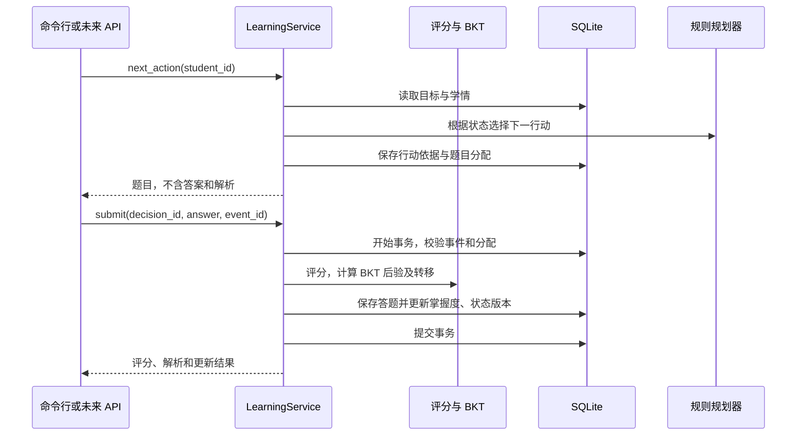

# 第一阶段运行与设计说明

状态：2026-10-19，离线规则核心已实现，题库人工审阅待完成。本文件说明第一阶段核心；后续已增加 HTTP、模型与 RAG，见 [API 说明](API_GUIDE.md) 和 [Agent 说明](AGENT_GUIDE.md)。前端仍未实现。

2026-10-20 补充：Vue 基础页面已实现，运行与人工验收见 [Web 说明](WEB_GUIDE.md)；原离线核心测试仍为 65 项。

## 运行与依赖

已在 Windows / Python 3.12.8 / pytest 7.4.4 实际运行。业务依赖为标准库，`sqlite3` 随 Python 提供。包声明 Python >=3.11，目前只验证了 3.12.8。

从根目录运行，无需先安装本项目：

```powershell
Set-Location D:\ZZUAgent
$env:PYTHONPATH = 'D:\ZZUAgent\backend\src'
$env:PYTHONIOENCODING = 'utf-8'
python -m eduagent --student learner-01 --goal logistic_regression
```

按 A/B/C/D 答题，大小写与首尾空格会归一化；非法选项不会计入记录。输入 `q` 或结束输入可退出，已提交记录保留，下次使用相同数据库和学生标识即可继续。

```powershell
# 自动使用标准答案生成合成演示记录
python -m eduagent --demo --student synthetic-01 --db data/local/synthetic.sqlite3

# 恢复已有学习目标，或仅查询状态
python -m eduagent --student learner-01
python -m eduagent --student learner-01 --status

# 仅测试离线核心（65 项），无需安装 HTTP 依赖
python -m pytest backend/tests/test_bkt.py backend/tests/test_catalog.py backend/tests/test_learning.py backend/tests/test_cli.py -c backend/pyproject.toml -q
```

`--goal` 可重复指定，首次省略表示全部五个知识点。目标会自动包含先修知识点，并保存到学生记录。不同目标使用新学生标识，防止静默覆盖已有计划。`--data-dir` 可指定另一份数据目录；默认相对当前目录的 `data/`。

`--max-rounds` 默认为每名演示学生累计 20 次有效作答，重启不清零。退出、查询和重复事件不增加轮数。修改该配置需新数据库。

如需隔离环境与安装入口，可使用下列方式；第二阶段已实际验证该安装路径：

```powershell
python -m venv .venv
.\.venv\Scripts\python -m pip install -e './backend[api,dev,agent]'
.\.venv\Scripts\python -m eduagent --student learner-02
.\.venv\Scripts\python -m pytest backend/tests -c backend/pyproject.toml -q
```

开发依赖现固定 `pytest==7.4.4` 与 HTTP 测试客户端 `httpx2==2.14.0`，构建工具固定 `setuptools==75.1.0`；首次安装可能需要联网。运行离线核心无需模型密钥或外部服务。

## 模块分工与 Agent 机制

| 文件 | 职责 |
| --- | --- |
| [bkt.py](../backend/src/eduagent/domain/bkt.py) | 纯函数 BKT，分开返回先验、后验、学习转移后状态 |
| [catalog.py](../backend/src/eduagent/domain/catalog.py) | 数据契约校验、先修拓扑排序、确定性选题、客观题评分、脱敏题目视图 |
| [models.py](../backend/src/eduagent/domain/models.py) | 掌握状态、决策与提交反馈的数据结构 |
| [policy.py](../backend/src/eduagent/agent/policy.py) | 根据学习事实选择诊断、复习、练习、推进、结束或停止 |
| [learning.py](../backend/src/eduagent/services/learning.py) | 组合工具、校验题目分配和事件 ID、控制事务 |
| [sqlite.py](../backend/src/eduagent/storage/sqlite.py) | SQLite 仓储、保存与恢复 |
| [cli.py](../backend/src/eduagent/cli.py) | 命令行交互和明确标注的合成演示 |

第一阶段的规则决策器实现后续 Agent 所需的规划接口：输入目标和持久化学情，输出行动、知识点、简明依据和一份题目。将来接入 LangGraph 与工具调用模型时，评分、BKT 和事务逻辑继续由流程服务执行。

决策器按照先修拓扑顺序处理未满足条件的知识点。无答题证据时诊断；近期答错时给本地复习提示并分配后续题；答对但未达阈值时继续练习；先修满足后推进；所有目标及先修满足条件后结束。当前版本还要求最近一次作答正确，才允许将高于阈值的状态用于推进。



题目、状态与决策均可追溯。这里没有模型自主规划能力；规则模式只验证该闭环的工程基础。

## 数据契约与一致性

- 知识点：`id`、`name`、`prerequisites`、`review_tip`；先修引用必须存在且无环。
- 题目：`id`、`version`、`knowledge_id`、`difficulty`、`stem`、`options`、`answer`、`explanation`、`source`、`review_status`。题型为单主要知识点的四选一；难度为 `easy/medium/hard`。
- `pending` 表示待人工校验；标为 `human_verified` 需同时提供 `reviewer` 与 `reviewed_at`。字段存在只支持追溯，不能代替实际审阅。
- 选题按 JSON 中固定顺序，不重复使用该学生已答过的题目。难度过滤由 `Catalog.select()` 提供；规则规划器当前不动态调节难度。
- 同一学生、同一状态版本读取下一行动会复用同一分配。提交必须引用该学生尚未消费的分配，不能直接提交任意题目 ID。
- 相同事件 ID 与相同内容返回原始结果并标记 `replayed=True`；内容冲突或换事件重交旧题目分配会被拒绝。
- 答题事实插入、掌握度更新和状态版本递增位于同一 `BEGIN IMMEDIATE` 事务；任一步失败整体回滚。
- 数据库绑定知识点/题库内容指纹、BKT 参数与策略配置。更改配置或题目内容后请换新 `--db`；P1 尚不实现历史迁移。
- SQLite 存储学生、答题、掌握度、决策和配置元数据。答题反馈保留题目/题库版本、BKT 参数及版本、三种概率和 UTC 时间。

先验为 0.20，学习转移 0.10，失误 0.10，猜测 0.25，阈值 0.80。均为演示假设，没有真实样本校准。只有合法新答题触发更新；浏览复习提示不增加掌握度。

## 人工审阅清单

当前十题均为 `pending`。以下答案只是当前题库草稿，需负责人核对题干、唯一正确性、计算和解析后逐项确认。

| 题目 | 草稿答案 | 主要核对点 |
| --- | --- | --- |
| lr_01 | B | MSE=(1+4)/2=2.5，题干已明确无 1/2 系数 |
| lr_02 | A | 平方损失导数为 -4，题干明确无偏置及损失定义 |
| gd_01 | C | 更新后 w=2-0.1×3=1.7 |
| gd_02 | D | 二次函数递推要求 0<η<2，题干排除 w0=0 |
| log_01 | C | sigmoid(0)=0.5 |
| log_02 | D | 正类标签下 -ln(p) 随 p 增大而减小 |
| reg_01 | A | 合理划分同分布数据下的过拟合情景 |
| reg_02 | B | (λ/2)w² 的导数为 λw |
| eval_01 | D | 独立测试集用于最终评估 |
| eval_02 | C | 精确率 8/(8+2)=0.8，区别召回率 |

同时审阅 [知识点配置](../data/knowledge_points.json) 中的先修关系，尤其“模型评估先于过拟合与正则化”的教学安排。该图用于约束演示顺序，不表示唯一合理依赖。

## 已验证与当前限制

实际自动测试结果为 **65 passed in 1.01s**，详见 [开发记录](DEVELOPMENT_PLAN.md#7-验证与进度记录)。覆盖数值基准、异常输入、数据校验、选题评分、先修决策、幂等、事务回滚、恢复与 CLI。

命令行已实际跑通逻辑回归目标的六次合成作答，随后结束。测试也覆盖五知识点、十次合成作答完整流程。这些验证未使用真实学生数据。

每知识点只有两题，答错后可能在达到阈值前耗尽题目，系统会以 `insufficient_questions` 停止并提示补题；不会自动生成题目。`round_limit` 表示达到累计作答上限。正式效果验证前需扩充题库、完成审阅，并确认 BKT 假设的局限。

本版本只用于本地演示，无账号认证或生产多用户服务；学生标识用于区分演示记录。后续阶段已验证隔离环境安装、HTTP 与真实模型工具调用；其他 Python 版本、非编辑分发包及真实学习效果尚未验证。
