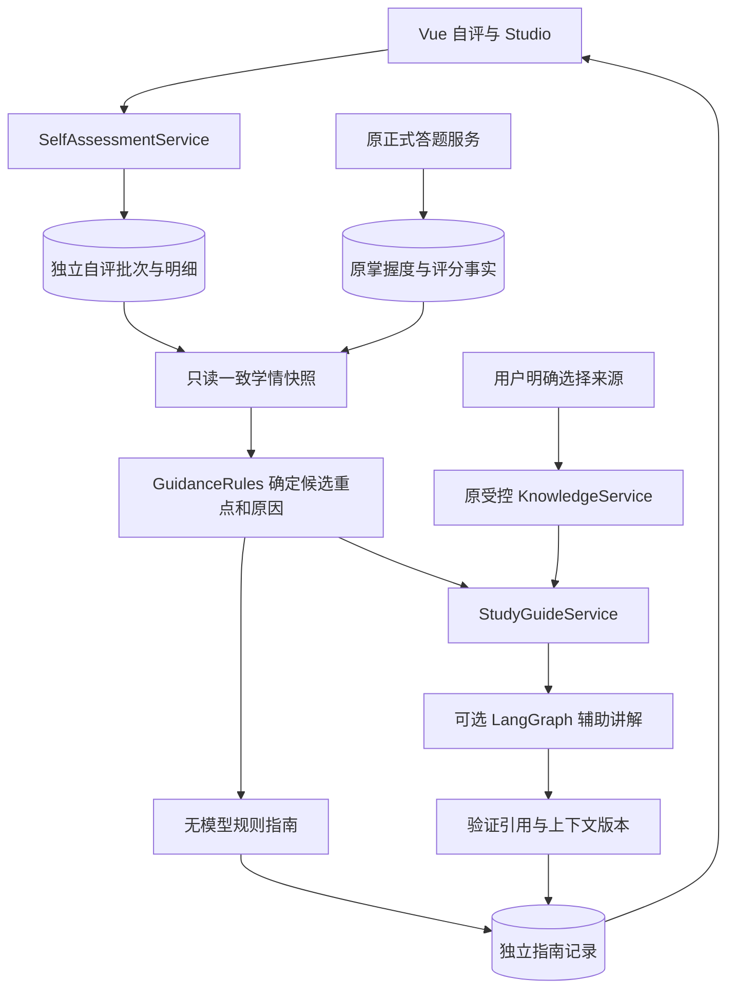

# Phase 4A 自评与个性化学习指南设计

后续状态（2026-10-21）：用户已明确批准并完成Phase4A工程，实际实现/接口/迁移与验收见[PHASE4A_GUIDE.md](PHASE4A_GUIDE.md)。下文保留初轮设计提案及当时“待确认”记录，不代表当前尚未实现。当前schema6、355/101项及18组隔离HTTP已通过；真实模型0调用，人工验收仍待完成。

日期：2026-10-21（Asia/Shanghai）。状态：**仅设计，等待用户确认实施**。本轮只读审查代码与现用数据库，新增/更新设计文档；没有编码、迁移、模型调用或功能测试。

## 1. 实际基线与设计边界

已核对 AGENTS、PROJECT_CONTEXT、DEVELOPMENT_PLAN、README、WORKBENCH_GUIDE，以及现有 BKT/RulePolicy、LearningService、SQLite 仓储/迁移、KnowledgeService、WorkbenchService/Agent、API schema、Vue 工作台与状态管理。

2026-10-21 用 SQLite `mode=ro` 和 `query_only=ON` 实查现库：**schema5、12 张表**。没有通过会自动迁移的 SQLiteRepository 打开现库。旧设计 V0_5_0_DESIGN 中“自评使用 schema5”的编号已经过时：5 已被 Phase3B 使用，本方案拟采用 **schema5→6**。

当前可复用部分与需要补充的内容：

| 实际实现 | 本阶段使用方式 |
| --- | --- |
| BKT 四参数与 Mastery.attempts/last_correct；RulePolicy.threshold=0.80 | 只读客观证据；attempts=0 的0.20是先验，不能标为实际薄弱 |
| students.revision | 只表示原学习事实版本；自评另设版本，不能复用或递增此字段 |
| metadata 配置绑定题库/BKT/RulePolicy | 保留原配置与事实；指南规则另行版本化，不混入原评分配置 |
| attempts/result_json 与 decisions.revision | 读取真实作答摘要和事件依据，不把自评生成伪答题 |
| KnowledgeService.search + SourceRef/KnowledgeCitation | 复用所有权、来源集合、版本、索引状态、前后校验与引用快照 |
| WorkbenchAgent 的 LangGraph/预算/引用检查 | 复用执行边界，补充服务端指南任务和学情摘要输入；原问答默认路径保持兼容 |
| workbench_runs / tutor_runs | 不写入新的自评或指南格式；指南另存独立表 |
| Sources、SourceDrawer、MarkdownRenderer、Studio | 复用选择与显示组件，Studio增量接入自评/建议/指南 |
| useWorkspace.boot/refresh、LearningService.next_action | 当前会调用/执行创建练习分配；自评保存、建议查询和指南生成不能复用这些有分配副作用的刷新路径 |

318项后端、87项前端及14组真实HTTP是 **Phase3B历史验证**，不是本轮重跑结果。40题候选包仍待审，原10题、55条检索评估与5/15课程外误检继续保留。

本方案只设计五知识点自评、规则建议与学习指南。不加入总结/卡片、教材解析、图片识题、新题库评分、自动改先修或认证平台。

## 2. 架构与数据职责



三类数据分离：客观评分/BKT是学习事实；自评是主观报告；指南是带版本依据的建议产物。自评、信心、上传资料和生成指南都不调用 update_bkt、submit、record_attempt、next_action 或 save_decision。

新增规则服务是**建议层**，不替换 RulePolicy 或正式选题策略。无需新增依赖、后台队列或外部服务。

## 3. 自评与差异规则

### 3.1 量表

| level | UI 标签 |
| --- | --- |
| 1 | 不了解 |
| 2 | 理解概念 |
| 3 | 能够完成基础习题 |
| 4 | 能够独立应用 |

信心提问建议明确为“你目前对完成该知识点相关学习任务有多大信心？”，取1～5，低到高。建议允许不填写信心：未填为 null，不能默认为3；填写时必须为1～5。未自评知识点为 assessment=null，不能填成0级或“不了解”。

四级是自述能力，BKT是针对现有客观题的模型概率，两者不具有直接数值等价关系。**不把等级换成25%/50%/75%/100%，不求加权总分，不把信心当正确率。** 当前题库也不足以验证“独立应用”这一能力层次。

### 3.2 第一版规则（建议采用 guidance-rules-v1）

| 学情条件 | 建议与解释 |
| --- | --- |
| 没有客观作答 | 标“待诊断”，展示自评；建议通过原正式练习取得证据，不能按BKT先验判断薄弱 |
| 最近一次答错 | 展示最近错误与事件时间，建议复习相应资料，再按原练习流程核验 |
| 有作答但未满足现有演示推进条件 | 提示继续复习/练习，列出p、题数、last_correct、阈值；不把概率当真实能力测量 |
| level≥3，但p低于现有阈值或最近答错 | 标“自述能力与当前答题证据需进一步核对”，建议补充诊断；不直接标“高估自己” |
| level≤2，但有作答、p≥现有阈值且最近答对 | 提示两类证据可能不一致，回顾已有正确作答，再诊断/更新自评；不直接标“低估自己” |
| 证据达到演示条件，但confidence≤2 | 保留BKT，建议回顾成功作答、解释解题步骤、逐步验证；不降低掌握度 |
| 自评早于最近一次作答 | 标明时间先后，提示更新自评；不把不同时间的报告说成同时发生的矛盾 |
| 题目耗尽或达到原累计轮数上限 | 明确当前正式诊断受限，提供资料/作答历史入口并保留诊断待办，不生成或启用新题 |

始终显示样本数、时间和证据限制。confidence≥4可加强“信心较高但仍需证据”的解释，不能覆盖客观规则或单独触发跳过先修。以上都是可审查的产品规则，不宣称为经标定的心理量表、置信区间或教学效果结论。

### 3.3 候选学习重点

全部五个知识点可并排比较；指南默认重点只从既有目标及其先修展开集合中选择，最多3项，其余作为概况显示。

先标出未满足的先修，后继显示 blocked_by，不推荐跳过。可用候选中按“最近错误→无客观证据→尚未达到条件→自评差异/信心支持”排序，同类按原拓扑顺序和知识点ID稳定排序。只读查询可用新题数量/累计上限，不能预先保留题目。

每项建议返回 reason_codes 与结构化 evidence：知识点、自评记录ID/等级/信心/时间、p、attempts、last_correct、最近至多3条相关作答事件/时间/结果、先修依据、参数和规则版本。最近作答按现有 decisions.revision 排序，不只从前端最近50条记录推断全部知识点状态。

默认建议并不改变正式练习目标。按钮“进入正式练习”继续由原服务决定下一题，不能新造 `/next?knowledge_id=...` 或承诺直接跳到指南推荐点。

## 4. 数据库方案：schema6，拟新增三表

采用两张自评表加一张指南表。自评批次表用于一次保存1～5个知识点、幂等和共同版本；明细表用于逐知识点历史。比把整份自评塞进JSON更便于约束、查询与并发测试，不新增可变“当前值”表。

### self_assessment_batches

| 字段 | 含义/约束 |
| --- | --- |
| request_id | 客户端标准UUID，主键；请求幂等编号 |
| student_id | students(id)外键 |
| course_id | 固定machine_learning |
| assessment_revision | 当前学生/课程的自评批次版本，正整数 |
| expected_revision | 提交时读取到的自评版本，非负整数 |
| request_hash / payload_json | 标准化有效载荷和hash，用于冲突检查/原请求重放 |
| learning_revision_at_save | 保存时原学习revision，只记录，不递增 |
| created_at | 服务端UTC时间 |

唯一约束 `(student_id,course_id,assessment_revision)`；额外唯一 `(request_id,student_id,course_id)` 供明细的复合外键引用。scope revision通过已提交批次MAX取得，无记录为0。

### self_assessment_entries

| 字段 | 含义/约束 |
| --- | --- |
| id | 服务端UUID主键，引用自评依据 |
| batch_id / student_id / course_id | 复合外键绑定同一批次和作用域 |
| knowledge_id | 现有五知识点之一，由Catalog验证 |
| level | INTEGER，CHECK 1～4 |
| confidence | INTEGER或null，CHECK null或1～5 |

唯一 `(batch_id,knowledge_id)`；按 `(student_id,course_id,knowledge_id,batch_id)` 建索引，结合父批次revision稳定读取最新与历史。时间/版本由父批次提供，API详情展开返回。现有知识点来自JSON Catalog，没有知识点SQL表，不虚构外键。

“修改自评”追加新批次/明细，保留旧报告。只提交变动行，未提交知识点保留原最新值。没有针对旧明细的覆盖式PATCH或删除接口。相同request_id/hash返回原回执，同ID不同内容409、非当前学生统一404。

保存事务先查询原请求，再检查 expected_revision；在BEGIN IMMEDIATE内分配新revision并原子插入批次和全部明细。任何一行无效整批拒绝。不同标签页即使改不同点，也采用同一自评revision保守冲突；UI保留本机草稿，要求读新版本后人工确认，不静默合并。新的request_id代表一次新的报告；重试必须保留原编号，不能为同次点击反复生成新编号。

### study_guide_runs

| 字段组 | 含义 |
| --- | --- |
| request_id PK、student_id FK、course_id | 独立指南请求与作用域 |
| request_hash/request_json | 同请求只生成一次 |
| learning_revision、assessment_revision | 客观与主观两个版本 |
| context_json/snapshot_hash | 冻结的目标、原配置版本、指南规则版本、来源版本及逐轮同意 |
| snapshot_json/recommendations_json | 保存时的真实学情摘要与确定性建议 |
| result_json | 模型辅助讲解/规则文本、实际引用快照、工具记录、用量与明确原因 |
| status、model_calls | 沿用running/complete/local/uncertain/stale/failed语义，计数为尝试数 |
| created_at/updated_at | 服务端时间 |

按学生/课程/时间/请求ID索引。自评与指南不写入 mastery、attempts、decisions、tutor_runs 或 workbench_runs。指南上下文保存自评entry ID和快照；指南不是每次打开页面自动重算的模型产物。

### 迁移与回滚（仅方案，尚未执行）

1. 实施前再确认实际schema5与12表；核实并停止本项目写入服务，保留代码/编译前端归档。
2. 沿用现有SQLite backup机制，生成独立schema5备份；验证 user_version、integrity_check、foreign_key_check、全部12表数量/旧列摘要。
3. EXCLUSIVE事务内再核对备份对应版本和摘要，只新增上述三表/索引，复核原12表不变、外键无错误后设置user_version=6；失败整笔回滚。
4. 支持新库及已有1～5版本升级路径，更新preserved_snapshot的已知表清单及完整性检查；旧schema5程序必须拒绝schema6。
5. 独立副本验证旧代码读schema5备份、拒绝schema6；通过后才按批准实施顺序部署。不能用本轮只读审查代替迁移验证。
6. 需要回退时先停写、另存当前schema6数据库，保留升级后的自评/指南；在独立目录配套恢复旧代码/前端与schema5备份副本。不要删表改版本或覆盖现库。迁移前备份不含之后新数据，不能宣称自动无损回退。

## 5. API契约提案

统一前缀 `S=/api/v1/students/{student_id}`；course_id固定machine_learning。旧API不变，新接口严格校验类型/字段、复用请求体上限和本机学生作用域。下表均**尚未实现**。

| 方法与路径 | 行为 |
| --- | --- |
| GET S/self-assessments/latest | 返回assessment_revision及五项最新自评/null |
| POST S/self-assessments | 保存1～5项的原子自评批次；首次201、原请求重放200 |
| GET S/self-assessments | knowledge_id可选、limit1～50、offset≥0；稳定分页历史 |
| GET S/self-assessments/requests/{request_id} | 读原保存回执，支持断网恢复；不追加记录 |
| GET S/learning-guidance | 同一事务读取客观/主观状态，返回规则建议及两个版本；不调用模型/分配题目 |
| POST S/study-guides | 显式生成并保存指南，支持rules/model及原来源约束 |
| GET S/study-guides | 最近已保存指南，limit1～50；不调用模型 |
| GET S/study-guides/{request_id} | 原请求状态/快照/引用及当前过期标记；不重生成 |

### 自评保存

```json
{
  "request_id": "7f14c437-62b2-41ef-95b8-c42ee09f4218",
  "course_id": "machine_learning",
  "expected_revision": 0,
  "items": [{"knowledge_id": "gradient_descent", "level": 2, "confidence": 3}]
}
```

回执返回 request_id、committed_revision、current_revision、learning_revision_at_save、服务端时间、entry IDs和值、replayed。重放晚于其他保存时，仍返回原提交内容与committed_revision，同时报告当前自评revision，避免把旧回执显示成最新。

### 规则概况

返回 learning_revision、assessment_revision、snapshot_hash、rule_version、goals、五知识点的 objective/self_report/signals、候选重点/reason_codes/evidence、受控action targets与练习可用性。不存在客观证据时 objective.has_evidence=false；来源事实、规则推导和未来模型讲解分开标注。

### 指南生成

```json
{
  "request_id": "cb0c1b7e-f267-4767-93a3-c84bb84929cb",
  "course_id": "machine_learning",
  "expected_learning_revision": 0,
  "expected_assessment_revision": 1,
  "mode": "rules",
  "sources": [],
  "allow_personal_external": false
}
```

重要语义：`rules + sources=[]` 是**完全不检索资料，仅根据保存学情生成指南**，绝不是查询全库。带非空sources时复用原SourceRef和索引校验；`model`模式必须非空来源，否则422。旧knowledge/search及workbench/questions的空来源拒绝规则不改。

model但未配置/依据不足时保存明确标注的规则结果；包含个人笔记且未获本轮同意则整轮不调用模型，可作本地受控检索。无模型时依然有规则建议，不编造资料引用。所选来源非法/过期/删除/未就绪，继续使用既有404/409/503错误，不能隐式换成全库；规则概况GET独立可用，用户可明确选择rules+空来源重新提交。

生成前两个学情版本不符返回409 `learning_context_changed`；生成中变化保存为stale，历史展示当时快照与变化原因，不能标为当前建议。后续GET同样比较两个revision、配置/规则版本和来源状态。老指南只读，不自动重新付费生成。

错误：非法字段/范围/重复知识点422；并发版本/编号内容冲突409；其他学生或不存在记录404；索引状态503；体积超限413。幂等查找先于最新版本校验，使完成后的原请求能安全重放。

## 6. Agent工作流与恢复

1. 校验学生/课程、请求编号和来源格式；先读已保存请求，存在则直接返回。
2. 同一数据库事务读取目标、客观状态、相关作答、自评与两个revision；校验前端expected值，计算并冻结规则建议、版本与snapshot_hash。
3. 仅在非空来源集合内，以至多3个候选重点的课程术语作本地检索；去重并确定性选至多5个片段。课程/个人库与版本限制继续由KnowledgeService强制执行，没有选择的来源不查询。
4. 持久化指南请求声明及规则快照后才可外发；没有模型/证据/个人外发授权时直接保留规则指南及可用本地依据。
5. 可选模型只接收本轮最小学情摘要和所选相关片段。明确告知将发送目标、自评/信心、BKT与答题摘要至已配置服务；不发送学生标识、原始完整答题记录、未选笔记或旧聊天。笔记外发另需**本轮**勾选，不复用Chat授权。
6. 新的冻结GuideRequestContext保留3B全部约束，并增加assessment_revision、snapshot_hash和guide_rule_version。每次模型/检索前与发布前再次校验；不能因只有students.revision未变而忽略自评更新。
7. 复用LangGraph受控执行器，给指南任务注入只读规则快照，不能只修改question字符串：现有WorkbenchAgent的初始消息只有question/evidence，学习状态工具又是可选调用，直接沿用会遗漏自评。拟做最小内部扩展或薄适配，将guide_context显式送入指南任务；旧QA默认路径/响应/存储保持不变。
8. 保留get_learning_state与retrieve_selected_sources两个只读工具及原调用上限；改写仍受原来源/原候选引用集合限制。不新增写自评、改BKT、改先修、评分、SQL、文件访问或分配练习工具。
9. 模型只补充解释文本和已检索citation_ids。候选知识点、优先级、事实数值、原因代码、action targets由程序生成并单独显示，不从模型文字反解析操作。模型不能以JSON字段重写这些值；引用校验不通过就丢弃模型补充，保留规则结果。
10. 保存实际引用快照、模型/规则标识、时间、工具轨迹和用量。内容解释可能有误，UI标为“模型辅助讲解”，不能宣称已证明句子级事实正确性。模型生成的任意链接不转为正式练习/资料按钮，按钮只消费服务器白名单targets。

默认最多3次模型调用、每次最多4个工具、合计8个工具，与3B设置一致，不自动提高token或预算。若多个重点没有对应资料，逐项说明仅有规则依据；没有证据不编引用、不外扩来源。

同ID同payload返回已有指南；同ID不同payload冲突。running请求重启或并发重复时保守显示uncertain，不接管付费生成；超时/无法确认执行时不自动重发。规则快照仍可读。浏览器发送前持久化原编号，刷新优先GET结果。开始新的独立模型请求必须由用户显式操作。

指南引用复用KnowledgeCitation与SourceDrawer，区分课程/个人来源、版本、位置及raw_md快照；修改/软删除后历史保留当时片段且标注，不能重新作为当前检索来源。自评历史和指南快照同样保留在本机；第一版没有物理清除承诺。

## 7. 前端变更

保持三栏与已有蓝白风格，不新增顶层复杂页面。Studio内逐步增加：

- “我的自评”：五行等级选择和信心输入，未填明确留空；保存/失败/版本冲突反馈、修改追加、历史展开；窄屏改卡片。建议用独立SelfAssessmentPanel，不把编辑写入通用MasteryPanel。
- “学情对照”：每点分别显示我的等级/信心/自评时间，与BKT估计/答题次数/最近结果；无客观证据显示待诊断，不能给先验概率画成真实测量。
- “下一步建议”：目标、至多3个重点、可解释原因/先修/证据限制，以及由服务器targets控制的现有练习/资料/历史入口。正式练习继续受原分配规则约束。
- “学习指南”：默认规则模式，显示基于哪两个学情版本、所选来源及模型服务。模型模式提示将外发的学情摘要，个人笔记另有本轮同意；未保存自评时提示先保存，避免误以为指南使用了草稿。
- “指南历史”：刷新只读，区分规则/模型辅助/待确认/已过期；复用MarkdownRenderer和引用抽屉，不引入新的HTML入口。

useSelfAssessments、useStudyGuidance分别管理自评草稿/保存回执和指南请求回执；按学生/课程隔离，与noteStorage键及草稿机制分开。来源选择可共享，但指南外发同意必须独立，提交、切换学生、来源/模式/学情版本变化均清除。

自评保存后只更新GET接口或其回执；指南刷新只读GET，不使用当前会调用POST /next的useWorkspace.refresh。现有App启动/原学习按钮行为不因此重构。跳转正式练习仍经过原笔记未保存保护，不清空未确认答题事件。

## 8. 分步实施与文件范围（均待确认）

| 步骤 | 工作 | 验收门槛 |
| --- | --- | --- |
| 4A-1 | 独立测试库实现schema6和自评仓储/API | 原12表保留、批次原子、幂等、冲突、历史/重启/隔离通过 |
| 4A-2 | 纯规则比较与建议、统一只读快照 | 无模型运行；不同学情建议有确定差异；不写任何原学习表 |
| 4A-3 | 自评/对照/建议Studio组件 | 保存/刷新/草稿/并发反馈、键盘与窄屏交互测试通过 |
| 4A-4 | 受控指南生成、历史/引用、逐轮同意 | 模拟模型、空来源语义、越权、两种版本竞争、重复扣费保护通过 |
| 4A-5 | 全回归、隔离真实HTTP、备份/副本回滚、按批准迁移部署 | 新增功能与原闭环独立报告；主库不写合成评分；人工与真实模型另记 |

拟新增：

- `domain/self_assessment.py`、`domain/guidance.py`：量表、确定性规则与结构化理由。
- `storage/self_assessments.py`、`storage/study_guides.py`：数据库访问与幂等记录。
- `services/self_assessments.py`、`services/study_guides.py`：事务/快照/版本/生成编排。
- `api/self_assessments.py`/`self_assessment_schemas.py`、`api/study_guides.py`/`study_guide_schemas.py`：独立契约。
- `frontend/src/useSelfAssessments.js`、`useStudyGuidance.js`、`components/SelfAssessmentPanel.vue`、`LearningGuidancePanel.vue`、`StudyGuidePanel.vue`：增量UI。
- 对应后端/前端测试、隔离HTTP验证脚本、实施后的SELF_ASSESSMENT_GUIDE及验证报告。

拟小幅修改：`storage/migrations.py`、`api/app.py`/`body_limit.py`、`agent/workbench.py`的内部任务适配（必要时薄适配独立文件）、`StudyWorkbench.vue`、`App.vue`、`api.js`及局部样式；文档随实施更新。

不改BKT公式/参数、正式RulePolicy、评分入口、题库/先修配置、旧Tutor契约、个人分块/检索算法、原笔记草稿状态机。实现时允许常规职责拆分，但不能由此扩展业务范围。

## 9. 测试计划

下列均为拟验证项，**本轮没有执行**：

| 类别 | 验证重点 |
| --- | --- |
| 量表/输入 | 1～4等级、信心1～5/null；禁止bool冒充int、越界、未知知识点、重复点、多余字段、超大请求 |
| 持久化 | 单点/五点原子保存、修改留历史、未填不伪造、重启恢复、服务器时间与稳定分页 |
| 幂等/并发 | 原ID重试不新增批次；内容变化409；双标签版本冲突保留草稿；旧回执不覆盖当前状态 |
| 客观/主观分离 | 保存自评、获取规则、生成/恢复指南前后，metadata/students/mastery/decisions/attempts/tutor_runs/workbench_runs逐表摘要不变；流程不调用next_action |
| 差异规则 | 无答题先验、高自评+最近错、低自评+BKT条件达标、低信心、自评/作答时间不一致、先修未满足、题耗尽/轮数到达、目标外知识点；检查具体reason_codes和targets |
| 指南边界 | rules+空sources不执行检索；model+空sources拒绝；课程/个人/组合、未选来源、其他学生、未就绪/版本变化/删除、片段与原文位置匹配 |
| 模型安全与回退 | 模拟越权改身份/来源/BKT/评分/先修、自评写入、伪引用、跳过工具；无密钥/证据不足/无笔记同意时零模型传输；规则产物仍清晰可用 |
| 版本竞争/恢复 | 模型期间自评改变但BKT不变，或客观作答改变，或资料改变，均不可发布为当前指南；并发同编号、超时、进程重启不自动重付费 |
| 前端 | 编辑/保存/刷新、独立草稿、差异说明、请求状态、模型同意逐轮重置、迟到响应不串学生、历史不调用模型、引用焦点/键盘、小屏和长内容 |
| 回归 | 原评分/BKT、学习目标/先修/停机规则、课程55例、笔记CRUD/索引/软删除/草稿、3B来源问答/幂等/引用/另存全部保留 |
| 迁移 | schema5备份可读，原12表摘要相同，DDL/备份失败不迁移，旧5代码拒绝6，副本恢复可用 |

自动测试使用临时/独立数据库；真实HTTP使用隔离数据和服务，并区分模拟提供者与真实模型。真实DeepSeek冒烟需单独确认次数/预算，仅使用合成资料和逐轮同意。浏览器人工清单独立列出，不把jsdom或HTTP当浏览器验收。

验收能证明自评/规则/版本/工具/引用工程行为，不能证明学习提升或主观量表有效性；真人效果、独立标注评估、课程外误检与内容审阅继续保留。

## 10. 等待确认的方案选择

建议确认：schema6新增三表；修改自评采用追加批次且共享自评revision；信心允许未填；等级不换算概率；差异只触发核验；建议层不改变正式推进；指南默认规则、最多3重点、逐轮个人外发同意；指南独立历史及双学情版本检查。

确认本方案后才开始4A-1编码与独立库验证。生产迁移需在实施授权范围内按备份/回归门槛执行。本轮结束于设计，不能把本方案中的表、路由、组件或测试写成已实现。
