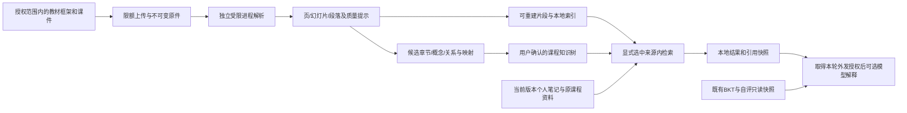

# Phase 4B：多源课程资料与结构化知识体系

设计日期：2026-10-21，状态更新2026-10-22（Asia/Shanghai）。**4B-1与获单独授权的4B-2已交付**，见[解析指南](PHASE4B1_GUIDE.md)与[知识体系指南](PHASE4B2_GUIDE.md)。现库schema8/27表，原21表保持；4B-3～5尚未实施。下文保留原设计基线，不能将其全部视为已实现。

本方案采用用户目标，取代此前以“教材目录导入”为中心的4B设想：教材知识框架提供组织骨架，教师课件与笔记提供可追溯内容。实施按4B-1～4B-5逐步交付。后续用户讨论OCR/DeepSeek/豆包后授权继续，4B-1选择本地原生解析加可选DeepSeek选页适配，不新增豆包服务或OCR部署；视觉默认关闭，真实费用与教师资料外发仍需另批。

## 1. 真实基线与复用边界

直接使用`sqlite3 mode=ro`、`query_only=ON`核对现库：schema6、15张表、完整性ok、外键错误0。没有构造会触发迁移的`SQLiteRepository`，没有查询/输出个人正文、密钥，没有调用HTTP或模型。审查快照见[phase4b-design-audit-v1.json](../data/evaluation/phase4b-design-audit-v1.json)。

428项后端、107项前端、32组隔离HTTP为**上一轮验证记录**，本轮没有重新运行功能测试，不能视为4B验收。现有检索55例、课程外5/15误检和40题待审继续保留。

| 实际模块 | 可以复用 | 必须增量处理的边界 |
| --- | --- | --- |
| `storage/migrations.py`、`storage/sqlite.py` | SQLite backup、原表摘要、排他事务、版本拒绝、同线程连接 | 当前只认识0～6；摘要表清单是固定列表，须纳入新表；应用连接构造会自动迁移，首次7升级需明确部署步骤 |
| `services/knowledge.py` | `_validate`前后核验、明确来源集合、笔记隔离、两路RRF | 仅课程/笔记两分支；知识筛选依赖正式Catalog；不能简单追加枚举就完成扩展 |
| `retrieval/index.py`、`lexical.py`、`personal.py` | 原课程TF-IDF/FAISS、共享分词/词组检查、稀疏TF-IDF思路 | 课程manifest与五知识点绑定；个人查询限制256片段/8192词项，不能照搬给整份课件或悄悄放大笔记限制 |
| `note_chunks.py`、`services/note_index.py`、`storage/personal.py` | 数学/代码块保护、原文位置、claim/publish token、失败/重启恢复模式 | 输入是笔记、单一Markdown原文，硬上限64KiB；PDF/PPTX须先有独立页/幻灯片结构，不能伪装成笔记 |
| `services/workbench.py`、`agent/workbench.py` | 不可变上下文、来源快照、调用预算、引用校验、幂等/未知执行状态 | `_source_status`目前将非笔记来源视为旧课程；`preview`只支持两类；外发控制只有`allow_personal_external` |
| `services/guidance.py`、`services/study_guides.py` | 一致的只读学情快照、确定性建议、历史过期标记 | 只对原正式知识点计算建议；新概念不能直接喂给正式规划、评分或自评接口 |
| Vue `StudyWorkbench.vue`、`useStudyWorkbench.js`、`SourceDrawer.vue` | 来源选择/恢复、聊天历史、响应式三栏、抽屉键盘/焦点 | 多处类型二选一、行号展示和两类来源恢复白名单需扩展；PPTX没有现成幻灯片渲染器 |
| `MarkdownRenderer.vue`、`rendering/markdown.js` | Markdown/LaTeX及净化 | 只能渲染提取文本，不能证明公式提取正确；不直接渲染OOXML或客户端HTML |
| `api/notes.py`、`api/body_limit.py` | 错误风格、请求幂等及限流思路 | 当前是JSON/base64笔记导入，统一256KiB上限且缓冲整个请求体；不适合20MiB文件上传 |

当前`.venv`未安装`pypdf`、`python-pptx`、`lxml`、`defusedxml`、`python-multipart`。本轮没有安装或更改依赖；实施时核对兼容性、安全公告、许可并固定直接与必要传递依赖。

## 2. 总体架构



保持FastAPI单体、SQLite、单一LangGraph Agent，不增加图数据库、Redis、Celery或Office服务。解析为本地任务，任务状态存SQLite，单个协调器调度一个受限子进程；子进程不持有SQLite连接和模型密钥。第一版仅本机单服务worker，明确拒绝多worker重复恢复任务的配置。

新增知识层和正式测评层分开。新节点可超过五个，表结构不枚举这五个ID；首版仍只启用`machine_learning`课程，不增加多课程平台入口。BKT、题库、自评仍使用原Catalog和原ID。

## 3. 4B-1：文件、解析与恢复

### 3.1 上传与文件分层

新增文档资源，默认属于当前演示学生和课程，**不是全课程公开共享**。`teaching_material`表示资料类别，不代表真实教师账号或身份认证。旧课程manifest只读保留，笔记仍使用现有notes接口。

登记：逻辑文档ID、课程、演示学生、标题、原文件名、格式、实际字节数、SHA-256、来源说明、材料角色、用户确认有权本地处理的声明、创建/更新时间。材料角色为`teaching_slides/textbook/framework/handout`，不将“教师课件”自动标为权威。

文件存于不公开挂载的`data/local/course_documents/`：`originals/<server_uuid>/<version_uuid>`保存原字节，`derived/<parse_run_uuid>/`保存规范提取结果和校验清单，`staging/<upload_uuid>/`用于未提交临时文件。客户端文件名只作显示，不能成为磁盘路径；不使用全局跨学生指纹查重或内容共享。

上传先流式写入临时文件并计算hash，验证后原子移入不可变版本路径，再在短事务中登记指针与任务。文件系统和SQLite不是一个原子事务：磁盘失败不发布指针，数据库失败留下隔离的未引用文件并记录恢复状态；不伪称双写完全原子。重启核验已登记原件hash、残留任务和可见指针；原件缺失/损坏时标失败，不能使用旧派生内容冒充当前资料。临时/孤立文件不进入检索，首版不自动物理清理已登记原件或历史版本。

初始限额为实验默认，写入服务端配置和测试：

| 项目 | 初始约束 |
| --- | --- |
| 格式 | `.pdf/.pptx/.md/.txt`；扩展名、声明MIME、文件签名/OOXML包结构共同校验；拒绝旧`.ppt`、`.pptm`、加密文件和伪扩展名 |
| 大小 | PDF/PPTX每文件20MiB；MD/TXT每文件2MiB，严格UTF-8，允许UTF-8 BOM，不默默猜GBK或替换错误字符 |
| 请求体 | 单文件、有限元数据字段；上传专用ASGI逐块计数，文件上限外最多256KiB协议/元数据开销；缺少或伪造Content-Length仍限制 |
| 文档 | 最多200页或200张幻灯片；提取文本最多100万字符/8MiB序列化结果；不得静默截断后标为完整 |
| PPTX包 | 最多4096条目；实际解压总量100MiB、单XML8MiB、压缩比100:1，元数据及实际读取双校验；拒绝重复/穿越/绝对路径/加密条目、宏和嵌入可执行对象 |
| 配额 | 每学生最多25份有效文档；所有保留版本原件合计250MiB；派生物另计上限100MiB。软删除不释放实际保留配额 |
| 解析资源 | 一次一个任务；墙钟60s、CPU30s、内存512MiB、输出8MiB；达到上限终止并给固定错误码，不能只给await套超时 |

不扩大现有笔记256KiB请求限制。二进制上传使用`multipart/form-data`和流式落盘；在表单解析之前限制总请求、文件/字段数量与字段长度，不能仅依赖`UploadFile`或请求头。新增可选解析依赖组与上传路由限额，不将文件做base64大JSON塞进笔记接口。

### 3.2 解析器与保真边界

| 格式 | 方案 | 可验证输出及限制 |
| --- | --- | --- |
| PDF | 首选`pypdf`逐页提取文本；不运行PDF JavaScript，不调用OCR或渲染服务 | 物理页码从1起、可选印刷页标签、提取文本和提示。阅读顺序、表格和公式可能失真；不声称提取结果等于视觉页面 |
| PPTX | `python-pptx`读取标题、文本框、分组内文字、表格；辅以受限OOXML读取 | 按presentation中的实际幻灯片顺序编号，保留内部slide标识、shape/段落ID、表格单元格坐标与合并范围；不按slide文件名猜顺序，不把z-order当阅读顺序 |
| Markdown | 复用受保护块识别思路，独立文档适配器 | 原文、标题路径、Unicode字符偏移和行号；不改现有笔记分块常量，不切断代码块/块公式；过大保护块明确报错 |
| TXT | 严格UTF-8解码，按段落和行号组织 | 原字节保留；规范化副本与原文映射明确，空白内容为empty，不标解析失败 |

PPTX普通文本中的数学符号原样保留；检测`m:oMath/m:oMathPara`时保存OMML原始XML字符串和位置，作为不执行的证据数据。可以可靠显示为文本的部分保留；无法保证等价转换为LaTeX时显示`equation_needs_review`，不把扁平化文字冒充完整公式，不引入XSLT自动转换。OMML原文只以转义文本查看，不能直接插入DOM。

图片、图表、SmartArt、OLE、扫描疑似页及其他未提取对象保留位置和类型提示；图像不做OCR/视觉理解，PPTX备注/隐藏页不默认进入检索（清单列出并说明）。OLE/宏包直接拒绝；普通外部超链接仅记录为不自动打开的文本，不取远程资源。对PDF低文本量/有图像页给`possible_scan_or_image_content`；不可可靠识别的公式错误无法保证全部检测，因此文档级始终显示“文本提取，图像与复杂公式未核验”，并要求实样对照。

解析单元保存`unit_kind(pdf_page/pptx_slide/markdown_section/text_block)`、页/幻灯片/行位置、标题、原提取文本、可展示Markdown、结构块、公式表示、未提取对象清单和warnings。公式或表格无法可靠转成Markdown时保留结构化表示/原提取文本及提示，不用模型补造原文。`partial`只表示部分文本可用，不能叫解析完整；无可靠文字仍保留单位与提示。

官方依据：pypdf说明文本提取需处理整个内容流，并不等同OCR，复杂版面/位置可能不可靠，见[文本提取](https://pypdf.readthedocs.io/en/stable/user/extract-text.html)。PPTX的[形状API](https://python-pptx.readthedocs.io/en/latest/api/shapes.html)和[表格模型](https://python-pptx.readthedocs.io/en/latest/user/table.html)支持文字/表格读取，但形状顺序是z-order；OMML的`m:oMath`表示见[Microsoft文档](https://learn.microsoft.com/en-us/dotnet/api/documentformat.openxml.math.officemath?view=openxml-3.0.1)。以上能力是选型依据，不是当前项目已完成解析的证明。

### 3.3 进程约束和状态

Windows主机采用独立子进程与Job Object限制内存/CPU、到时终止整个任务树；通过标准库`ctypes`调用，不引入常驻服务。先完成限制和进程关联，再放行解析，避免启动窗口内无限制运行；依据见[Windows Job Objects](https://learn.microsoft.com/en-us/windows/win32/procthread/job-objects)及[内存限制结构](https://learn.microsoft.com/en-us/windows/win32/api/winnt/ns-winnt-jobobject_extended_limit_information)。Linux如支持则用资源限制；不能建立所需硬限制时解析功能失败关闭，不能退化为无限制API线程。子进程只收到原件路径、输出目录和限额，使用最小环境，不继承模型密钥，不传shell命令；进程分离不是完整OS安全沙箱，不承诺抵御所有解析器漏洞。

ZIP只读取受限必要条目，不`extractall`；XML禁DTD/实体、外部解析和网络访问，`python-pptx`底层解析器也需核对配置/源码，不能只加固自己的OMML分支。实施核对运行时Expat/lxml/libxml2；恶意XML、压缩包和超时用隔离合成夹具验证。参考[Python ZIP](https://docs.python.org/3.12/library/zipfile.html)、[XML安全说明](https://docs.python.org/3.12/library/xml.html#xml-vulnerabilities)、[FastAPI文件上传](https://fastapi.tiangolo.com/tutorial/request-files/)。

解析状态：`pending → processing → ready/partial/empty/failed`；被版本竞争淘汰的任务为`superseded`。每次尝试有独立parse_run、token、parser_version、配置hash、租约/开始/完成时间和固定错误码。耗时提取在数据库事务外，发布前复核学生/课程、当前文件版本、hash、派生代次、删除状态和token；旧任务不得发布。

版本更新通过校验并登记新文件时，立即切换当前目标、使旧解析和索引不再可用于当前查询；新构建失败也不回退旧内容。失败前原件保留，显式重试产生新解析尝试。重启可恢复pending，失联processing转pending并限制一次自动恢复；已failed不反复自动重试。解析是本地任务，不套用模型“未知执行不得重发”的付费请求恢复策略。

同request_id同规范元数据+文件hash重放返回同资源/任务；不同内容409。相同作用域、不同request_id重复原件给`duplicate_document`及本作用域已有ID，不改原来源说明；不同学生不可借此探测文件存在。同一文件更新相同hash为无操作，其他更新/删除需expected_revision，删除回执阻止迟到的创建重放复活。

删除为软删除：当前目录、解析下载入口和检索立即不可见，索引失效。原件、历史版本、解析和既有引用仍可能留在本机/备份，不能描述为物理清除；永久清理不在首版。

## 4. 课程知识结构和确认

`Course`使用小型课程登记表，首版只登记现有课程。每位演示学生可有一个当前课程知识结构；章节、概念和审核是该本机作用域内的工作内容，不自动公开共享。

`Chapter/Section/KnowledgeConcept`在一张`knowledge_nodes`中用`node_kind`区分，避免为每种节点引入重复CRUD。共同字段包括稳定UUID、structure_id、名称、别名、说明、排序、revision、创建/更新时间、`pending/confirmed/rejected/archived`状态、提出方法及证据引用。概念ID与正式knowledge_id使用不同命名和校验入口。

教材骨架首版输入为人工编辑或经授权的Markdown标题框架/受限JSON；预览后生成候选章节、小节、概念，不能仅凭自动标题识别直接发布。教师课件标题、显式术语及笔记可以补充候选概念，保留提出来源。没有具体教材名称/版本/框架时不虚构官方章节。

| 关系 | 语义及约束 |
| --- | --- |
| `contains` | 知识导航的主包含关系；节点位于同一structure，单一主父、类型合法、无环；Course作为结构根，章节为顶层，小节/概念有明确父节点 |
| `related_to` | 对称相关，不表示先修；规范化端点去重、不允许自身关系；跨章节可指向同一概念，无须复制概念 |
| `suggested_prerequisite` | 有依据的候选先修，明确方向`先修概念→后续概念`；课件顺序本身不足以确认先修 |
| `verified_prerequisite` | 用户显式确认并记录确认者作用域、时间及证据的导航先修；无自环/有向环；不会写入原Catalog先修图 |

候选关系、节点独立审核；确认节点不等于确认全部映射/先修，也不等于教师权威审阅。确认先修采用一个事务归档对应suggested关系、生成verified关系和审核事件。已确认节点的语义修改回到pending，保留修改前快照及审核历史；排序/结构变动同样需要版本校验。

结构维护独立`structure_revision`，每个写入采用request_id+request_hash、expected_structure_revision及必要entity revision。审核批次原子完成，旧页面不能覆盖新结构；所有审核和修改追加`knowledge_review_events`，不能通过直接PATCH review_status伪造“已确认”。

正式导航只显示confirmed节点及合法已确认contains关系；待确认/被拒绝项在单独审核列表。候选先修只在明确标记的建议区，不当作已确认教学事实。

概念可手动关联`assessment_knowledge_id`（仅原五个之一，校验Catalog版本），用于展示“关联的既有知识点学情”，不表示概念已被独立测量。没有关联或答题证据时显示“未纳入正式测评/待诊断”，不复制邻近概念的BKT值。原自评仍仅五项，不自动新增。

## 5. 课件到概念映射

先以版本化规则生成候选：标题/别名匹配、英文完整词、中文术语匹配、明显章节上下文；保存rule_version、命中词、位置、证据片段和匹配类型，不把规则分数称为真实概率。不因短字符相交强行关联，也不为提升旧开发集分数添加专用过滤词。

每条`source_mapping`保存：作用域、course/structure、source_type/source_id/source_version、parse_run_id（文档）、unit_id、page/slide或行位置、content_chunk_id、chunk_hash、concept_id/concept_revision、mapping_method、rule_version、review_status、evidence_snapshot、提出/确认时间。多对多：一个片段可关联多个概念，多份课件可关联同一概念。

映射状态为`pending/confirmed/rejected`，当前有效性另外计算`current/stale/deleted/unavailable`，不要把曾经确认的历史记录悄悄改为另一版本。源或概念语义版本变更后旧映射不再是当前正式映射，重新提出并确认；已确认映射的证据不被重建覆盖。旧笔记、课程文件和新文档的关联通过各自来源适配器验证，个人笔记scope必须一致。

无可靠命中的内容进入“待分类资料”；在明确选中该文件且未加概念筛选时仍可检索可靠片段。概念筛选默认仅使用当前confirmed映射；审核模式可查看候选，但不能混作正式导航结果。模型语义关联只是后续可选建议能力，首版用规则，未授权不外发材料。

## 6. SQLite分阶段迁移提案

**本轮没有执行以下DDL或更改user_version。** 为避免4B-1先建一批空功能表，按交付点分迁移；以下7/8/9为顺序建议，若期间有其他迁移则重新分配，不能只改数字绕过校验。

| 阶段/建议schema | 新表与关键约束 |
| --- | --- |
| 4B-1：6→7 | `courses`：通用course_id/名称，先登记machine_learning；`course_documents`：id/owner_student_id/course_id/标题/材料角色/来源/权利声明/revision/当前文件及解析指针/deleted_at；`document_versions`：version_id/document_id/file_revision/安全存储key/文件名/类型/大小/hash/时间，UNIQUE(document_id,file_revision)；`document_parse_runs`：尝试/文件版本/派生代次/parser与配置hash/token/租约/状态/错误/产物hash；`document_units`：解析尝试/页或slide/段落/原提取文本/块及公式JSON/提示；`document_operations`：作用域/request_id/request_hash/操作/回执/时间 |
| 4B-2：7→8 | `course_structures`：课程/owner/revision，当前作用域唯一；`knowledge_nodes`：类型/别名/内容/状态/revision/可空既有测评ID；`knowledge_relations`：端点/类型/状态/revision；`knowledge_review_events`：request_id/hash/结构版本/确认者作用域/操作与实体前后快照，追加写 |
| 4B-3：8→9 | `document_index_state`：目标source_version、发布版本、indexer_version/token/状态/数量/hash；`document_chunks`：来源版本/解析/unit/ordinal/位置/片段与hash；`source_mappings`：上一节多对多、版本证据和审核字段；4B-4只接检索/Agent契约，不提前占用其他表 |

新表使用真实外键、scope复合唯一键与复合外键，防止子记录引用其他学生/课程的文档或结构。当前版本/解析指针在同事务中登记，必要时使用延迟外键；FK与业务检查共同保证指针确实属于该文档。跨旧manifest/notes/新文档的多态source引用无法直接用一个SQLite外键表达，必须由来源适配器在事务快照内校验，并有隔离/失效测试，不伪称已有数据库级FK。

既有15表、原CHECK(course_id='machine_learning')、学生revision、配置fingerprint及Catalog全部保持。课程登记表的扩展性不表示本阶段放开旧课程/评分接口。不把新知识树塞入metadata.configuration，否则原配置绑定会拒绝历史库。

迁移步骤：停止本项目写入→归档代码与前端→SQLite backup→核验备份user_version、全部既有表的列清单/行数/摘要、完整性和外键→排他事务内复查未被其他写入改变→逐条DDL→核对旧列内容完全一致、新外键及完整性→最后设置版本并提交。任何失败回滚；备份失败零DDL。首次部署7需显式执行迁移，不由普通GET意外触发；6代码拒绝7/8/9的测试在副本中完成。

原件与解析产物不只在SQLite中：每次后续升级还需冻结/校验全部被引用文件的hash清单，并保留一致的文件备份。回滚前额外备份升级后的库和文件，保留新增资料/审核/学习记录；在独立目录恢复旧代码、旧页面、匹配的旧库副本与文件清单，单独端口验证后切换。禁止覆盖现库、删表降级或让旧服务操作新库；回退副本不含升级后的新数据，首版无自动合并。

## 7. API与来源/引用契约

以下为**拟议接口**，当前服务没有这些文档/知识树路由。沿用`S=/api/v1/students/{student_id}`、严格请求字段及error封装。

| 阶段 | 路由组 | 主要契约 |
| --- | --- | --- |
| 4B-1 | `GET/POST S/documents` | 分页目录；单文件multipart上传，metadata为严格JSON表单字段，含request_id/course_id/title/来源/权利声明；新建202，幂等重放200，不等待耗时解析 |
| 4B-1 | `GET/PATCH/DELETE S/documents/{id}` | 元数据详情/修改、软删除；写入携带request_id和expected_revision；不存在/其他scope统一404 |
| 4B-1 | `POST S/documents/{id}/versions`；`GET .../versions` | CAS上传新版本；文件hash与metadata共同进入幂等摘要；旧版本不作为当前内容 |
| 4B-1 | `POST S/documents/{id}/parse`；`GET .../parse-runs/{run_id}` | 指定当前文件版本、expected_revision、request_id重试；202/200，GET只读，不暗中重跑任务 |
| 4B-1 | `GET S/documents/{id}/units`；`GET .../original?version_id=...` | 按明确版本/解析尝试分页；原件通过scope检查后attachment下载，nosniff/no-store，不暴露磁盘路径，不静态公开挂载 |
| 4B-2 | `S/courses/{course_id}/structure`、`.../structure/import`、`.../tree`、`.../nodes`、`.../relations`、`.../reviews` | 预览/候选导入、编辑、原子确认；树默认confirmed；request_id/hash/结构及实体revision；新结构是学习者本地工作空间 |
| 4B-3 | `.../mappings`、`.../mapping-suggestions`、`.../reviews` | 规则候选、分页证据、确认/拒绝；人工审核GET不触发模型，更新不能复用过期证据 |
| 4B-4 | 现有`S/knowledge/sources`、`S/knowledge/search`及工作台/指南 | 增量扩展第三类来源、概念筛选及位置；保留旧请求字段与原课程检索接口，不重写旧回执 |

固定错误如`unsupported_document_type/invalid_encoding/document_too_large/archive_limits_exceeded/parse_timeout/parse_memory_limit/parse_failed/revision_conflict/request_id_conflict/source_changed/index_unavailable`。不返回原始解析异常、全文、其他学生标题或本机绝对路径。

来源类型扩为`course_material/personal_note/teaching_material`；`material_role`区分教材、框架和课件。来源审阅状态新增`imported_unverified`，不因解析成功或确认映射而变为human_verified；映射审核、提取质量与内容权威性分别显示。保留`source_id/source_version`；新文档source_version含文件revision、单调派生代次及原件/parser/配置指纹（总长兼容现100字符限制），不能只用文件hash。重新解析/换chunker即改变派生代次，旧任务和旧引用不会因相同文件hash重新变成当前。

引用沿用`KnowledgeCitation`，增加可空`location`、`parse_run_id`、`parser_version`、`concept_ids`、`extraction_warnings`；旧行号/offset和raw_md继续可读。示意：

```json
{
  "source_type": "teaching_material",
  "source_id": "服务端文档UUID",
  "source_version": "目录返回的当前版本",
  "citation_id": "doc_服务端安全编号_g2:3",
  "chunk_id": "服务端片段hash",
  "location": {"kind": "pptx_slide", "slide_number": 7, "shape_ids": [4, 6]},
  "raw_md": "对应的提取文本片段快照",
  "extraction_warnings": ["equation_needs_review"]
}
```

示意省略现有必填hash、title等字段，不能直接作为实际请求。PDF使用`page_number/page_label`；MD/TXT使用原文行号及Unicode偏移。文档引用的raw_md明确是**提取结果的Markdown表示**，不是PDF二进制原文，也不是模型生成讲解；snapshot与已发布单位/片段核对hash，原件位置另外保存。citation_id仍由服务端生成并满足现有解析器规范，不由模型重构。

搜索可新增`concept_ids/structure_id/expected_structure_revision/source_types`筛选，旧`knowledge_id`仍是正式五知识点筛选，两者不可混为一个参数。文件筛选就是明确选择文档source_id；章节筛选只扩展确认树中的概念，不扩大source_ids。所有过滤取交集，空来源仍422，零匹配仍为零，不改为全库。

## 8. 多源RAG与Agent边界

文档分块不跨页/slide，公式/表格/代码块尽量原子，800字符/100重叠只是起点。记录unit、块位置、parser/chunker版本与原提取片段hash；超过保护块或片段预算明确失败/提示，不能静默漏掉后半本材料。`parse_status`和`index_status`分开：partial资料可对可靠文字建立ready索引并显示范围警示，无法可靠表示的公式/图像块保留证据但不作为已解释文本进入词项索引或模型上下文；不把整个partial文件误称为完全可检索。

教师文档建立独立稀疏TF-IDF分支，复用词项计算思路。原课程FAISS和个人分支保持配置及评估结果；三分支各取候选后RRF合并，不比较不同语料的原始余弦分数。个人256片段限制保持，新文档初始每文档最多1024片段、单次合计2048片段/32768词项，超限要求缩小来源，不静默截断。全部所选来源总数先保留55上限。单测确认既有排名未因新分支出现而改变，不承诺词项检索具有语义理解。

执行顺序：scope/类型/版本/删除/解析和索引状态核验→载入仅所选当前可靠片段→概念/文件/类型交集→计算→再次核验所有选择与结构版本。索引保存token/target/source_version，发布也再次校验；更新/删除立即使旧版本不可当前检索，失败保原件、重建不改人工映射证据。index ready与节点 confirmed相互独立。

扩展不可变RequestContext：原学生/课程/request_id/来源及学情版本，加结构ID/revision、概念过滤、外发授权的来源版本列表。工具只能接query，不能从模型传入学生、来源、SQL或修改权限。新增知识导航读取只读confirmed树及当前确认映射；相关资料可以展示为候选入口，但用户未选中时不得读取片段或进入模型上下文。再次检索、问题改写与指南同样取原来源集合交集。

**课件外发默认关闭。** 本轮授权仅本地解析/组织/检索，不发送任何教师课件给DeepSeek/VLM。后续如另行确认有权外发并启用通道，每轮必须展示服务、具体文件标题/版本和仅相关片段，提交`external_source_grants`（严格绑定本轮所选source_refs），不是上传时的永久同意。选择来源、打开资料、确认知识点均不等于外发授权。既有`allow_personal_external`只授权笔记，不得顺带授权课件；指南和Chat各轮独立。缺少任何所选受限来源的本轮授权时，按既有方式整轮仅本地，UI明确说明，不能后台偷偷发剩余受限片段。

历史问答仍保留生成时引用快照，后来修改/删除显示状态，不能重新作为当前来源。新增模型上下文只给本轮所取片段，不给全部课件、全部笔记或历史授权；模型补充沿用明确标签，不把教师表述当标准答案。保存回答为笔记继续幂等并保留来源版本/位置，不触发BKT。

新概念不参与正式重点排序。已有GuidanceService继续从原五项答题/自评快照产生规则建议，新资料只给已确定重点补充可选学习资源；不能因为用户确认了新的verified_prerequisite而改写正式策略。来源、结构或映射版本变化时新生成重新校验、历史标可能过期；无模型时整条本地流程可用。

## 9. Vue增量页面

在现有资料学习工作台增加“课程知识体系”子视图，保留Chat/Studio和原答题页面。4B-1先提供实际可用的上传/文件列表/状态/单位详情，不出现尚未实现的知识树审核按钮；4B-2/3再接树、候选及人工确认。

- 左：资料/知识树切换，按类型和课程筛选；“打开”与“参与检索”分开，新增课件默认不勾选；pending/failed禁用检索，partial显示警示和可提取范围。
- 中：知识树节点详情或文档单位详情；显示章节路径、相关文件页/slide、规则证据、未分类内容、确认/拒绝/编辑与冲突反馈。课程知识树先用嵌套列表和按钮，不宣称ARIA tree却不实现键盘规范。
- 右：复用现有Studio只读学情/自评。仅对明确关联原正式ID的概念显示关联学情，其他标未纳入正式测评。
- 窄屏：沿用标签切换来源/详情/Studio，长表格和公式内部滚动；编辑草稿与notes/self-assessment分开保存，保留现有笔记草稿行为。
- 引用抽屉：复用Escape/焦点恢复/Tab约束，新增PDF第N页、PPTX第N张、块提示和提取质量；显示匹配文本快照，提供受控原件下载。首版不承诺网页内渲染PPTX、Office外观或像素级定位，不能把下载按钮描述成幻灯片预览。
- 解析进度只显示已知状态、完成单位数/总数，不虚构百分比；轮询GET不重新解析/调用模型，离开页面停止轮询，刷新恢复服务端任务。

## 10. 拟修改文件与实施规模

路径均为计划，不表示已经存在或已完成：

| 阶段 | 新增主体 | 必要修改 |
| --- | --- | --- |
| 4B-1 | `documents/models.py`、`documents/parsers/{pdf,pptx,text}.py`、`documents/{preflight,worker,limits}.py`；`storage/documents.py`；`services/documents.py`；`api/{documents,document_schemas,upload_limit}.py`；Vue `DocumentManager.vue/DocumentUnits.vue/useCourseDocuments.js`；解析/存储/API/资源限制测试和隔离HTTP脚本 | migrations/snapshots、APISettings/config允许配置、app路由/lifespan、上传限额、pyproject可选依赖及锁定清单；App/工作台子视图/API适配器；不改正式学习代码 |
| 4B-2 | `domain/course_structure.py`、`storage/course_structure.py`、`services/course_structure.py`、结构API/schema、`CourseKnowledgeTree.vue/ConceptDetail.vue`及测试 | schema8、路由及子视图；原Catalog只读取做可空关联校验 |
| 4B-3 | `retrieval/document_chunks.py`、`services/{document_index,source_mapping}.py`、对应仓储/API、`MappingReview.vue`及测试 | schema9、审核事件、重启恢复 |
| 4B-4 | 文档来源适配器与检索分支、来源/外发约束测试 | knowledge/Workbench/Guide schema、历史状态、RequestContext、工具只读适配、来源标签/恢复白名单/引用抽屉；旧接口回归 |
| 4B-5 | 新来源独立评估集、验收/迁移/回退指南及实际HTTP报告 | 文档、部署与响应式细节；不启用40道待审题 |

| 阶段 | 单人有效开发时间估计（含本阶段测试/文档） | 可交付退出条件 |
| --- | --- | --- |
| 4B-1 | 22～32小时 | 四格式受限上传、不可变原件、单位/位置/提示、任务重试/重启、版本/删除、隔离HTTP及迁移副本验证 |
| 4B-2 | 12～18小时 | 可编辑候选骨架/节点/关系、用户确认、并发保护、正式导航不含未确认项 |
| 4B-3 | 10～16小时 | 可复现规则映射、多对多、证据/版本/人工审核、未分类、竞争失效 |
| 4B-4 | 14～22小时 | 三来源受控本地RAG、引用/历史/只读Agent、无密钥可用、教师材料零未授权外发 |
| 4B-5 | 10～16小时 | 综合回归/HTTP、前端构建、浏览器人工清单及真实执行结果、已知不足和回退记录 |

总计约68～104有效小时，是范围估算，不是日期承诺；不含教材框架编制、资料授权和人工教学审核。4B-1后根据真实课件复杂度重估。优先风险为中文PDF提取/公式保真、OOXML复杂对象、安全资源上限和文件/数据库一致性；降低风险的方式是保留原件/证据、明确partial/failed和缩小首版格式能力，不用模型猜补原文。

## 11. 验收计划（尚未执行）

| 领域 | 自动化与隔离HTTP验证 |
| --- | --- |
| 四格式解析 | 自建有明确期望文本的中文/英文PDF、PPTX标题/分组/多段落/合并表格、MD公式代码/TXT；逐页/slide编号与字串、块坐标一致；乱序slide文件名仍按presentation顺序 |
| 公式/图像 | OMML原串可恢复；扫描疑似页、公式图片、图表/SmartArt、混合文本图片均有提示；无可靠文字不被标ready完整；不承诺发现所有语义提取错误 |
| 上传安全 | 伪MIME/扩展名、加密/坏PDF、PPTM伪装、宏/OLE、ZIP穿越/重复名/压缩炸弹、XXE/实体、超页数、流式无Content-Length超限、文件名控制字符/路径、超时/超内存/过量输出 |
| 版本与恢复 | 同请求重放/异内容冲突、同scope查重/跨scope无泄露、并发更新、删除中解析、旧token竞争、发布前源变化、磁盘/DB双写失败、原件缺失/hash变化、任务中断/重启、失败人工重试 |
| 结构与映射 | 超过五个概念、不合法层级/环/重复相关边、候选先修确认、节点修改后复核、版本冲突、确认不外发；多对多映射、未分类、过期映射不充当前正式映射 |
| 多源检索 | 单类/组合、未选来源0命中、空集合不全库、concept/type/文件交集、跨学生隔离、更新删除不可见、索引竞态/失败原件仍在、三个来源引用明确、旧课程结果独立保留 |
| Agent/历史 | 模拟模型越权扩源/改身份/SQL/BKT/引用注入被拒；教师无外发授权零传输；笔记同意不能授权课件；历史GET/重放不调用模型；当前结构变更与生成竞争标过期 |
| 学习事实 | 上传、解析、确认、检索、生成和另存前后对比BKT、attempts、decisions、学生revision、自评及原历史；只读建议不得分配题目 |
| 迁移 | 6→7以及后续副本的备份hash/旧表摘要、备份失败、中途DDL失败回滚、FK、完整性、未知版本拒绝、旧6代码拒绝7副本、恢复副本可读；文件清单和原件hash一起核对 |
| 前端 | 文件状态/错误/冲突、刷新只GET、非就绪禁选、知识树待确认可区分、来源标签/位置/抽屉、草稿隔离、恶意Markdown和原始XML安全显示 |

浏览器人工清单单独记录1440/1024/390px：上传/更版/失败重试/删除、知识树修改确认、映射证据、来源选择、原文抽屉、键盘焦点/Escape、长公式/表格、刷新与既有笔记编辑/答题/指南。HTTP/组件测试不充作人工浏览器结果；受到工具限制的项目写未执行。

新增来源评估独立报告检索相关性、正确位置率、提取缺失及公式告警，不将解析成功率等同语义正确率，不用新增材料改变旧55例结果。第一批真实教材/课件需用户确认使用权并与原件人工对照；本轮未提供具体教材/课件，未作真实解析或教学效果结论。

## 12. 当前结论与下一步

架构可在原项目增量扩展，首个实施单元为4B-1，4B-2～5按验收逐步推进。本轮只设计，没有新增运行依赖、功能代码、现库DDL、模型请求或教师材料外发。

实施4B-1时先在隔离数据库/自建文件验证解析与迁移，验收后再执行有备份的非破坏部署。具体教材名称/版本、可用框架和有权处理的教师课件，在需要人工原件验收前补充；不阻塞合成夹具的工程开发。正式BKT/评分变更、破坏性操作、付费视觉调用或教师材料外发必须另行确认。
