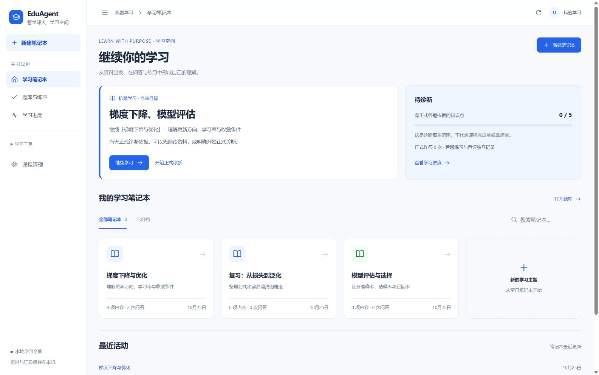

# 前端 UI / UX 全面优化交付报告

日期：2026-10-25（Asia/Shanghai）。[当前状态](CURRENT_STATUS.md) · [设计系统](FRONTEND_DESIGN_SYSTEM.md) · [固定版本开源参考](OPEN_SOURCE_UI_REFERENCES.md)。

## 交付结果与边界

已在原 Vue3 前端实际实现并构建新版学习首页、共享导航、统一浅色主题、Notebook 上下文、引用页码链接、练习题号与真实范围进度、知识状态展示及管理区收尾。本机现有 8000 服务可直接提供新构建，刷新即可使用。

本轮未修改后端源码/测试或数据库 schema，未变更 BKT、正式评分、原题准入、私人外发同意或原检索算法。现用 schema14、50 张表的摘要与本轮备份一致；原 151 个资料/题库/知识/评估文件指纹保持。依赖清单及锁文件未变。正式仍原五知识点、十道演示题；四十候选未自动启用。

## 审查基线与实施

实施前先读取 CURRENT_STATUS、PROJECT_CONTEXT、DEVELOPMENT_PLAN、README 及第一阶段指南。工作区包含上一轮未提交内容，因此以实际工作树备份增量修改，没有重置这些修改。

备份为 `data/local/ui-refactor-20261025-095938/`，含 SQLite 在线 backup、完整性/外键检查、50 表摘要、425 份源码/文档指纹和源码 ZIP；随后补入原 `.gitignore`。备份脚本在建立基线前创建，单独列于本轮脚本交付。

基线前端 225 项通过。发现：新笔记本界面与管理旧页各用一套颜色、小字普遍低对比度，手机隐藏学习辅助入口，首页缺少目标和诊断状态，单题缺少题号/范围计数，课程准备工具之间缺少统一的任务导航。

完成的改造：

- 语义颜色、字体、间距、圆角、阴影及焦点变量集中管理，覆盖全部主要业务样式。保留本机字体、原 Markdown/KaTeX 和 SVG 图标，没有远程视觉依赖。
- 三个一级学习入口保留。桌面侧栏可折叠，手机菜单包含资料助教、笔记、记录、正式诊断、原文和管理全部入口；管理新增课程概览与发布的明确分工。
- 首页展示已保存目标、真实正式答题覆盖、待诊断提示、继续笔记本和最近更新。诊断覆盖不是学习完成率，不展示无证据先验百分比。
- Notebook 显示主题与当前问答资料范围，上传仍标未核验；回答可以直接进入本 Notebook 普通练习。可选 `task=chat/practice/notes` hash 参数恢复任务，旧链接保持问答默认值。
- 单题保留 Markdown、公式、表格、代码及原题来源。新增题号、上一题/下一题和题号导航；范围进度按当前筛选的可练题 ID 与保存结果去重，草稿不算完成，已有会话读取不会自动新增练习。
- 知识状态并列展示正式依据、自评、原配置先修及当前程序建议。没有新增图算法或更改先修关系。
- 课程准备采用“原件 → 知识结构 → 习题校对 → 发布检查”导航。审核页收起低频提取记录、去掉重复页头，保留原文/结构化内容对照、审核勾选与保存；实际发布状态继续来自后端。
- 通用弹窗和模态引用抽屉统一处理焦点循环、背景 inert、滚动锁、Escape 和关闭恢复。宽屏引用保持区域语义，不锁住整个工作区。

## 典型任务前后比较

下表为合成数据下的助手操作路径，不是用户研究或耗时统计。点击数从列出的起点计算，不包括输入文字与滚动。

| 任务 | 改造前 | 改造后 | 实际改善 |
| --- | --- | --- | --- |
| 首页判断学什么、是否已诊断 | 首页只列笔记本；需另点学习进度 | 首页直接显示目标、0/5 诊断依据和下一步 | 判断所需页面跳转由 1 次减到 0 次；继续学习仍 1 次点击 |
| 从问答反馈开始同主题练习 | 回到顶部点“练习”任务，需滚动定位 | 回答末尾直接点“到本笔记本练习” | 都为 1 次点击；减少滚动查找，Notebook 范围保持 |
| 从第 5 题回第 2 题 | 回题库找题，或从最近练习列表找 | 点击题号 2；已有会话只读打开 | 明确题号，至少 2 次定位操作缩为 1 次；先保存未提交作答 |
| 手机打开我的笔记 | 辅助导航被 CSS 隐藏，主页没有可达按钮 | 菜单 → 学习工具 → 我的笔记 | 正常 3 次点击可达，无需手工输入 hash |
| PDF 引用回对应版本第 3 页 | 引用快照有页码，原文件链接未带页码 | 快照、原页图、原版本链接 `#page=3` | 保留实际定位；支持页码的阅读器减少一次手工选页，不宣称文字高亮 |
| 刷新 Notebook 练习/笔记任务 | 回到问答后需再次选任务 | URL 保留任务参数并恢复原普通会话/笔记关联 | 省一次任务选择，不自动提交或调用模型 |
| 管理区跨准备步骤 | 展开管理菜单后寻找工具 | 页面内准备流程直接切换 | 同一条任务导航串联工具；没有把导航步骤当作审核完成度 |

## 自动化与本机 HTTP

| 类别 | 实际结果 | 说明 |
| --- | --- | --- |
| 前端 | 234 / 234，20 个测试文件 | 基线 225；新增 9 项覆盖真实证据、稳定 ID、范围去重、切题草稿、PDF 页码、焦点、并发读取、任务恢复与笔记返回保护 |
| 生产构建 | 通过 | Vite 构建 160 个模块，保留按页加载；13 个 Page chunk 经现有 HTTP 服务逐一比对 |
| 后端 | 625 / 625 | 原业务完整回归，没有修改后端源码或测试 |
| 隔离真实 HTTP | 23 组通过 | 原验证脚本支持独立 `--output`，本轮结果另存，不覆盖历史证据；模拟 provider 2 次，真实模型 0 次 |
| 现用部署与数据 | 通过 | schema14 / 50 表、完整性/外键、全部表摘要、151 个旧文件及后端文件指纹、依赖清单保持 |

证据：[HTTP](../data/evaluation/ui-ux-http-v1.json)、[部署/逐文件清单](../data/evaluation/ui-ux-deployment-v1.json)、[浏览器布局测量](../data/evaluation/ui-ux/layout-checks.json)、[浏览器交互与弹窗](../data/evaluation/ui-ux-browser-v1.json)。测试数量不代表真实语义精度或教学效果。

## 助手浏览器验收

使用独立合成学习标识 `ui-demo`、合成 PDF、题目和笔记。资料与模型 provider 显式禁用外部执行，浏览器没有使用现用学习者作答或上传真实内容。旧界面从本轮源码 ZIP 独立构建，在合成库副本运行；两个解析 worker 使用不同目录。

| 视口 | 页面范围 | 实际结果 |
| --- | --- | --- |
| 1600×1000 宽屏 | 首页、Notebook 问答/练习、笔记、学情、资料、题库审核、知识体系、发布 | 页面几何检查通过；宽屏引用可并排，侧栏可折叠 |
| 1280×900 笔记本 | 同上 | 页面几何检查通过；原文抽屉、PDF 第 3 页引用和原页图片可用 |
| 768×1024 平板 | 同上 | 页面几何检查通过；使用菜单访问完整导航 |
| 375×812 手机 | 同上 | 页面几何检查通过；练习单列、题号可点，导航弹窗 Tab / Escape 可用 |

共 36 个页面/视口组合；记录实际 `innerWidth`、`clientWidth`、`scrollWidth`，没有文档级横向溢出。公式、代码和表格允许在各自区域滚动。另检查了选中资料详情与题目编辑状态，1280/375 均没有文档横向溢出。窗口截图由浏览器工具生成，部分图片不包含滚动条，图片像素宽度与设定视口相差约 15px；报告使用实际 DOM 视口测量值。

实际交互检查还覆盖：

- 正确提交一道人为构造的普通单选题，范围计数从 0/5 到 1/5；正式诊断仍无依据。
- 简答草稿在切题后可恢复，刷新保留原文和 `task=practice`，没有自动提交。
- 只选合成 PDF 做本地检索，回答引用指向真实第 3 页；原文件保留 `version_id` 并带 `#page=3`，原页图成功加载（600px）。
- 模态引用 Escape 后焦点返回触发按钮；手机菜单 Shift+Tab 循环，Escape 后回到菜单按钮。
- 公式、表格及 Python 代码笔记预览；离开选择保留草稿，返回内容保持；保存后与 Notebook 关联，刷新仍在笔记任务。
- 查看笔记本历史、来源和页面仅恢复已保存结果；本轮真实模型调用 0。HTTP 的模拟调用与浏览器的本地检索分别记录。

## 改造前后截图

均为合成数据。旧版主要截图视口 1280×720；新版分别标注视口，不作像素差异或速度基准。新版截图还包含验收过程中新增的合成笔记/本地回答，因此内容计数允许变化。

| 页面 | 改造前 | 改造后 |
| --- | --- | --- |
| 首页 | [旧首页](../data/evaluation/ui-ux/before-home.jpg) | [1600 新首页](../data/evaluation/ui-ux/after-home-desktop.jpg) |
| 问答与资料 | [旧工作区](../data/evaluation/ui-ux/before-notebook.jpg) | [1280 新工作区](../data/evaluation/ui-ux/after-notebook-desktop.jpg) |
| 单题练习 | [旧单题](../data/evaluation/ui-ux/before-practice.jpg) | [1280 新单题](../data/evaluation/ui-ux/after-practice-desktop.jpg) |
| 学习进度 | [旧进度](../data/evaluation/ui-ux/before-progress.jpg) | [1280 新进度](../data/evaluation/ui-ux/after-progress-desktop.jpg) |
| 课程资料 | [旧资料目录](../data/evaluation/ui-ux/before-materials.jpg) | [1280 资料详情](../data/evaluation/ui-ux/after-materials-desktop.jpg) |

其他截图：[平板首页](../data/evaluation/ui-ux/after-home-tablet.jpg)、[手机首页](../data/evaluation/ui-ux/after-home-mobile.jpg)、[手机练习](../data/evaluation/ui-ux/after-practice-mobile-viewport.jpg)、[手机导航](../data/evaluation/ui-ux/after-navigation-mobile.jpg)、[手机创建弹窗](../data/evaluation/ui-ux/after-create-mobile.jpg)、[PDF 引用](../data/evaluation/ui-ux/after-pdf-citation.jpg)、[宽屏引用](../data/evaluation/ui-ux/after-citation-wide.jpg)、[笔记预览](../data/evaluation/ui-ux/after-notes-desktop.jpg)、[题目审核](../data/evaluation/ui-ux/after-review-desktop.jpg)、[手机发布页](../data/evaluation/ui-ux/after-publish-mobile.jpg)。



## 失败、修复与验证限制

1. 受限环境启动 Vite 子进程报 `spawn EPERM`；后端 pytest 临时目录报 WinError 5。未修改测试以绕过断言，转正常本机权限运行后通过。
2. 初次前端回归缺少旧 `.progress-topics` 定位类；保留兼容类后通过。引用抽屉改用统一焦点处理时破坏了内嵌区域原焦点/关闭行为，恢复其独立处理并通过原测试。
3. 首次浏览器夹具把空 JSON 当成 GET，保存笔记 405；修复夹具。失败目录 `data/local/ui-browser/` 保留。旧新版服务初次共用目录触发 worker 锁，改为合成库与资料目录副本后启动成功。
4. 浏览器暴露题目深链接与页面挂载的读取竞争，改为同一作用域等待在途读取，并防止未加载 ID 覆盖路由；自动化和浏览器复核通过。
5. 保留笔记草稿后返回笔记再次弹离开提示，改为仅离开当前笔记编辑任务时检查；新增回归通过。
6. 补充手机创建弹窗检查发现固定宽度被Grid隐式列撑开，显式使用minmax(0,1fr)后375px视口内弹窗为343px，并复核表单优先焦点。
7. 构建期间旧标签缓存旧 chunk 导致一次页面资源加载失败。刷新取得新入口后恢复，草稿保持；没有自动重发业务请求。更新运行中的版本后仍需刷新旧标签页。

已知限制及待人工验收：

- 本轮未交付深色模式、内置 PDF 文本高亮、OCR/解析/检索升级、主观自动评分或新正式测评内容。PDF 页码 fragment 是否执行由浏览器阅读器决定；原页对照和快照可单独使用。
- 只完成助手浏览器和自动化验收，未做真实手机/平板硬件、读屏软件、200% 系统缩放及全部第三方 PDF 阅读器验证。手机长题仍需纵向滚动。
- 未对真实教师课件的复杂公式、表格、扫描件进行内容审查。原解析警告保留；合成题的测试审核标记不能推广到真实四十候选题。
- 未做真实学生可用性访谈、教学效果、弱网或性能基准。首页最近活动采用 Notebook 的服务器更新时间，并非学习时长记录。
- 正式内容、历史 55/15 检索记录及失败均保留；负责人仍需实际内容审核，不以截图或测试通过替代。

## 运行与回退

常规运行保持 README 的 FastAPI 命令，访问 `http://127.0.0.1:8000/#/notebooks`。源码修改后在 frontend 目录运行 `npm.cmd run build`，已有浏览器标签刷新。

验证命令：

```powershell
Set-Location frontend
npm.cmd test
npm.cmd run build
Set-Location ..
.\.venv\Scripts\python.exe -m pytest backend/tests -c backend/pyproject.toml -q --basetemp data/local/ui-refactor-pytest-local
.\.venv\Scripts\python.exe scripts/verify_notebooks.py --output data/evaluation/ui-ux-http-v1.json
.\.venv\Scripts\python.exe scripts/verify_ui_deployment.py
```

浏览器合成夹具：`scripts/ui_browser_fixture.py` 首次准备；`--serve --port 8765` 仅在本机运行独立库。已存在的夹具不自动重置；不要将它当作负责人审核或生产资料。

回退不需要覆盖数据库。先保留后来新增资料与当前源码，再从本轮 `code-before.zip` 取回匹配的前端源码，重新构建并刷新；不要连接不兼容旧后端，也不要用旧库覆盖后来学习记录。备份 ZIP 与数据库均已校验。本轮完成后停止，不自动进入后续解析、检索或付费模型阶段。

## 实际文件清单

以本轮备份为基线的逐文件修改清单见 [ui-ux-deployment-v1.json](../data/evaluation/ui-ux-deployment-v1.json) 的 `changed_files`。备份脚本 `scripts/snapshot_ui_refactor.py` 在建立基线前新增，额外列明。新增截图与本轮 JSON 均在 `data/evaluation/ui-ux*`，未覆盖旧阶段证据。

<!-- FILE_INVENTORY -->

```text
.gitignore
README.md
docs/CURRENT_STATUS.md
docs/DEVELOPMENT_PLAN.md
docs/FRONTEND_DESIGN_SYSTEM.md
docs/OPEN_SOURCE_UI_REFERENCES.md
docs/PROJECT_CONTEXT.md
docs/REFACTOR_STAGE1_GUIDE.md
docs/REFACTOR_STAGE1_REPORT.md
docs/UI_UX_REFACTOR_REPORT.md
frontend/src/App.vue
frontend/src/__tests__/notebooks.test.js
frontend/src/__tests__/ui-ux.test.js
frontend/src/app/AppSidebar.vue
frontend/src/app/AuthoringSteps.vue
frontend/src/app/CourseShell.vue
frontend/src/architecture.css
frontend/src/components/Icon.vue
frontend/src/components/PersonalBankWorkspace.vue
frontend/src/components/SourceDrawer.vue
frontend/src/documents.css
frontend/src/features/learning/InsightsPage.vue
frontend/src/features/materials/resource-library.css
frontend/src/features/notebooks/LearningHome.vue
frontend/src/features/notebooks/NotebookChat.vue
frontend/src/features/notebooks/NotebookPage.vue
frontend/src/features/notebooks/NotebookSources.vue
frontend/src/features/notebooks/NotebooksPage.vue
frontend/src/features/notebooks/notebook.css
frontend/src/features/practice/ExerciseDesk.vue
frontend/src/features/practice/QuestionBankPage.vue
frontend/src/features/practice/practice-desk.css
frontend/src/features/practice/usePersonalBank.js
frontend/src/notes.css
frontend/src/personal-bank.css
frontend/src/phase5.css
frontend/src/product.css
frontend/src/rendering/markdown.css
frontend/src/shared/EmptyState.vue
frontend/src/shared/KnowledgeStatus.vue
frontend/src/shared/LearningProgress.vue
frontend/src/shared/PageHeader.vue
frontend/src/shared/ProductDialog.vue
frontend/src/shared/academic.css
frontend/src/shared/design-tokens.css
frontend/src/shared/useOverlayFocus.js
frontend/src/study-guidance.css
frontend/src/styles.css
frontend/src/views/LearningInsights.vue
frontend/src/views/QuestionBankView.vue
frontend/src/workbench.css
scripts/ui_browser_fixture.py
scripts/verify_notebooks.py
scripts/verify_ui_deployment.py
scripts/snapshot_ui_refactor.py（建立基线前新增）
```
