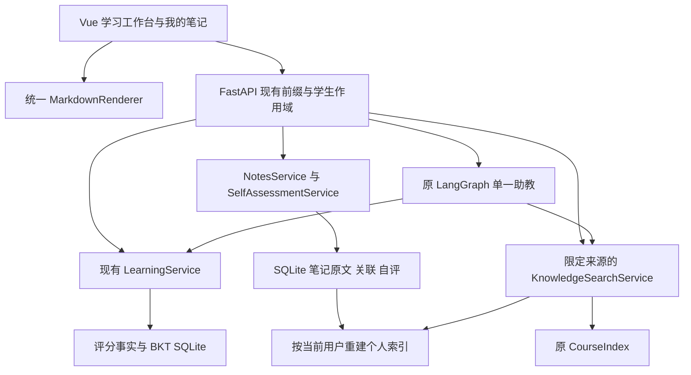

# v0.5.0 设计审查与实施计划

后续Phase4B范围以用户2026-10-21提出的[多源课程资料与结构化知识体系方案](PHASE4B_DESIGN.md)为准，取代教材目录导入设想；首轮仅设计，原件/解析、候选知识/映射确认及三源检索分步实施，不改变正式BKT/评分。本文件其余早期方案继续作为历史保留。

最新进度（2026-10-21）：用户已批准并完成Phase4A，当前schema6、355/101项及18组隔离HTTP通过；实际自评/建议/指南契约见[PHASE4A_GUIDE.md](PHASE4A_GUIDE.md)。下文最初版本提案与早期阶段编号为历史，不用来判断当前授权/实现。

日期：2026-10-20。状态：**Phase1～3B工程已完成；浏览器人工验收、3B真实模型冒烟与后续生成/自评仍待完成。** 本文保留最初完整版本提案及历次记录。用户随后已明确授权3B，实际使用两张工作台表及schema5，318/87项回归；当前契约以[WORKBENCH_GUIDE.md](WORKBENCH_GUIDE.md)为准。旧提案的表结构/版本号不代表当前实现，后续阶段不自动授权。

设计审查轮仅更新文档，随后经确认完成Phase1（225/47项测试）。本轮按用户明确授权完成Phase2，后端269项、前端75项与构建通过；现用schema2备份迁至3、真实HTTP验证与原学习回归通过。本轮模型请求0，版本清单仍为0.4.1，不宣称整个v0.5.0已发布。

后续经明确授权完成Phase3A，295/75项回归与13组隔离HTTP通过，schema4已部署。实际采用标准库Markdown块识别和稀疏TF-IDF，未引入原提议markdown-it-py、个人FAISS或跨请求缓存；原因是小型笔记无需额外依赖即可保留准确原文位置并执行来源校验。新增本地检索开关默认true；严格所选来源未就绪时整体报错，不使用初始提案的隐式partial返回。Agent/三栏/Studio仍未实施；后文这些部分为未来方案。

## 1. 建议方案及边界

在原单体应用内新增笔记与自评服务，保留单一 LangGraph Agent。前端采用统一安全 Markdown 渲染和 textarea 编辑器；原始笔记保存在 SQLite，个人索引作为可删除、可重建的派生数据。课程与个人检索使用独立语料、词表和索引，由一个检索服务按用户选择组合结果。

本版本仍只允许关联现有五个机器学习知识点，`course_id` 固定为 `machine_learning`；该字段用于数据隔离与来源标识，不提供课程管理。笔记和自评不写入 BKT，也不改变现用题库、参数、先修图或推进策略。PDF、图片识题、在线生成正式题目、自动推断先修边与复杂编辑器不在范围内。

图中的 `LS` 工具仍只为模型提供学情与合法练习元信息；模型没有评分、BKT、自评或笔记修改权限。

## 2. 现有实现审查与复用

下表保留初次设计审查时的基线（统一渲染前225/18项、11路径、schema2），不是当前功能清单。当前为四个导航、统一安全渲染、14个API路径及schema3；笔记服务与迁移已完成，未来个人检索/自评仍按后文计划执行。

| 实际位置 | 已有能力 | 复用与必要调整 |
| --- | --- | --- |
| [App.vue](../frontend/src/App.vue)、QuestionPanel、TutorPanel | 三个导航入口，题目、解析、课程检索、讲解与历史；目前使用 Vue 插值显示纯文本 | 保留蓝白布局；统一替换内容显示位置，新增我的笔记；本版不拆独立 AI 助手路由 |
| [package.json](../frontend/package.json) 与锁文件 | Vue 3.5.44、Vite 8.3.4、Vitest 5.0.5、jsdom 26.1.0；未发现 Markdown、KaTeX、DOMPurify 或高亮组件 | 在 Phase 1 新增所需依赖并固定版本，不假定现有包已支持公式 |
| [useWorkspace.js](../frontend/src/useWorkspace.js)、storage.js | 学习状态与答题幂等重试；localStorage 保存标识和未确认事件 | 原答题状态机保留；笔记草稿、保存和冲突处理单独组合，不复用答题 event_id |
| [api.js](../frontend/src/api.js) | `/api/v1` 前缀、学生子资源、JSON、超时与错误转换 | 保持前缀；扩展 PATCH/DELETE 的“不确定是否已提交”处理，目前仅 POST 作此判断 |
| [api/app.py](../backend/src/eduagent/api/app.py)、schemas.py | 11 个 OpenAPI 路径、严格字段、错误封装、每个同步请求独立连接 | 新功能分组到 notes/knowledge 路由；保留同线程创建和使用连接的约定 |
| [services/learning.py](../backend/src/eduagent/services/learning.py)、domain/bkt.py、agent/policy.py | 确定性评分、BKT、事务与 revision、先修规则 | 原样作为学习事实边界；新服务不复用其 learning revision，不持有写分工具 |
| [storage/sqlite.py](../backend/src/eduagent/storage/sqlite.py) | schema 2，metadata 配置绑定；构造函数每次执行建表和 user_version=2 | 提取明确迁移入口；构造连接不再反复执行 DDL 或将新版本写回 2；保留配置不匹配拒绝启动 |
| [retrieval/index.py](../backend/src/eduagent/retrieval/index.py) | 五份资料、15 段，独立 TF-IDF/FAISS、词组检查、可追溯章节 | 原 CourseIndex 暂不重构；个人检索复用分词、有效词组和向量计算方法，避免改变课程词表、排名或阈值 |
| [agent/tutor.py](../backend/src/eduagent/agent/tutor.py) | 三种受限工具、原问题预检、最多三次模型调用、来源检查和回退、历史保存 | 扩展受学生与来源选择约束的个人检索；原问题预检改为检查选定来源，保留零依据零调用 |
| backend/tests、frontend/src/__tests__ | 算法、HTTP、历史、工具与引用、jsdom 组件；既有测试数量 225/18 | 作为回归基础；原纯文本 XSS 测试按安全渲染契约扩充；路径总数断言随新 API 有意更新 |

两个需显式解决的现状：一是课程检索目前绑定 `agent.enabled`，关闭模型就无法检索；二是目前无账号认证，`student_id` 是可自行输入的演示标识，不能当作已认证身份。v0.5.0 的 SQL/索引作用域隔离不能解决冒用标识问题。

## 3. Markdown / LaTeX 设计

### 3.1 依赖和渲染链

Phase 1 实际使用 `markdown-it` + `@mdit/plugin-tex` + `katex` + `highlight.js` + `DOMPurify`。与最初候选 KaTeX 包装插件相比，使用其同一数学解析模块并直接捕获 KaTeX 异常，避免原文日志与未知命令无提示的问题，详见渲染说明。编辑器后续先用 textarea，不引入 CodeMirror、Shiki 或新的状态管理库。数学语法交给插件，不自行用正则替换全文美元符号。

渲染链为：原始字符串 → Markdown token 解析 → 公式与代码高亮生成 → DOMPurify 对最终 HTML 清理 → MarkdownRenderer 唯一的 `v-html` 出口。清理后不再由其他插件改写 HTML。`markdown-it` 支持独立行内渲染；组件提供 `block` 与 `inline` 模式，分别用于正文与选项等位置。[markdown-it 文档](https://markdown-it.github.io/markdown-it/)

具体约束：

- 关闭原始 HTML、自动 URL 转换及任意属性插件；Markdown 中的脚本、标签作为文本处理。代码内容只能经转义/高亮后显示。
- 仅允许 `http`、`https` 和当前文档锚点；禁用 javascript、data、file、blob、协议相对及应用内相对链接。外链使用 noopener/noreferrer。引用来源使用 Vue 按钮定位，不从来源文本生成任意 href。
- 不自动加载 Markdown 外链图片，显示替代文字；不执行代码块，不支持 iframe、HTML 表单或文件包含。
- KaTeX 设置 `trust=false`、`maxExpand=1000`、`maxSize=20`；每个公式初始限制 2000 字符。无效公式显示安全转义的原文与简明提示，不把异常字符串当 HTML。每次文档渲染使用独立宏环境，避免跨笔记宏污染。这些是本项目拟采用的资源限制；安全选项作用见 [KaTeX 安全说明](https://katex.org/docs/security) 和 [选项](https://katex.org/docs/options)。
- 保留 KaTeX 所需的可访问 MathML、有限 SVG 和布局样式；不能简单启用“仅 HTML”清理而破坏公式。原始 HTML 已禁用，布局属性只来自公式库；不放行用户提供的样式或任意 SVG。采用 DOMPurify 默认安全命名空间规则，再限制不需要的标签和链接，并用固定对抗样例验证组合。[DOMPurify 配置说明](https://github.com/cure53/DOMPurify)
- highlight.js 仅注册 Python、C++、JavaScript、JSON、Bash；未知语言或大于 8192 字符的单代码块按纯文本显示，避免自动检测大段内容。其核心加指定语言导入方式可减少加载量。[highlight.js 文档](https://highlightjs.readthedocs.io/en/latest/readme.html#importing-the-library)
- CSS、公式字体和高亮主题随本地构建发布，不依赖 CDN。保留现有浅色界面，代码块用局部深色主题；本版不增加全站主题切换。公式、代码、表格在容器内横向滚动。
- 预览约 300 ms 防抖；64 KiB 上限下测试长正文、多公式与复杂代码。超出公式/代码资源限制只降级对应片段，不静默截断保存原文。

### 3.2 接入位置

Agent 正文、课程资料与检索片段、引用原文、习题题干、选项、即时解析、历史解析、笔记预览全部使用同一组件。标题、按钮和学生标识仍为普通文本。

题干不能把任意块级 HTML 直接塞入现有 legend；改为合法的题干容器并通过 aria-labelledby 关联 fieldset，选项使用行内模式。保留键盘选项操作、读屏标签和答题事件顺序。

旧资料中的 `y_hat = w*x + b` 等普通文字不自动改写成公式，也不修改课程文件以制造展示效果。新测试使用独立样例；实际出现 `$...$` 时才数学渲染。现有 `[linear:1]` 引用继续作为来源标记保留，不解释成任意 Markdown 链接。

## 4. 数据模型与版本迁移

### 4.1 拟新增五张表

| 表及阶段 | 主要字段 | 约束及用途 |
| --- | --- | --- |
| `notes`，Phase 2 / schema 3，已实现 | id TEXT PK；student_id TEXT；course_id TEXT；title TEXT；content_md TEXT；revision INTEGER；content_hash TEXT；created_via；created_at/updated_at；deleted_at可空 | student_id外键；course仅machine_learning；revision≥1；Markdown为权威内容；软删除、同名允许；实际约束见笔记说明 |
| `note_knowledge_points`，Phase 2 / schema 3 | note_id TEXT；knowledge_point_id TEXT | 联合主键，note_id 外键；五个知识点来自现有 JSON，服务端验证，不假装能对 JSON 建外键；0～5 个关联 |
| `note_index_state`，Phase 2 / schema 3，已实现 | note_id PK/FK；status；target_revision；indexed_revision 可空；indexed_hash 可空；indexer_version 可空；chunk_count；error_code 可空；updated_at | schema3只允许disabled/0片段；未来pending/ready/empty/failed须Phase3迁移后引入，不能假装已索引 |
| `note_chunks`，Phase 3 / schema 4 | note_id FK；source_revision；ordinal；chunk_id；section；content_text；content_hash；start_line/end_line；indexer_version | 主键 (note_id,source_revision,ordinal)，chunk_id 唯一；只保留当前发布版本；用户、课程、标题和知识点通过笔记及关联表连接取得 |
| `knowledge_self_assessments`，Phase 4 / schema 5 | id TEXT PK；student_id FK；course_id；knowledge_point_id；level INTEGER；confidence INTEGER 可空；assessed_at TEXT | 仅追加，level 1～4，confidence 1～5 或 null；按 student/course/knowledge/time/id 查询最新与历史，不更新 mastery |

笔记 ID 使用 UUID；创建或导入前由客户端生成并保留一次。`content_hash` 是保存原文 UTF-8 字节的 SHA-256；标题或关联变化也使 revision 加一，因此索引是否当前必须同时比较 revision 和 hash。创建后原文不自动重排空格或改写公式；导入可明确转换 UTF-8 BOM 与换行，报告转换情况。

标题为 1～120 字符，允许空正文以保存草稿；关联不重复，最多五个。数据库通过 CHECK 约束版本、课程、自评级别和信心取值，通过外键与级联约束笔记派生数据；服务层另外验证知识点、正文体积和所有权。相同内容的无修改保存不额外增加 revision。

除表中明确可空的字段外均为 NOT NULL；时间采用服务器生成的 UTC ISO 8601 字符串。索引状态的 indexed_revision/indexed_hash 成对可空，未建立索引不能填造当前版本；正式建表脚本在相应阶段实现并测试。

拟建索引：notes(student_id,course_id,updated_at,id)、关联表(knowledge_point_id,note_id)、chunks(note_id,source_revision)、自评(student_id,course_id,knowledge_point_id,assessed_at,id)。索引派生字段不能以客户端提交值为准。

Phase2实际改为作用域/revision校验后的事务软删除，保留UUID以防延迟创建重放重新建出笔记。deleted_at非空后所有正常读取/更新均排除；原文、关联与删除记录保留在本机库/备份，没有永久清除功能。Phase3才实现删除后的片段失效、缓存清理和历史引用提示；当前没有个人片段或笔记外发模型。选择理由与保留范围见笔记说明。

### 4.2 迁移安排

Phase 1 不迁移数据库；Phase 2 增加 notes/关联/状态并迁移 2→3；Phase 3 增加 chunks，3→4；Phase 4 增加自评，4→5。数据库 schema 号与产品版本号分别管理，不把 v0.5.0 当作 PRAGMA 数字。

1. 提取 `storage/migrations.py`。0/1/2 版本经已知迁移顺序升级；空库仅在明确初始化时建表。常规连接只检查版本，不执行整套 DDL。异常的新版本或未知旧结构直接拒绝。
2. 部署时暂停旧服务写入，用 Python sqlite3 backup API 生成新的带旧版本和随机后缀备份，并核验完整性。避免在线只复制主文件；备份 API 支持数据库一致性快照。[SQLite 备份](https://www.sqlite.org/backup.html)、[Python sqlite3 backup](https://docs.python.org/3.12/library/sqlite3.html#sqlite3.Connection.backup)
3. 迁移使用显式事务、逐条 DDL，成功后才更新 user_version；避免假设 `executescript` 会自动遵守外层回滚边界。启动过程中不接收并发请求。[Python sqlite3 事务说明](https://docs.python.org/3.12/library/sqlite3.html#transaction-control)
4. 对照备份检查原六张表 metadata/students/mastery/decisions/attempts/tutor_runs 的行数与规范内容摘要，校验学习 revision、配置绑定、原评分及讲解恢复；不改历史 JSON 或旧配置指纹。
5. 失败回滚并停止启动。复核发现旧0.4.1构造连接会写回user_version=2，并不会安全拒绝schema3，原设计该项判断已纠正：严格禁止旧程序打开新库。回退使用升级前备份副本与旧代码的独立目录，先另行备份现库以保留新笔记/学习事实，不做破坏式降级迁移。

## 5. API 与笔记交互

继续使用 `/api/v1/students/{student_id}`，以下以 `S` 表示该完整前缀。全新资源必须先验证学生存在；note_id 之外的每个查询同时包含 student_id/course_id，错误作用域与不存在统一返回 404。

| 方法与路径 | 请求/查询要点 | 返回与语义 |
| --- | --- | --- |
| GET `S/notes` | course_id 固定；q≤100，标题字面搜索；knowledge_id 可选；limit 默认20、最大50，offset≥0 | 列表元信息、关联、revision、索引状态；不批量返回全文 |
| POST `S/notes` | id UUID、title、content_md、knowledge_point_ids；course_id | 首次 201；同 ID、仍为 revision=1 且内容相同可返回已有结果，不重复新增；其他冲突 409，客户端 GET 对账，不覆盖后续修改 |
| GET `S/notes/{note_id}` | owner/course 校验 | 原文、关联、revision、hash 与当前索引状态 |
| PATCH `S/notes/{note_id}` | expected_revision 必填；title/content_md/knowledge_point_ids 按需更新 | 200；条件更新成功才 revision+1，正文、关联与状态同事务；旧版本 409，不覆盖 |
| DELETE `S/notes/{note_id}` | expected_revision 查询参数必填 | 204；更新/删除竞态由 revision 保护；删除成功后不能再被当前检索返回 |
| POST `S/notes/import` | JSON：id、file_name、content_base64、可选标题及关联 | 201；原始文件在后端严格解码与验证；不在服务器按上传文件名落盘 |
| POST `S/notes/{note_id}/reindex` | expected_revision | Phase 3；返回 ready/empty/failed，失败保留原文，可显式重试 |
| POST `S/knowledge/search` | query≤1000；scope=course/notes/both；knowledge_id；top_k 1～5；course_id | 统一来源列表和各分支状态；作用域过滤在向量构建和搜索前完成 |
| POST `S/self-assessments` | id UUID、knowledge_point_id、level、confidence 可空、course_id | Phase 4；201，服务器时间，重复相同 ID 不重复追加 |
| GET `S/self-assessments` | knowledge_id 可选；limit/offset | 自评历史，按时间和 ID 稳定排序 |
| GET `S/self-assessments/latest` | course_id | 每个知识点最新自评；无数据为 null/缺省，不填成 0 级 |
| POST `S/tutor`，扩展现有 | question 保持；新增 retrieval_scope，缺省 course | 保留旧请求；notes/both 需用户显式选择，模型不能扩大选择范围 |

保留旧 `/api/v1/materials/search` 的课程检索行为与返回契约；新统一检索使用独立响应模型，不把个人来源塞进旧课程类型。沿用现有 `{error:{code,message}}` 结构：409 revision_conflict、404 note_not_found、413 content_too_large、422 invalid_import/validation_error、503 retrieval_unavailable。

笔记保存与索引失败分开反馈：原文已保存时返回保存成功及 `index_state=failed`，不返回让用户误以为原文丢失的整体失败。notes 模式索引不可用不回假空结果；both 模式可返回课程结果，但必须注明个人分支不可用，并提示重建。

Phase 3 拆开检索开关与模型开关：拟新增 `EDUAGENT_RETRIEVAL_ENABLED`，未设置时沿用旧 `agent.enabled` 的行为；显式启用后，即使没有 API 密钥也可使用已安装的本地检索依赖。Agent 仍需原密钥与开关。原文 CRUD 不依赖 FAISS/模型，未安装检索依赖时显示 disabled；显式要求检索但依赖缺失时给出可操作的配置错误。扩充 config.py 的允许字段，不能只写入 .env 而忽略现有严格校验。

### 5.1 导入与资源上限

单文件最多 64 KiB，编辑保存同样检查 UTF-8 字节数；JSON 请求体拟限 256 KiB。Markdown/TXT 只接受严格 UTF-8（可含 BOM），不猜测 GBK；拒绝 NUL、异常控制字符、无效 base64、明显 PDF/ZIP/图片/可执行文件内容及不支持格式。扩展名、MIME 和文件名都不能替代内容检查；含 HTML 的文本可以原样保存，显示时仍禁用 HTML。

选择 base64 JSON 而非 multipart，是因为文件很小且现有适配器只支持 JSON；代价为约三分之一传输膨胀，优点是不额外引入 multipart 上传依赖。客户端只用于提前反馈，服务端重复所有检查。文件名只取显示用基础名，拒绝路径成分，不据此读取文件系统。

初始拟限每学生本课程 50 篇、有效原文合计 1 MiB；个人索引最多 256 段、词表上限 8192 维、每段约 800 字符。具体作为配置和性能测试起点；超过索引预算明确失败并保留原文，不静默截断或漏掉部分笔记。稠密 TF-IDF 的内存成本与“段数×词表维数”有关，不能只限制上传文件数。

### 5.2 编辑器与保存可靠性

新增“我的笔记”，列表、编辑、预览和关联选择在一个面板完成；宽屏左右分栏，窄屏编辑/预览切换，沿用现有断点与按钮风格。Phase 2 即支持手动选择五个知识点，不先做模型关联建议。

保存状态区分未修改/未保存/正在保存/已保存/保存失败/版本冲突，索引状态单独展示。按 student_id/course_id/note_id 分别保留本地草稿；切换笔记、页面或学习标识时提供保存/保留草稿/取消，关闭页面有未保存内容提示。草稿存储失败必须告知，不能显示“已保存”。

保存请求开始时捕获正文和 revision，写入期间继续输入也不能被旧响应覆盖；确认响应后只把对应快照标为保存，后续编辑仍为脏状态。PATCH/DELETE 超时后先 GET 对账，不自动重放写操作。创建/导入请求复用原 UUID；重试不得产生第二篇笔记。409 保留本地内容，提供读取服务器版本或另存新笔记，不自动合并覆盖。

切换用户时取消个人搜索/笔记请求，或校验请求捕获的学生与页面代次，防止旧响应进入新用户视图。localStorage 草稿分键仅用于本机恢复，不是身份认证或加密存储。

## 6. 个人 RAG 与一致性

### 6.1 分块和发布

后端拟新增 `markdown-it-py` 到 API 可选依赖，用 token 提取标题、正文、表格文字及代码；不执行 HTML、不请求链接，不以浏览器渲染 HTML 建索引。保留公式源码；数字/公式相近度仍受现有词项算法限制。该库提供解析 token，适合实现文本提取与原文行区间映射。[markdown-it-py 文档](https://markdown-it-py.readthedocs.io/en/latest/using.html)

优先按标题和段落分块，再按约 800 字符窗口、约 100 字符重叠切分长块；分块行为写入 `indexer_version` 并测试。chunk 同时含 note_id、用户、课程、关联知识点、标题、section、chunk_id、内容、hash、source_revision 和行区间；冗余信息可由查询连接取得。空笔记标为 empty；纯符号且无可索引词项时明确说明词项检索限制。

一次保存的执行顺序：

1. 事务内校验 owner、revision、上限，保存原文/关联，revision+1，状态改 pending，删除旧派生片段；立即使旧版本失效。
2. 提交原文事务后进行有界解析和分块，避免计算期间占用 SQLite 写锁；初版同步完成，不引入任务队列或后台调度系统。
3. 新事务再次比较当前 note revision/hash；只有仍对应原快照才替换片段并发布 ready/empty。旧重建任务不得覆盖较新的保存或复活已删除笔记。
4. 解析/索引失败只标记对应 revision 的 failed；不能把新 revision 的状态改回旧错误。进程中断留下 pending，刷新展示并允许重试。

### 6.2 用户隔离与索引缓存

先在同一只读数据库快照中 SQL 查询当前 student/course 的笔记清单、关联及当前 revision 片段，再创建该用户专属的 TF-IDF/FAISS 索引；不先搜索全体用户向量再隐藏其他人的结果。笔记标题、关联和片段必须都经作用域过滤，模型工具不接受可任意改写的 student_id 参数。

FAISS 不持久化为权威文件；SQLite 原文与当前片段可恢复并重建内存索引。缓存键包含 student_id、course_id、当前有效笔记的 `(id,revision,hash,indexer_version)` 清单摘要；小型有界缓存拟最多四个作用域。每次查询先从数据库核对清单；多进程也不能只依赖某进程的“已失效”标记。构建后原子替换缓存，不跨用户复用词表。

当前笔记存在 pending/failed 时，查询同时返回个人分支 partial 状态与未索引数量；只有 ready 且 revision 对应的片段进入向量索引，不能把可用的部分结果宣称为全部笔记检索。预算失败保留原文并明确失败原因。

返回结果前再次核验所用版本；查询期间发生更新或删除则重试一次，持续变化时明确失败，不返回旧片段。这里的最后核验是竞态保护，不能代替检索前 SQL 权限过滤。

课程与个人索引分开计算，不把个人词条加入原 CourseIndex。both 模式分别取最多五条合格结果，再用固定等权 RRF（k=60）组合、去重并截取 top_k，保留各分支原分数与融合排名。独立 TF-IDF 分数不当作可直接比较的统一概率；融合策略是待验证的工程规则，不宣称已优化。

### 6.3 来源与引用契约

统一来源响应拟包含 citation_id、source_type、source_id、course_id、knowledge_point_ids、title、section、content、content_hash、source_revision、chunk_id、review_status、retrieval_score、fusion_score。Tutor 的课程引用同时保留原有 knowledge_id/source/score 字段，新增字段提供兼容默认值；个人引用的 knowledge_id 可空，实际关联以列表为准，review_status 明确为 personal_unverified。旧材料检索模型不变。

- 课程：保留 `linear:1` 等现有 ID、原文和 review_status；多知识点字段映射为单元素列表。
- 个人：如 `note_<uuidhex>_r3:2`，明确 personal_note、个人未核验、原文 revision/hash。这个形式兼容原引用词法，但必须另外检查实际检索、归属及版本，不能因正则匹配就信任。
- 当前检索只引用当前发布片段。已保存的讲解可显示当时片段快照和版本；更新/删除标志由当前查询补充，不改写历史评分事实。

## 7. Agent 与自评接入

### 7.1 检索和外发边界

Tutor 默认 `retrieval_scope=course`，保持旧客户端行为。用户可显式选择“仅笔记”或“课程＋笔记”；界面说明选择后会把检索到的笔记片段发送至已配置 DeepSeek。仅在本地预览、保存、索引和检索时不调用模型；不因为笔记中含指令或模型请求而扩大来源范围。

保留原 `retrieve_course_material`，增加绑定当前学生的 `retrieve_personal_notes`；可用工具按用户选择限制。统一 SearchService 供 API 与工具复用；模型不获原始全库、不获得其他学生标识、不获任意 SQL/文件工具。get_learning_state 可增加自评只读字段，get_next_exercise 仍调用原策略；最多三次模型调用与八次工具执行的限制保持。

索引内部的 student_id 只用于服务器隔离，外发工具片段移除学生标识、完整本机路径及无关字段，仅保留回答需要的片段、标题、类型、引用 ID 和版本等来源信息。

原问题预检使用选定来源的并集，个人检索结果不再被旧“课程候选为空”分支错误拦截。改写检索仍限制在原问题各来源候选集合内；仅笔记无依据时不偷偷切回课程。全部选定来源均无依据则 model_calls=0；某分支失败时显示实际来源范围，不冒充已结合两类依据。

最终回答区分课程资料、个人笔记、进一步解释；引用必须属于本次实际检索且内联与列表一致。若用户要求结合两类资料，但只有一类可用，明确说明欠缺，不能声称已比较。疑似矛盾提示“存在不一致，需核对”，提供两类出处；课程资料本身也仍为待审草稿，不能把来源类别当事实正确性的自动证明。

将笔记和资料放在带类型与引用元信息的工具数据中，提示模型忽略其中的指令；程序仅执行固定白名单工具。该设计加恶意笔记测试只能验证工具权限和流程，不证明提示注入已被彻底解决，也不能自动保证模型发现所有知识冲突。

模型生成前保存个人来源清单，结束前复查所用笔记是否更新/删除；变化时返回 `personal_sources_changed` 并使用当前本地依据回退，不保存为有效的旧版本讲解。保留原 learning revision 变化检查。旧 tutor_runs 缺少新增字段时按课程来源兼容读取，不回填虚构个人引用。

### 7.2 自我评价

四级含义采用任务书定义：完全不了解、理解基本概念、能完成基础习题、能独立应用和解释；学习信心可选 1～5。保存采用独立追加事件，时间由服务器生成，历史不可通过“修改最新值”覆盖。

MasteryPanel 显示两列/两组：客观答题形成的“BKT 模型估计”和“我的自评及时间”。不把四个等级换算成 BKT 概率，也不把信心当正确率。Agent 可以据差异建议额外诊断或复习，但当前 RulePolicy 和正式分配保持不变；本版不自动执行额外教学推进策略。

对创建/导入/修改/删除笔记、重建索引、提交自评、生成讲解分别断言 mastery、attempts、学习 revision、评分历史完全不变；只有原 answers 入口产生正式 BKT 更新。

## 8. 拟涉及文件

Phase 1 所列代码已落实，其余“新增”仍是计划；正式实施时可按最小职责调整命名，不据此增加管理后台或新服务。

| Phase | 拟新增 | 拟修改 |
| --- | --- | --- |
| 1 渲染 | frontend/src/components/MarkdownRenderer.vue；frontend/src/rendering/markdown.js；frontend/src/rendering/markdown.css；frontend/src/__tests__/markdown.test.js；data/evaluation/markdown-fixtures.json | frontend/package.json、package-lock.json；App.vue、QuestionPanel.vue、TutorPanel.vue；必要样式；现有 app 测试 |
| 2 笔记 | backend/src/eduagent/domain/notes.py；storage/migrations.py、storage/notes.py；services/notes.py；api/notes.py、api/note_schemas.py；frontend/src/components/NotesPanel.vue；useNotesWorkspace.js、noteStorage.js；backend/tests/test_notes.py、test_notes_api.py、test_migrations.py；frontend/src/__tests__/notes.test.js | storage/sqlite.py 的初始化路径；api/app.py；backend/pyproject.toml；App.vue、api.js、styles.css、Icon.vue |
| 3 个人 RAG | retrieval/note_chunks.py、personal.py；services/knowledge.py；api/knowledge.py、knowledge_schemas.py；backend/tests/test_personal_retrieval.py、test_knowledge_api.py、test_tutor_notes.py | notes 服务/仓储/迁移；backend/pyproject.toml；api/settings.py、config.py、app.py；agent/tutor.py；TutorPanel.vue、NotesPanel.vue、api.js、useWorkspace.js、toolLabels；.env.example 只加非密钥配置 |
| 4 关联与自评 | domain/self_assessment.py；storage/self_assessments.py；services/self_assessments.py；api/self_assessments.py；frontend/src/components/SelfAssessmentPanel.vue；backend/tests/test_self_assessments.py；frontend/src/__tests__/selfAssessment.test.js | migrations.py；MasteryPanel.vue；Agent 学情只读工具；关联 UI 与查询；api.js |
| 5 验收 | scripts/verify_v050_workflows.mjs；docs/V0_5_0_ACCEPTANCE.md；docs/evaluation/ 下另存新证据 | 现有回归脚本按版本更新但保留旧报告；版本清单；README 与各指南 |

每阶段同步 DEVELOPMENT_PLAN；目标与限制变化同步 PROJECT_CONTEXT。原题库、候选题及课程材料不在本次拟修改清单，现有内容审阅状态不因开发自动改变。

## 9. 分阶段顺序与验收

每阶段形成可运行增量再继续，不一次提交全部模块。Phase 1 新前端依赖已核对 npm/Node 22.14.0 兼容、安全公告与许可，并锁定安装；实际版本见渲染说明。Phase 3 后端 Markdown 解析依赖仍未安装，实施时另行核验固定，不能将 Phase 1 结果当作其兼容测试。

| 阶段 | 最小交付 | 必须通过的验收 | 不属于该阶段完成的内容 |
| --- | --- | --- | --- |
| Phase 1 | 统一渲染组件及六类内容接入；不改题库/资料文本 | 固定样例包含标题、列表、表格、引用、代码、特殊字符、分数/矩阵/上下标、行块公式、转义美元、代码内美元；恶意 HTML/链接/公式宏/畸形输入不能执行；组件测试及生产构建通过，长内容不撑破布局 | 没有笔记 API/索引，不迁移数据库 |
| Phase 2 | 迁移与备份机制、笔记 CRUD/导入、手动知识点关联、textarea/预览、草稿与保存冲突 | 文件库关闭重开恢复；同名跨学生隔离；非法导入/过大请求/旧 revision/并发修改/丢响应重试；保存不改 BKT；索引显示尚未启用 | 不能宣称笔记已经可 RAG 检索 |
| Phase 3 | 当前版本分块、个人索引、三种来源检索与 Agent 接入 | 更新/删除后旧片段不可当前检索；检索前作用域；索引失败保原文且可重试；重建竞态/缓存/新进程恢复；原课程 55 条结果不因个人笔记变化；预检、引用与工具权限测试 | 模拟 Agent 测试不等于真实模型质量；真实请求另记结果与费用 |
| Phase 4 | 自评追加历史、最新状态与 BKT 分开展示、Agent 只读参考 | level/confidence 边界、学生隔离、重复事件、排序、刷新；自评/笔记/讲解都不改变评分事实、BKT 与原推进策略 | 自评不转换成客观掌握度，不修改先修图 |
| Phase 5 | A～I 的真实 HTTP 复验、界面人工验收、迁移/恢复说明及结果记录 | 下表全部有实际结果或明确未通过/未运行；原核心回归、前端测试/构建、版本一致性、秘密信息检查通过 | 不将局部成功标成全部验收，不虚构真人效果 |

建议工作量约 25～40 个有效开发小时，包含实现、回归与文档，不含负责人内容审阅和真人试用；这是范围估算，不是交付承诺。Phase 1 完成后按实际耗时调整。优先减少编辑器修饰、自动关联建议和额外导航，不压缩作用域隔离、并发版本控制或迁移验证。

| 任务书场景 | 拟验收方式 |
| --- | --- |
| A 公式笔记保存与刷新 | 真实 notes API 保存/重新读取原文、hash/revision；Vue 重新挂载恢复与公式 DOM；人工浏览器确认视觉 |
| B 导入与检索来源 | UTF-8 Markdown 文件经实际导入接口，查询返回 note_id/revision/hash 和真实片段 |
| C 修改更新 | 控制旧/新版本独有关键词，修改后只允许新版本命中；测试重建期间再次保存 |
| D 删除移除 | 删除与查询/重建竞态，不可当前返回已删除片段；历史引用如实标注 |
| E 同名用户隔离 | A/B 同名不同唯一内容；检索前索引语料只含当前作用域；缓存、直接 GET/PATCH/DELETE/reindex 与模型工具均测试 |
| F 自评不改 BKT | 保存前后对照完整学习快照、答题与原决策，不只比较页面四舍五入值 |
| G Agent 联合讲解 | 模拟客户端检查来源分类、实际引用、冲突提示与权限；再单独做少量真实 DeepSeek 验证，不把模拟冒充实调 |
| H 原流程回归 | 已有算法/评分/存储/题目分配/历史测试全通过，旧库迁移后完整重放与恢复 |
| I 异常与安全 | XSS/不安全协议/公式资源限制、异常文件/体积、索引失败/重试、未保存内容和网络丢响应 |

浏览器自动化此前被 URL 安全策略拒绝。本轮不操作浏览器或规避限制；若后续仍受限，组件与 HTTP 验证单独交付，视觉、键盘、窄屏验收保留为负责人手动项目，不能宣称已自动完成。

## 10. 风险、兼容性与待确认取舍

| 风险 | 拟处理 | 剩余限制 |
| --- | --- | --- |
| 可输入的演示标识不是认证 | 所有读写/检索绑定请求作用域，不接收模型传入学生 ID；保持 localhost 演示范围 | 猜到他人 student_id 仍可能冒用；如需多人联网使用，必须另行设计认证，不能据当前方案宣称私有账号安全 |
| 安全清理与数学布局互相影响 | 最终统一清理；完整公式/MathML/SVG 对抗样例；只允许库生成布局属性 | 依赖必须持续修复；结构测试不能代替全部浏览器安全验证 |
| 旧客户端和历史引用不兼容 | scope 默认 course；旧课程检索契约不变；历史新增字段默认课程；新统一响应独立定义 | 原引用检查只能验证结构，不能证明陈述被来源语义支持 |
| 迁移破坏原学习事实 | 备份、事务、原表摘要、失败回滚；新旧进程不共用新 schema | 不能直接让旧二进制打开新库；回退需保留新产生笔记 |
| 原文已更新但索引落后 | 保存即失效旧片段；revision/hash 条件发布；每次查询查数据库版本 | 初版同步重建可能短暂 pending，需显示而非伪造成功 |
| 稠密词项向量资源增长 | 独立个人索引、段数/词表/总量预算、有界缓存 | 仍是词项匹配，公式语义和同义表达能力有限 |
| 联合检索污染课程评估 | CourseIndex 不混入个人词表；课程分支与 55 条报告回归 | 原先 5/15 课程外误检仍存在，不借新功能宣称已修复 |
| 笔记含错误或恶意指令 | 来源标记、用户选择外发范围、工具白名单、冲突提示与对抗测试 | 不能保证模型识别所有冲突或彻底免疫提示注入 |
| 单人工作量与比赛节点 | textarea、手工关联、无新索引服务、逐阶段验收 | 日投入时间/学院截止仍未知，按实际进度调整 |

确认本方案即选择：textarea、五个固定知识点/单课程、64 KiB 文件、JSON 导入、独立个人索引、仅本机匿名演示、显式选笔记后才外发检索片段、独立自评且不改 BKT。若希望改成多人账号、CodeMirror 或语义嵌入，应在相应阶段前单独评估范围。

Phase1～2及经单独批准的Phase3A工程结果已交付，人工浏览器清单保留。下一步Phase3B工作台/个人Agent问答及Studio等待用户另行确认；不能从3A授权推断已授权未来功能。未来自评的schema编号按实际迁移顺序调整，旧提案数字不预占数据库版本。
